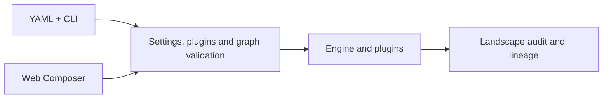

# ELSPETH

**E**xtensible **L**ayered **S**ecure **P**ipeline **E**ngine for **T**ransformation and **H**andling

[](LICENSE)
[](https://www.python.org/downloads/)


ELSPETH builds, validates, runs, and audits data and LLM workflows whose
outputs need to be reviewed and explained. You can author a pipeline in
version-controlled YAML or through the authenticated Web Composer. Both paths
use the same plugin contracts, graph validation, execution engine, and
Landscape audit trail.

> **Pre-release status:** ELSPETH may be suitable for carefully evaluated,
> use-case-specific applications, but it is not yet ready for general production use.
> Before relying on it, validate ELSPETH against your requirements and risk controls.
>
> **AI-generated code:** ELSPETH is a rapid prototype, generated and reviewed by AI,
> that is in active development with major systems subject to change. Limited user
> testing has been conducted on a small set of use cases.
>
> **Chroma security advisory:** Do not use Chroma with ELSPETH until upstream
> publishes a fixed release and ELSPETH adopts and verifies it. This includes
> the `rag_retrieval` transform with `provider: chroma`, the `chroma_sink` sink,
> and Chroma examples in all connection modes. ChromaDB has unresolved code-execution vulnerabilities;
> version 1.5.9 is still affected. See the
> [pre-authentication advisory](https://github.com/advisories/GHSA-f4j7-r4q5-qw2c),
> [collection-update advisory](https://github.com/advisories/GHSA-36p7-vc44-83pf),
> and [upstream server and client issue](https://github.com/chroma-core/chroma/issues/6717).

## What it does

- **Builds explicit pipelines.** Sources, transforms, gates, barriers, and sinks
  form a directed graph with named edges and declared data contracts.
- **Validates before execution.** ELSPETH checks settings, plugin declarations,
  graph structure, routes, and compatible schemas. Runtime checks also hold
  plugins to declarations that validation relied on.
- **Records what happened.** Landscape stores source and token lineage,
  external calls, routing, terminal outcomes, and output evidence. Logs and
  telemetry support operations; they do not replace the audit record.
- **Supports recovery.** Durable work records, checkpoints, and sink effect
  protocols support interrupted runs within their documented limits.
- **Offers two authoring paths.** YAML supports direct review and version
  control. The Web Composer uses a provider-driven tool loop to propose changes
  to versioned session state, with validation and review before execution.



The web and CLI paths converge at runtime assembly and execution. They do not
yet run a shared, persisted compiled-pipeline artifact. The
[architecture guide](ARCHITECTURE.md) describes the current boundaries.

## Try a YAML pipeline

You need Python 3.14 or newer and [uv](https://docs.astral.sh/uv/). From a
source checkout:

```bash
git clone https://github.com/dta-au/elspeth.git
cd elspeth
uv sync --frozen
uv run elspeth validate --settings examples/threshold_gate/settings.yaml
uv run elspeth run --settings examples/threshold_gate/settings.yaml --execute
```

The example writes its output under `examples/threshold_gate/output/` and its
Landscape database at the path configured in its settings file. The
[first-pipeline guide](docs/guides/your-first-pipeline.md) walks through the
configuration, results, and lineage. Use `uv run elspeth plugins list` to see
the registered plugins in your checkout.

## Try the Web Composer

The Web Composer adds a FastAPI service and React frontend for authenticated
authoring, validation, review, execution, and run inspection. Its LLM planner
needs a configured model provider; a local login alone does not configure one.
Follow the [local web setup guide](docs/guides/web-local-development.md) for
dependencies, development credentials, model settings, and startup. For a
user walkthrough, see the [Composer guide](docs/release/composer-guide.md).

## Audit and trust

Landscape is the runtime evidence store. ELSPETH distinguishes engine-owned
audit and control records, validated pipeline rows, and untrusted external
input. Source data and provider responses are validated at their entry
boundaries; corruption of audit records fails closed. See
[data trust and error handling](docs/guides/data-trust-and-error-handling.md)
and the [current audit and lineage guarantees](docs/release/guarantees.md).

ELSPETH supports audit export and optional signing. The
[export settings and limits](docs/reference/configuration.md#export-settings)
describe what is exported and how to configure it.

## What changed in 0.8.13

0.8.13 adds the Composer context budget. See the [release notes](CHANGELOG.md),
which also record earlier releases.

Long Composer sessions used to grow until the server or the model gateway
rejected a request for size. Before each compose-loop and planner model call,
the server now removes older context in a fixed order until the request fits an
operator-set prompt-token cap and a request-byte ceiling: earlier tool results
in the turn, then earlier assistant prose, then escape-hatch transcript events,
then the oldest earlier user requests. The system skill, catalog, tool
definitions, current request, pipeline state and latest tool round trip are
never removed. What was removed is recorded on each call's audit record, and
the user is told when earlier conversation is no longer visible to the
Composer. A request that cannot fit is refused before any model call, with a
named cause and the recourse (start a new session, or shorten the request).

Two configuration changes are breaking. `ELSPETH_WEB__COMPOSER_CONTEXT_MAX_PROMPT_TOKENS`
is required and has no default: the web server does not start without it. Set
it to the prompt-token limit of the model gateway in front of the Composer. The
default of `ELSPETH_WEB__COMPOSER_PLANNER_MAX_REQUEST_BYTES` drops from 2 MiB
to 960 KiB and now also bounds the compose loop.

The budget does not bound every Composer request. Advisor and review calls are
not yet covered ([#364](https://github.com/dta-au/elspeth/issues/364)), token
counts are estimated from request bytes rather than a tokenizer, and a request
the provider still rejects for context length is not retried.

Session epoch 78 and Landscape epoch 50 are unchanged from the previous
release; this release adds no schema-epoch cutover, so existing session and
Landscape stores need no action. The 0.8.10 cutover guidance below continues to
apply to older stores. Backwards compatibility is permitted and considered from 0.8.5 within
explicitly supported boundaries. This release authorizes no in-place migration,
reset or downgrade. Package metadata is 0.8.13; the package version alone does
not establish qualification or image publication. Automatic image publication
from main is held; verify the release tag and image digest before installing a
published image.

## Previously in 0.8.12

0.8.12 is the Composer tool remediation. See the [release notes](CHANGELOG.md).

Under explicit approval, one composition proposal is pending at a time: a
response carrying more than one mutation is refused whole, and a mutation is
refused while a proposal is pending, with guidance to the model. This contains
the defect rather than redesigning it; auto-commit sessions and blob-only
proposals are not covered. Refusals and no-ops go back to the model as tool
feedback instead of an approval card. `diff_pipeline` answers in freeform
sessions, transforms can be spliced into planner-built pipelines, an oversized
blob read is reported as a size refusal, and contradictory Composer skill text
was corrected in place without restructuring it.

MCP file paths are confined to the configured data directory, and the
standalone MCP server runs under a supervisor that settles its child process on
shutdown, failed start and parent death. Creating Landscape tables on PostgreSQL
no longer breaks a later SQLite initialization in the same process.

The web interface takes the ARGOnite look in light and dark themes. A new
`file_inject` transform attaches the content of a file to each row; in the
Composer it accepts only a file the user uploaded. Langfuse moves to 5.2.0 and
the OpenTelemetry packages to 1.45.1, which clears the remaining Python
dependency advisories; Langfuse tracing now needs Langfuse Cloud or a
self-hosted server at 4.59.0 or later.

Session epoch 78 and Landscape epoch 50 are unchanged from the previous
release; this release adds no schema-epoch cutover, so existing session and
Landscape stores need no action. The 0.8.10 cutover guidance below continues to
apply to older stores. Backwards compatibility is permitted and considered from 0.8.5 within
explicitly supported boundaries. This release authorizes no in-place migration,
reset or downgrade.

## Previously in 0.8.10

0.8.10 carries the Composer performance remediation. Proposals, the
`set_pipeline` schema and fixed tool definitions are verified once; restored
states keep their identity through review projection, reconciliation and commit
binding; plugin summaries, proposal lists and review cards read once per
request; advisory validation shares a brief memo that durable review records
never read; and operation streams authorize on one connection. Every LLM call
row records the byte size of each request component. Approval binding shares
the cached runtime manifest with run start, and the transform executor reads
the recorded input hash. Outputs, hashes and decisions are byte-identical to
0.8.9. See the [release notes](CHANGELOG.md).

Composer and advisor models must be reasoning models: a reasoning hint is sent
on every composer-plane call, `ELSPETH_WEB__COMPOSER_*_REASONING_EFFORT=none`
is refused at startup, and gateway adapters must declare the `reasoning`
capability to serve the Composer. The frontend holds Run while a session
operation is still in flight, and `.env` discovery starts from the working
directory.

Session epoch 78 replaces session epoch 77 and retains its committed graph-review
authority while strengthening quota custody and shared rate-limit policy binding.
Landscape epoch 50 replaces epoch 49 and records durable provider-attempt identity
on run calls. Both epochs are unchanged from 0.8.9, so an existing epoch 78 session
store and epoch 50 Landscape store need no action. Preserve epoch 75, both epoch 76
session-store contracts, epoch 77 session stores and epoch 49 Landscape stores; use
a separately provisioned epoch 78 session store and epoch 50 Landscape store. Keep
old workers isolated from the new stores. Compatible stores still require exact
schema admission; unsupported stores are preserved and refused before incompatible
writes. Backwards compatibility is permitted and considered from 0.8.5 within
explicitly supported boundaries. This release authorizes no in-place migration,
reset or downgrade.

Quota API quantities now use decimal strings for exact signed-64-bit values;
older numeric clients must adapt their response parsing. Proxy deployments must
explicitly configure `ELSPETH_WEB__TRUSTED_PROXY_HOSTS` with their actual numeric
forwarding peers; the default trusts no forwarding headers.

See the [release notes](CHANGELOG.md) and [deployment runbooks](docs/runbooks/index.md)
before upgrading.

## Recovery and deployment

To resume an interrupted run, replace the ID in
`elspeth resume <run_id> --execute` with the run you intend to resume, for
example `elspeth resume abc123 --execute`. Without `--execute`,
`elspeth resume <run_id>` checks whether the run can be resumed without
changing it. See the [recovery runbook](docs/runbooks/resume-failed-run.md)
for the eligibility checks and operator procedure.

Set `IMAGE_TAG` only after confirming that the intended container tag was
published; the [Docker guide](docs/guides/docker.md) shows how to inspect it.
The [AWS ECS cold-install runbook](docs/runbooks/aws-ecs-cold-install.md)
describes the tracked Terraform package. Azure Container Apps has
Single/sticky desktop acceptance; live cloud acceptance is a separate gate.
See the [deployment platform reference](docs/reference/deployment-platforms.md)
for the precise support limits.

## Documentation

| Start here | For |
| --- | --- |
| [First pipeline](docs/guides/your-first-pipeline.md) | YAML walkthrough and result inspection |
| [Local web setup](docs/guides/web-local-development.md) | Web Composer development setup |
| [User manual](docs/guides/user-manual.md) | Product workflows and commands |
| [Architecture](ARCHITECTURE.md) | Components, boundaries, stores, and execution paths |
| [Plugin guide](PLUGIN.md) | Writing and testing plugins |
| [Configuration](docs/reference/configuration.md) and [environment variables](docs/reference/environment-variables.md) | Settings and deployment options |
| [Deployment platforms](docs/reference/deployment-platforms.md) | Supported profiles and acceptance limits |
| [Release notes](CHANGELOG.md) and [roadmap](ROADMAP.md) | Changes and planned work |

ELSPETH includes a separate [LLM compatibility gateway](gateway/README.md)
for certain provider integrations. It deploys independently from the engine.

## Contributing and support

See [CONTRIBUTING.md](CONTRIBUTING.md) for development checks and pull request
guidance, [GOVERNANCE.md](GOVERNANCE.md) and
[CODE_OF_CONDUCT.md](CODE_OF_CONDUCT.md) for project participation,
[SECURITY.md](SECURITY.md) for private vulnerability reporting, and
[SUPPORT.md](SUPPORT.md) for help channels and current support limits.

ELSPETH is available under the [MIT License](LICENSE).
