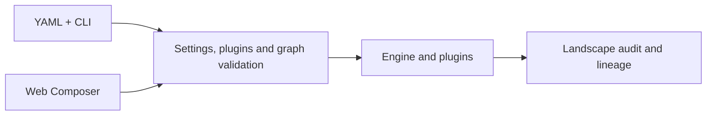

# ELSPETH

**E**xtensible **L**ayered **S**ystem for **P**rocessing, **E**valuation, **T**ransformation and **H**andling

[](LICENSE)
[](https://www.python.org/downloads/)


ELSPETH builds, validates, runs, and audits data and LLM workflows whose
outputs need to be reviewed and explained. You can author a pipeline in
version-controlled YAML or through the authenticated Web Composer. Both paths
use the same plugin contracts, graph validation, execution engine, and
Landscape audit trail.

> **Pre-release status:** ELSPETH may be suitable for carefully evaluated,
> use-case-specific applications, but it is not yet ready for general production use.
> Before relying on it, validate ELSPETH against your requirements and risk controls.
>
> **AI-generated code:** ELSPETH is a rapid prototype, generated and reviewed by AI,
> that is in active development with major systems subject to change. Limited user
> testing has been conducted on a small set of use cases.

## What it does

- **Builds explicit pipelines.** Sources, transforms, gates, barriers, and sinks
  form a directed graph with named edges and declared data contracts.
- **Validates before execution.** ELSPETH checks settings, plugin declarations,
  graph structure, routes, and compatible schemas. Runtime checks also hold
  plugins to declarations that validation relied on.
- **Records what happened.** Landscape stores source and token lineage,
  external calls, routing, terminal outcomes, and output evidence. Logs and
  telemetry support operations; they do not replace the audit record.
- **Supports recovery.** Durable work records, checkpoints, and sink effect
  protocols support interrupted runs within their documented limits.
- **Offers two authoring paths.** YAML supports direct review and version
  control. The Web Composer uses a provider-driven tool loop to propose changes
  to versioned session state, with validation and review before execution.



The web and CLI paths converge at runtime assembly and execution. They do not
yet run a shared, persisted compiled-pipeline artifact. The
[architecture guide](ARCHITECTURE.md) describes the current boundaries.

## Try a YAML pipeline

You need Python 3.14 or newer and [uv](https://docs.astral.sh/uv/). From a
source checkout:

```bash
git clone https://github.com/dta-au/elspeth.git
cd elspeth
uv sync --frozen
uv run elspeth validate --settings examples/threshold_gate/settings.yaml
uv run elspeth run --settings examples/threshold_gate/settings.yaml --execute
```

The example writes its output under `examples/threshold_gate/output/` and its
Landscape database at the path configured in its settings file. The
[first-pipeline guide](docs/guides/your-first-pipeline.md) walks through the
configuration, results, and lineage. Use `uv run elspeth plugins list` to see
the registered plugins in your checkout.

## Try the Web Composer

The Web Composer adds a FastAPI service and React frontend for authenticated
authoring, validation, review, execution, and run inspection. Its LLM planner
needs a configured model provider; a local login alone does not configure one.
Follow the [local web setup guide](docs/guides/web-local-development.md) for
dependencies, development credentials, model settings, and startup. For a
user walkthrough, see the [Composer guide](docs/release/composer-guide.md).

## Audit and trust

Landscape is the runtime evidence store. ELSPETH distinguishes engine-owned
audit and control records, validated pipeline rows, and untrusted external
input. Source data and provider responses are validated at their entry
boundaries; corruption of audit records fails closed. See
[data trust and error handling](docs/guides/data-trust-and-error-handling.md)
and the [current audit and lineage guarantees](docs/release/guarantees.md).

ELSPETH supports audit export and optional signing. The
[export settings and limits](docs/reference/configuration.md#export-settings)
describe what is exported and how to configure it.

## What changed in 0.8.18

0.8.18 changes canonical hashing for new runs, improves worker coordination
and recovery, and fixes several Web Composer validation, request-size and
credential-check paths. See the [release notes](CHANGELOG.md) for the specific
behaviour and upgrade actions.

0.8.18 removes Chroma support: the `chroma_sink` sink, the `rag_retrieval`
transform and Chroma collection probes. Settings and saved pipelines that use
them are refused after upgrading; `azure_ai_search` is the retrieval transform.

Session epoch 79 and Landscape epoch 51 are unchanged from 0.8.17; this release
adds no schema-epoch cutover, and existing 0.8.17 session and Landscape stores
open unchanged. Finish CLI runs and interrupted web runs before upgrading;
runs admitted under earlier canonical or implementation versions cannot be
continued. Upgrading from 0.8.16 or earlier means applying the 0.8.17 and
0.8.16 upgrade notes first; the upgrading section below lists what each earlier
release requires. Backwards compatibility is permitted and considered from
0.8.5 within explicitly supported boundaries.
This release authorizes no in-place migration, reset or downgrade. Package
metadata is 0.8.18; the package version alone does not establish qualification
or image publication. Automatic image publication from main is held; verify
the release tag and image digest before installing a published image.

## Upgrading from earlier releases

Apply each release's upgrade actions in order, oldest first. This section
holds only what an operator must do or know; the [release notes](CHANGELOG.md)
carry each release's full upgrade notes, and the
[deployment runbooks](docs/runbooks/index.md) cover the procedures. Backwards
compatibility is permitted and considered from 0.8.5 within explicitly
supported boundaries. None of these releases authorizes an in-place migration,
reset or downgrade.

### 0.8.17

0.8.17 changed no schema epoch; 0.8.16 session and Landscape stores open
unchanged. Existing stores need no action. Finish interrupted web runs before
upgrading: a web run admitted under 0.8.16 is refused on resume as
`IMPLEMENTATION_CHANGED`. Upgrading from 0.8.15 or earlier means applying the
0.8.16 upgrade notes first.

- The `get_pipeline_state` tool description and the advisor's evidence header
  gained one sentence each; clients or tests pinning those prompts must follow
  the 0.8.17 release notes.

### 0.8.16

0.8.16 changed no schema epoch; 0.8.15 session and Landscape stores open
unchanged.

- Web runs admitted under 0.8.15 do not resume, because the plugin policy hash
  changes: finish interrupted web runs before upgrading, or run them again
  afterwards. A run approval recorded under 0.8.15 must be given again.
- Long inline prompts belong in files: a Composer edit that adds or changes an
  inline LLM prompt over 100 words or 1,000 characters is refused, and the
  composer puts the text in a file instead. Existing long inline prompts still
  validate and run, but the composer cannot change them in place.
- An inline prompt the template check refuses (over the size limit for one
  template, nested too deeply or holding a number literal too long to read)
  now makes the pipeline invalid; it used to be valid with a warning.
- The advisor reply cap now defaults to 16384 tokens (was 8192) and the
  advisor timeout to 180 seconds (was 60); explicit settings are used as given.
- Clients or tests that pin Composer tool results must follow the 0.8.16 tool
  changes in the release notes.

### 0.8.15

It superseded 0.8.14, which was tagged but never published as a release or
version-tagged image, so the 0.8.14 changes shipped for the first time there:
upgrading from 0.8.13 or earlier means moving to Python 3.14, and the 0.8.14
upgrade actions apply.

- A run interrupted before upgrading to 0.8.15 cannot be resumed after it;
  finish or re-run interrupted runs first.
- Session epoch 79 replaced session epoch 78 and Landscape epoch 51 replaced
  epoch 50. The session store added `prompt_review_snapshots` and
  `prompt_file_approvals`, and the Landscape store added `run_prompt_inputs`.
  Startup refuses the older stores; preserve them and use separately
  provisioned new ones.
- API clients that approve prompt review cards must send `reviewed_anchor`.

### 0.8.14

0.8.14 moves ELSPETH to Python 3.14. It changed no schema epoch.

- Python 3.14 is now required for `elspeth`, `elspeth-lints` and the LLM
  gateway; 3.12 and 3.13 are no longer supported or tested. The release image
  carries its own CPython under `/opt/python`, so it has no
  `/usr/bin/python3`.
- Startup refuses `JSON_LOGS=true`; unset it.
- The runtime-validation manifest hash changes with the interpreter, so a run
  checkpointed under 3.13 refuses to resume under 3.14 and a web approval
  recorded under 3.13 no longer matches: drain in-flight runs and pending
  approvals before upgrading. Web runs admitted before the upgrade also refuse
  to resume, because the plugin policy hash changes.
- A Web Composer graph that feeds `report_assemble` straight into a `text`
  sink is refused; insert `line_explode`.
- New shares are stored under `shares/` in the payload store. Links created
  earlier keep working but remain purge-exposed, and `purge --payload-dir`
  must never point at `shares/`. Library entries published earlier must be
  republished before they can be forked.
- CI runs one Python 3.14 lane, so required status-check names change and the
  repository ruleset must be updated to match.
- Many plugin configurations and inputs that used to load are now refused, and
  some outputs and error shapes change; check the 0.8.14 upgrade notes against
  your pipelines.

### 0.8.13

0.8.13 adds the Composer context budget. Two configuration changes are
breaking:

- `ELSPETH_WEB__COMPOSER_CONTEXT_MAX_PROMPT_TOKENS` is required and has no
  default: the web server does not start without it. Set it to the
  prompt-token limit of the model gateway in front of the Composer.
- The default of `ELSPETH_WEB__COMPOSER_PLANNER_MAX_REQUEST_BYTES` drops from
  2 MiB to 960 KiB and now also bounds the compose loop.

### 0.8.12

0.8.12 is the Composer tool remediation.

- MCP file paths are confined to the configured data directory.
- Langfuse tracing now needs Langfuse Cloud or a self-hosted server at 4.59.0
  or later.
- Under explicit approval, one composition proposal is pending at a time: a
  response carrying more than one mutation is refused whole.

### 0.8.10

0.8.10 carries the Composer performance remediation; its schema epochs are
those of 0.8.9.

- Composer and advisor models must be reasoning models:
  `ELSPETH_WEB__COMPOSER_*_REASONING_EFFORT=none` is refused at startup, and
  gateway adapters must declare the `reasoning` capability to serve the
  Composer. `.env` discovery starts from the working directory.
- Session epoch 78 replaces session epoch 77 and retains its committed
  graph-review authority while strengthening quota custody and shared
  rate-limit policy binding. Landscape epoch 50 replaces epoch 49 and records
  durable provider-attempt identity on run calls. Preserve epoch 75, both
  epoch 76 session-store contracts, epoch 77 session stores and epoch 49
  Landscape stores; use a separately provisioned epoch 78 session store and
  epoch 50 Landscape store. Keep old workers isolated from the new stores.
  Compatible stores still require exact schema admission; unsupported stores
  are preserved and refused before incompatible writes.
- Quota API quantities now use decimal strings for exact signed-64-bit values;
  older numeric clients must adapt their response parsing.
- Proxy deployments must explicitly configure
  `ELSPETH_WEB__TRUSTED_PROXY_HOSTS` with their actual numeric forwarding
  peers; the default trusts no forwarding headers.

### 0.8.1 and earlier

Upgrading to 0.8.0 and to 0.8.1 was a paired session and Landscape database
cutover with no in-place migration; see those releases' notes. Stores older
than the current epochs are refused at startup: preserve them and provision
new ones.

## Recovery and deployment

To resume an interrupted run, replace the ID in
`elspeth resume <run_id> --execute` with the run you intend to resume, for
example `elspeth resume abc123 --execute`. Without `--execute`,
`elspeth resume <run_id>` checks whether the run can be resumed without
changing it. See the [recovery runbook](docs/runbooks/resume-failed-run.md)
for the eligibility checks and operator procedure.

Set `IMAGE_TAG` only after confirming that the intended container tag was
published; the [Docker guide](docs/guides/docker.md) shows how to inspect it.
The [AWS ECS cold-install runbook](docs/runbooks/aws-ecs-cold-install.md)
describes the tracked Terraform package. Azure Container Apps has
Single/sticky desktop acceptance; live cloud acceptance is a separate gate.
See the [deployment platform reference](docs/reference/deployment-platforms.md)
for the precise support limits.

## Documentation

| Start here | For |
| --- | --- |
| [First pipeline](docs/guides/your-first-pipeline.md) | YAML walkthrough and result inspection |
| [Local web setup](docs/guides/web-local-development.md) | Web Composer development setup |
| [User manual](docs/guides/user-manual.md) | Product workflows and commands |
| [Architecture](ARCHITECTURE.md) | Components, boundaries, stores, and execution paths |
| [Plugin guide](PLUGIN.md) | Writing and testing plugins |
| [Configuration](docs/reference/configuration.md) and [environment variables](docs/reference/environment-variables.md) | Settings and deployment options |
| [Deployment platforms](docs/reference/deployment-platforms.md) | Supported profiles and acceptance limits |
| [Release notes](CHANGELOG.md) and [roadmap](ROADMAP.md) | Changes and planned work |

ELSPETH includes a separate [LLM compatibility gateway](gateway/README.md)
for certain provider integrations. It deploys independently from the engine.

## Contributing and support

See [CONTRIBUTING.md](CONTRIBUTING.md) for development checks and pull request
guidance, [GOVERNANCE.md](GOVERNANCE.md) and
[CODE_OF_CONDUCT.md](CODE_OF_CONDUCT.md) for project participation,
[SECURITY.md](SECURITY.md) for private vulnerability reporting, and
[SUPPORT.md](SUPPORT.md) for help channels and current support limits.

ELSPETH is available under the [MIT License](LICENSE).
