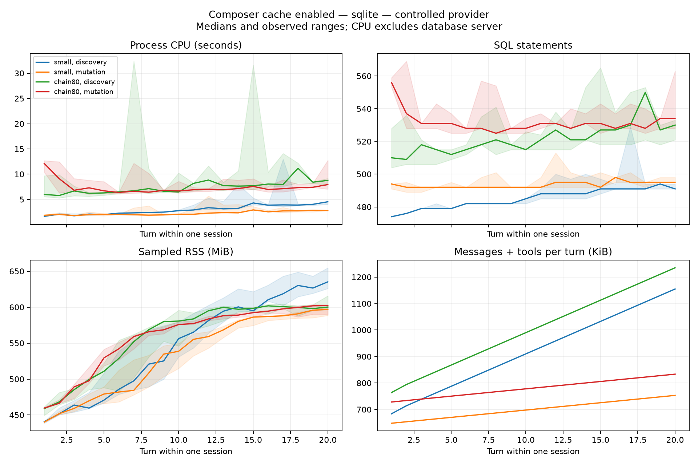

# Composer cache profiling — measured results

Measured 8 November 2026. This is an implementation-worktree measurement, not
a staging deployment verification. The matched comparison below is distinct
from the earlier experiments.

## Matched main comparison, 8 November 2026

All six discovery/mutation/WITHHOLD qualifications and three alternating
20-turn pairs completed successfully: 120 measured turns, each with exactly
three controlled SDK calls and a matching durable final review. Summary
validation exited zero. Main was clean at
`3b28d537be98234da8135c418bf185a998c18b68`; the feature was local HEAD
`1a97c2c04e69c5dd2e5971f2b7e5fe718567ad84` plus uncommitted inputs, fingerprint
`3f63e9398d94d2cd0fde6ee5f770768217a0097478d70f51cb0d445824e424ce`.
This snapshot **precedes the subsequent policy-only component-probe change**;
it must not be relabelled as exact final-source timing.

Conditions: small graph, discovery workload, fresh process and SQLite database
per run, shared Python 3.12.14 environment, zero controlled-provider delay,
10 composition rounds, 24 discovery rounds, 240-second turn budget and 20 requests/minute.
Full input maps, installed distributions, actual imported module hashes and
before/after source checks matched their required contracts. The exact reviewed
manifest difference was the type-stub dependency plus lock-format revision.
No paid model calls were made. A roughly ten-second disk-usage scan occurred
during pair 3 main; conditions were not perfectly quiet. Startup model-cost-map
fetches failed and fell back to the local map in both variants.

Total 20-turn process CPU was lower in all three feature runs: reductions
14.87%, 29.23% and 23.02%. Median totals were 76.374 seconds main (range
65.742–83.780) versus 58.796 feature (55.966–59.290). Summed CPU was 22.95%
lower. These are three paired observations, not confidence intervals or an
isolated causal estimate of caching alone. The whole feature changeset is
compared, and controlled SDK responses do not predict live upstream latency.

At turn 20, the paired CPU difference ranged from −1.140 to +0.732 seconds;
one feature run was slower at that turn. SQL statements fell by three in each
pair at turn 20, but this does not measure rows or database wire bytes. Median
RSS at turn 20 was 658.0 MiB main versus 668.7 MiB feature: **no memory reduction
is established**. RSS includes the whole process and accumulated history; it
is not a per-turn allocation or leak verdict.

The table reports medians over all three repetitions. Growth is not a constant
cost per additional turn: the feature rises from 1.938 to 4.244 seconds CPU,
477 to 494 SQL statements, and 440.6 to 668.7 MiB RSS between turns 1 and 20.

| Turn | Main CPU s | Feature CPU s | Main SQL | Feature SQL | Main RSS MiB | Feature RSS MiB |
| --- | ---: | ---: | ---: | ---: | ---: | ---: |
| 1 | 2.619 | 1.938 | 477 | 477 | 442.113 | 440.609 |
| 2 | 2.395 | 1.487 | 479 | 476 | 445.332 | 452.730 |
| 3 | 2.659 | 1.583 | 479 | 476 | 455.871 | 481.395 |
| 4 | 2.772 | 1.846 | 482 | 479 | 460.160 | 493.812 |
| 5 | 2.897 | 1.848 | 482 | 479 | 467.445 | 512.430 |
| 6 | 2.913 | 2.104 | 482 | 482 | 498.020 | 521.047 |
| 7 | 2.842 | 2.023 | 485 | 479 | 520.875 | 546.656 |
| 8 | 2.869 | 2.238 | 485 | 482 | 528.113 | 560.711 |
| 9 | 2.968 | 2.385 | 485 | 482 | 547.672 | 569.176 |
| 10 | 3.083 | 2.429 | 485 | 482 | 571.820 | 584.566 |
| 11 | 3.260 | 2.523 | 485 | 482 | 583.992 | 597.754 |
| 12 | 3.792 | 2.762 | 488 | 482 | 599.301 | 603.387 |
| 13 | 3.646 | 2.756 | 488 | 482 | 605.859 | 613.410 |
| 14 | 5.024 | 3.253 | 491 | 488 | 617.488 | 617.117 |
| 15 | 4.125 | 3.073 | 491 | 488 | 623.672 | 628.895 |
| 16 | 4.558 | 3.481 | 491 | 488 | 633.902 | 636.133 |
| 17 | 4.546 | 5.322 | 497 | 494 | 639.273 | 645.965 |
| 18 | 6.526 | 3.977 | 494 | 491 | 645.547 | 655.285 |
| 19 | 4.355 | 4.558 | 494 | 494 | 656.988 | 660.273 |
| 20 | 4.985 | 4.244 | 497 | 494 | 657.996 | 668.688 |

Raw rows, commands, provenance and qualification receipts:
`work/.cache/common-main-pairs-final-1`; validated summary:
`work/.cache/common-main-pairs-final-1-summary.json`. Earlier CPU/allocation
matrices below are separate experiments and must not be added to these totals.

## Follow-up measurement and deferred prefix experiment

The later integrated feature tree was measured separately from the original
matrix below. A controlled three-pair comparison changed only
`prompt_guard_rendering.py` and added its regression test. Each variant ran
twenty small-graph discovery turns with three controlled provider calls per
turn, using a fresh process and SQLite database. Order was baseline/candidate,
candidate/baseline, baseline/candidate. All six runs completed successfully:
120 healthy turns, unchanged source/fixture maps before and after every child.
The normal turn profiler remained enabled; Yappi and tracemalloc were disabled.

This comparison **does not establish a whole-turn speedup**. Total process CPU
across twenty turns changed by −15.0%, +13.8% and +21.3% in the three paired
candidate runs. The following per-turn medians describe those observations;
they do not cancel the inconsistent total-run result.

Aggregate candidate CPU was 212.619 seconds versus 201.196 seconds before,
an increase of 5.68%. The index is therefore **deferred from the final build**.
The original renderer is semantically correct; no demonstrated workload
failure requires this change now. Its asymptotic improvement alone does not
justify the additional compatibility machinery and unmeasured temporary
allocation cost for the requested whole-turn goal. This is insufficient
evidence of benefit, not proof of a general regression. Astra reviewed the
decision. The exact pre-experiment source was restored; the isolated patch,
regression tests and all raw evidence remain preserved for a future measured
crossover/allocation investigation.

| Turn | Baseline CPU | Indexed-prefix CPU | Baseline SQL statements | Indexed-prefix SQL statements |
| --- | ---: | ---: | ---: | ---: |
| 1 | 2.600 s | 3.431 s | 480 | 483 |
| 5 | 2.199 s | 2.229 s | 479 | 482 |
| 10 | 2.894 s | 3.052 s | 488 | 488 |
| 15 | 3.882 s | 3.565 s | 491 | 491 |
| 20 | 4.238 s | 3.899 s | 494 | 494 |

Turn-20 CPU ranges were 4.215–8.654 seconds before and 3.716–5.055 seconds
after. Sampled turn-20 RSS medians were 639.20 and 619.02 MiB respectively;
RSS is whole-process residency and does not isolate the index's allocation
cost or prove a memory improvement. The temporary index adds memory
proportional to distinct path prefixes. Small SQL-count differences can arise
from timing-dependent polling/lease work; this algorithm changes no SQL path.
Raw data, variant snapshots, full input maps, commands, UTC receipts and
qualified summary are retained at `work/.cache/prefix-paired-final`.

Separate CPU and allocation attribution runs each completed twenty healthy
turns on the same recorded pre-prefix source. Controlled worker-thread,
sleep, retained/freed-allocation and caller-owned tracer cases qualified the
diagnostic instruments. CPU attribution identified the old pairwise path
comparison generator growing from 1,332 calls at turn 1 to 2,135,982 at turn 20.
The replacement passed 165 tests and Astra review; its scaling correction
must not be confused with a measured end-to-end speedup.

Allocation tracing reported 35.682 MiB retained after turn 1 and 45.636 MiB
after turn 20, with a 27.396 MiB net release during turn 20. Inclusive peaks
were 40.414 and 74.909 MiB. This is collection and allocation churn, not a
proof of a leak or its absence. The largest retained pathlib allocation's
caller has not been established. These diagnostics deliberately omit forced
per-turn garbage collection and are not comparable to the original memory
matrix's post-collection baseline. Observer overhead is recorded separately.
Their inner harness rows retain `mode=cpu` despite the outer tracing wrapper;
the companion diagnostic metadata is authoritative. Exclude these runs from
normal CPU/RSS aggregates. Raw diagnostics are retained under
`work/.cache/attribution-small-discovery-{cpu,allocations}-final`.

## Source and workload

Branch `codex/composer-cache-final`, local commit
`1a97c2c04e69c5dd2e5971f2b7e5fe718567ad84`, with uncommitted Stage 6 and catalog
repairs. Each raw run records the full source digest, profiler and fixture
digests, command, dependency versions, actual database version and UTC receipts.
The source must remain unchanged within a run for inclusion. The original
matrix below precedes the later integrated fixes and separate measurement above.

The controlled harness exercises real authenticated HTTP admission, durable
worker claims, tools, validation, Advisor handling, persistence and terminal
settlement. Only provider transport/readiness and the process watchdog authority
use testing seams. Each healthy turn includes two primary calls and one Advisor
call, a successful requested tool action and a matching final ADMIT review.
Graphs are preseeded through real upload/source configuration: either two
processing nodes or an 80-node chain. Discovery requests plugin schema;
mutation changes graph metadata. Twenty successive turns share one session.
This is not an empty-graph tutorial-authoring workload.

App startup, graph seeding, frontend rendering and pipeline execution are outside
the measured turn. Python 3.12.14, SQLAlchemy 2.0.45, LiteLLM 1.102.0, four CPU
cores of cgroup capacity and 16 GiB memory limit. The local PostgreSQL target
uses the repository's isolated PostgreSQL 16 test-container workflow. CPU is
the application process including its worker threads; SQLite work is in that
process, whereas PostgreSQL server CPU is not included.

## SQLite turn growth

Twelve cache-enabled CPU runs provide three repetitions of each workload.
Four additional cache-disabled runs provide one exploratory control each.
All 320 CPU observations completed the required tool and review checks.
The following are medians across the three cache-enabled runs, not percentiles
or confidence intervals.

| Graph / work | CPU turn 1 | CPU turn 20 | SQL statements turn 1 → 20 | Sampled RSS at turn 20 |
| --- | ---: | ---: | ---: | ---: |
| Small / discovery | 1.657 s | 4.542 s | 474 → 491 | 635.25 MiB |
| Small / mutation | 1.866 s | 2.797 s | 494 → 495 | 596.84 MiB |
| 80-node / discovery | 5.981 s | 8.773 s | 510 → 530 | 600.22 MiB |
| 80-node / mutation | 12.117 s | 7.943 s | 556 → 534 | 602.19 MiB |

Large-graph timings vary substantially between observations. These results do
not demonstrate that caching is universally faster. Cache-disabled controls
are single repetitions and are the same feature tree with caching disabled,
not unmodified main. Specifically, the control disables the Composer session
cache setting; it does not remove static catalog preparation already present
in this feature tree. SQL statement counts do not measure result bytes, scanned
rows or total database work. Lease/heartbeat activity can change counts with
elapsed time.

Range shading shows the observed minimum and maximum of three repetitions.
Request size is the sum of serialized messages and tools over the three
physical calls, not TCP wire traffic. Small discovery's Advisor request grows
from about 173 KB to 642 KB over these turns, while accounted cache entries
remain at 210,748 bytes. Attribution of CPU growth requires separate diagnostic
profiling; correlation alone does not identify the cause.

## Memory

Memory observations use separate processes with one-frame Python allocation
tracing, a post-seed baseline and garbage collection around samples. They must
not be mixed into untraced CPU timings. One small-discovery and one
small-mutation run completed, providing 40 healthy memory observations.

| Workload | Retained Python heap after turn 1 | After turn 20 | Turn-20 allocation peak above turn start |
| --- | ---: | ---: | ---: |
| Small discovery | 4.527 MiB | 4.089 MiB | 15.829 MiB |
| Small mutation | 4.233 MiB | 3.840 MiB | 9.347 MiB |

Retained Python heap is approximately stable in these traced small-graph runs.
RSS grows in the separate untraced runs. These instruments do not establish
whether native allocation or allocator retention explains that difference,
and do not establish absence of a memory leak. Cache accounting is neither
total process memory nor a measurement of every Python allocation.

The 80-node discovery memory run failed at the separate five-second runtime
preflight limit under tracing, before a healthy turn was recorded. The driver
then skipped the final 80-node mutation memory condition. Both limitations
remain; the production preflight and whole-turn deadlines were not increased.

## PostgreSQL status and diagnostic lead

The initial PostgreSQL attempt failed before turn 1 because the unit fixture's
development signing keys did not meet external-state startup requirements.
The profiler now supplies fresh in-memory keys only for its isolated PostgreSQL
fixture, through normal validation. Application security checks are unchanged.
Record this profiler revision difference when comparing retained artifacts.
A one-turn control subsequently passed with unchanged source and matching ADMIT.
The PostgreSQL matrix stopped with exit 1 during its seventh run. Six complete
20-turn runs (120 healthy observations) qualify. The seventh completed ten
healthy turns, then turn 11 returned HTTP 500 `composer_plugin_error` during
runtime preflight. Its response has null validation errors and diagnostic ID;
the underlying exception is not established. That entire incomplete run is
excluded from aggregates, and the remaining thirteen planned runs did not run.
The retained safe failure receipt is `20261108-v3-postgres/failure-safe.json`.
No process was interrupted to obtain this checkpoint.

Its first three small-discovery repetitions are now complete (60 healthy turns).
Their medians grow from 3.092 to 15.276 seconds wall time, 2.125 to 5.993 seconds
application CPU and 503 to 585 SQL statements between turns 1 and 20. Turn-20
wall times range from 13.018 to 17.711 seconds. These controlled-provider runs
demonstrate history-dependent local work without establishing its full causal
breakdown. The partial aggregate is retained as `postgres-first4-summary`
(which also contains one completed small-mutation run).

In the first completed small-discovery sequence, application CPU rose from
2.062 to 4.684 seconds, wall time from 2.963 to 13.018 seconds, and SQL statements
from 503 to 577. Aggregated driver-cursor time rose from 0.951 to 11.591 seconds.
Cursor intervals can overlap between threads and exclude fetch/commit work;
they must not be summed with CPU or described as database-server CPU.

Source tracing identifies growing private-audit deduplication scans inside the
session write lock, plus a graph-review receipt lookup. The `tool_calls` column
is PostgreSQL JSON, and repeated nested predicates are a plausible source of
history-dependent database work. Advisory-lock calls also grow slower. Query
plans and wait attribution remain necessary to distinguish parsing, storage,
network and lock costs. No index or schema optimization is verified yet.

## Live-provider pilot

Using the requested DeepSeek Composer and GLM Advisor configuration, one
preseeded discovery pilot completed in 12.133 seconds: 2.190 seconds process CPU,
9.768 seconds within SDK calls, 596 SQL statements and three returned provider
calls. Final review was ADMIT. Reported provider cost was $0.0069259468.
Provider-side prompt-cache hits were present; this is distinct from the
application's session cache.

A preceding pilot needed an Advisor semantic repair and stopped at the
profiler's call guard before another dispatch. Its three returned calls cost
$0.0082812031. Total reported cost across six returned calls was $0.0152071499.
Concurrent account usage by other experiments is not attributed to this work.
No further paid calls are planned for the present measurements.

The separate main baseline reports a 21.7-second tutorial run at
`3b28d537be98234da8135c418bf185a998c18b68`. That workload, provider conditions and
call sequence do not match this pilot. No speedup ratio is supported.

## Evidence and remaining qualification

Local raw results and source snapshots are retained under
`work/profile-results/20261108-v2-sqlite`,
`work/profile-results/20261108-v3-postgres` and `work/profile-results/live-pilot-*`.
The corrected SQLite aggregate and chart are under `sqlite-figures-v2`.
The summarizer rejects failed, incomplete, source-changed or non-ADMIT runs;
positive and damaged-metadata controls were exercised. Its request-byte
aggregation was corrected to sum physical-call sizes rather than compare lists.

These measurements do not replace final application tests. The 17 cache
benchmarks passed after the prefix deferral on that recorded snapshot.
The earlier matched recovery experiment failed on both main and the feature;
a later serial rerun passed all 12 previously failing feature recovery cases
at their original deadlines. This does not change the earlier experiment.
Final architecture/default/PostgreSQL gates remain outstanding. The exact
matched-comparison adapter and raw receipts remain in ignored local `work/`;
the remote checkpoint includes these summaries and general profiling scripts,
not those raw artifacts. See
[the investigation inventory](composer-follow-up-investigations.md).
