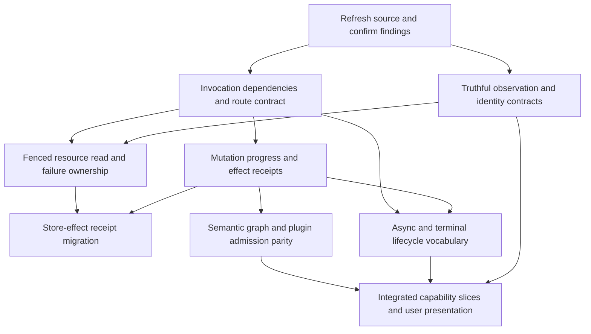

# Structural remediation plan

Baseline assessed: `3b28d537be98234da8135c418bf185a998c18b68`, restored 0.8.9.
**Status: proposed design only.** No production implementation, migration,
backlog publication, merge or deployment is included in this assessment.
The [synthesis](synthesis.md) explains the evidence and ownership diagnosis;
[individual sheets](inventory.md) retain tool-specific requirements.

## Target and design choice

Establish a first-class orchestrator supported by first-class tools and plugins
by strengthening the current seams. A tool selection should have explicit
dependencies, admitted arguments, an interpretable result, known effects and a
settled or explicitly unresolved lifecycle. Plugin-owned semantics must remain
consistent through discovery, authoring, preview and execution. The orchestrator
must know when it is discovering, editing, waiting for review, recovering,
handing off or complete.

Three approaches were considered:

| Approach | Benefit | Consequence | Disposition |
|---|---|---|---|
| Patch each observed call site independently | Fast containment of the concrete failures | New routes and tools can repeat missing-context, incomplete-observation and result-shape mistakes | Use narrowly as temporary containment, not the target |
| Strengthen existing invocation, observation and settlement contracts in bounded slices | Reuses current provider, policy, review and durable-custody machinery; each slice has a regression oracle | Requires compatibility work at strict response and persisted payload boundaries | Recommended |
| Replace orchestration with a new generic agent/workflow framework | Could provide a uniform facade | No evidence that it preserves current audit, provider, approval, fencing, policy or replay contracts; large migration risk | Not justified by this reconnaissance |

## Ordering and dependencies

R1 and R2 are independently investigable but changes to shared result/dispatch
types must integrate serially. R1's queue field-preservation fix and R4's no-op
progress slice do not depend on the blob read overhaul in R3. Only store-effect
receipt migration needs both R3 and the shared receipt design. R6 can be designed
early, then migrate after the relevant R4 receipt semantics are explicit.
Priorities express consequence and prerequisite,
not a claim that each item is equally large or should ship in one release.

## R0 — Rebind reconnaissance before implementation

**Priority:** prerequisite. **Owner:** implementing/reviewing agent with maintainer
scope. **Resolves:** stale-source recommendations when the incoming `.10 lite`
changes alter a finding.

Re-run the live producers, compare affected files/callers and reproduce each
candidate on the actual implementation branch. Classify findings as remaining,
changed, corrected or still unverified. Keep the old 0.8.9 observations as dated
evidence; do not revive the abandoned full `.10` workplan. Inspect policy,
provider and session routes implicated by a changed handler rather than merely
relocating line references.

**Compatibility:** none changed by this step. Preserve current data and work.
**Acceptance:** exact branch/revision and measured tool names; each selected
finding has a current trigger, source trace, positive control and rejecting
control. A fixed finding is removed from implementation scope, with source/test
evidence supporting that disposition. Do not force the tool count to stay 46.

## R1 — Make invocation prerequisites explicit and route-checked

**Priority:** P0, restores dependable tool selection. **Owner:** Composer invocation
and tool-contract layer. **Findings:** GS-01 (`diff_pipeline`), SG-04
(`inspect_source` context admission), SG-07 (queue fields lost before validation);
structural observation of async/control
tools outside synchronous declarations.

Extend the current descriptor/context seam with tool-specific required
capabilities, such as baseline view, policy snapshot, session metadata,
fenced blob read, scoped secret resolver, runtime preflight and async session
review. A descriptor need not hold raw resources; it names what an invocation
owner must supply. Use owned context types or a validated construction step
so an advertised executable tool cannot silently lack a required dependency.
Define `diff_pipeline` baseline semantics explicitly: admitted turn-start state,
not whatever state a later caller happens to pass.

In the same admission-contract workstream, preserve every admitted queue field
until the intrinsic kind guard checks it, or reject forbidden kind fields in a
typed argument union before construction. Correct this bounded invariant gap
without waiting for a full semantic graph redesign. Extend parity controls to
bulk/replacement paths to prevent other kind-specific builders discarding
forbidden authored intent before validation.

**Affected components:** `tools/declarations.py`, `_registry.py`, `_dispatch.py`,
`ToolContext`, freeform `tool_batch.py`, planner context construction, MCP
adapter, boot/provider tool producers, source inspection/read adapters.

**Compatibility:** preserve tool names, ordinary arguments and legitimate route
exclusions. Existing local/internal callers must supply the newly required
capability or receive a defined unavailable result before work begins. Do not
turn an intentional MCP exclusion into automatic model exposure. A strict
prerequisite for source inspection may break unsafe direct callers; identify
and migrate those callers rather than preserving an authority bypass.

**Observable acceptance:**

- A real scripted freeform turn selecting `diff_pipeline` observes the admitted
  baseline; unchanged and changed graph controls report the correct delta.
- Planner and MCP retain their documented baseline scopes, including loaded
  sessions and proposals; missing required context rejects before handler work.
- Source inspection and content reads require the same owned read authority;
  absent/wrong-session/stale authority yields no file reads or metadata leak.
- Every emitted tool on every route can construct its declared dependencies,
  or has an explicit availability/refusal reason. A deliberately omitted
  required dependency makes the route contract check fail.
- Existing strict/non-strict wire bytes, semantic omission/null behavior,
  tutorial/provider transitions and redaction remain covered.
- A canonical queue succeeds; each forbidden collector scope field and their
  combinations reject before mutation through public upsert/bulk paths. The
  invariant sees the exact admitted candidate, not a cleaned surrogate.

**Risk/reversibility:** medium-to-high, because an admission change can over-hide
valid capabilities. Introduce checks around existing callers before moving code.

## R2 — Give observations completeness, scope and canonical identity

**Priority:** P0 for discovery truth. **Owner:** resource discovery services and
selected tool response contracts, with UI/orchestrator consumers. **Findings:**
BOS-01 hidden blob window, BOS-03 alternative UUID lookup, GS-02 diagnostic
response mismatch, GS-03 model/audit UI descriptions; recovery park-window
limitation is related but not runtime-reproduced.

Define a bounded resource page with stable session scope, ordering, continuation
and an explicit completeness signal. Reuse its semantics for ordinary blobs,
inline-eligible blobs and, where warranted, parked graph discovery while
retaining their distinct eligibility rules. Admit blob IDs once into an owned
canonical representation and pass that value through lookup, read, binding,
update and delete. Decide whether noncanonical forms are accepted/canonicalized
or uniformly refused; do not accept them at one stage and report false absence.
Declare whether continuation is snapshot-consistent or a live traversal. If
live, define duplicate/omission and readiness-transition behavior rather than
promising snapshot completeness under arbitrary concurrent mutation.

Treat model catalogue, policy availability, credential readiness and actual
remote reachability as separate observations. Keep `get_audit_info` described as
policy information unless a separately authorized session-lineage operation is
implemented. Make exact/fuzzy diagnostic branches satisfy one result contract.

**Affected components:** blob query helpers/service, source blob resolution,
metadata/read/write tools, `_generation_responses.py` and selected response
contracts, `explain_validation_error`, recovery context, UI
`toolCallDescriptions.ts` and tool cards.

**Compatibility:** paging changes to bare list/data envelopes can break strict
decoders and recorded response replay. Choose an additive/versioned envelope
and update selected contracts, model serialization and browser decoders in the
same slice. Existing `{}` calls can continue to request the first page only if
the result clearly says whether more exists. Preserve all existing IDs and
session restrictions; no blob/store migration is needed just to normalize
incoming UUID spellings. Do not add credential probes to catalogue discovery.

**Observable acceptance:** 0/1/50/51/large authorized inventories are complete
over continuation under the declared snapshot/mutation semantics; deterministic
create/delete/readiness interleavings meet that contract without a false
completeness claim;
malformed/stale/foreign cursors cannot cross sessions. Empty complete and
truncated nonempty results are distinguishable. Equivalent accepted UUID forms
resolve to the same record in all adapters, or reject uniformly. Exact and fuzzy
diagnostic matches carry the same promised code semantics; unknown queries are
honestly unmatched. UI text makes no run-lineage or credential-check claim for
constant/catalogue tools. If parked discovery is included, test beyond 100.

**Risk/reversibility:** medium; response compatibility is more consequential than
the query change. Preserve the previous reader through an explicit adapter if
needed, not by silently dropping completeness.

## R3 — Centralize resource snapshot reads and failure ownership

**Priority:** P1, depends on R1/R2. **Owner:** blob domain and safe tool error
projection. **Findings:** BOS-02 owned missing-byte taxonomy, SG-04 source
inspection admission; whole-file-before-slice behavior is a source-established
cost limitation, not a measured performance incident.

Make content/attachment/source inspection/preview consume one fenced snapshot
reader that binds session, blob identity, lifecycle, storage root and bytes/hash.
That shared port must support streaming: retain source inspection's bounded
memory and full streamed hash, rather than delegating it to the existing
whole-file `read_bytes` implementation.
Preserve no-symlink/path policy, content integrity and credential safeguards.
Represent missing service-owned ready bytes and hash/metadata corruption as
typed owned-storage/integrity faults; represent invalid user content separately.
Tools return safe categorical facts and supported next actions without exposing
raw paths, bytes or credential material. The orchestrator should not tell the
model to repair storage by editing the pipeline.

Only optimize I/O after defining snapshot integrity: a bounded returned slice
does not prove bounded underlying work. Consider streaming hash verification or
version-bound verified snapshots; do not skip full integrity or guard scanning
merely to reduce read volume. A cached verification must bind the exact immutable
content version and policy.

**Affected components:** `tools/blobs.py`, source inspection/resolution,
`generation.py` preview inspection, `web/blobs/service.py`, tool/audit exception
classification and user recovery presentation.

**Compatibility:** retain preserve/refuse behavior and exact existing bytes.
Failure categories may change downstream retry/HTTP/UI behavior: migrate
consumers deliberately and retain safe rendering of older stored responses.
No storage rewrite, reset or resource regeneration is authorized by this plan.

**Observable acceptance:** ready-existing content succeeds; unauthorized,
out-of-root, stale-fence, missing-ready-bytes and hash-mismatch controls all
refuse without disclosures or false readiness. Missing bytes receive the same
owned category across service/tools. A valid read/update interleaving sees one
snapshot or a defined retryable conflict, not mismatched metadata and bytes.
Instrument actual read volume before claiming a paging/preview optimization;
integrity and credential-negative controls must still fail closed.

**Risk/reversibility:** high integrity risk; migrate one consumer at a time behind
the common port with existing tests and new negative controls.

## R4 — Separate graph change, observed effect and durable progress

**Priority:** P1, contract/no-op slice depends on R1; store-effect migration also
depends on R3. **Owner:** tool outcome contracts and Composer
lifecycle; store-specific settlement remains with its current service.
**Findings:** SG-03 no-op/version inconsistency, BOS-04 graph-independent blob
effects and retry limitations; synthesis groups 4 and 6.

Define stage-specific owned outcomes, or a discriminated family, for argument
admission, semantic success/refusal, graph-content change, observed external/store
effects, validation scope, proposal/review obligations and durable settlement.
Reference existing authoritative receipts rather than copying them into a new
all-optional carrier. The orchestrator can project these outcomes for the user
after settlement; that projection is not a second source of commit truth.
Fields are facts, not another broad `success` claim. Preserve dispatch audit
status separately from tool-domain refusal. Establish one no-op policy across
metadata/source/node/output patch tools: content equality must not masquerade
as graph progress, while attempted actions remain audited.

For effectful operations, state which durable operation/call identity supports
replay, what a fresh invocation means and when retry is unsafe or unknown.
Do not infer that unchanged graph version means no work occurred. Keep existing
blob custody drivers, ambiguous-effect refusal, operation replay and fences;
wrap their actual receipts rather than recreating transactions in Composer.

**Affected components:** `ToolResult`, discovery/progress helpers, mutation
handlers, blob effect adapters, tool-batch accumulator, proposals and acceptance,
audit projections, completion checks, recovery terminal results.

**Compatibility:** a changed no-op version policy can affect stale-view checks,
caches and progress counters; audit attempts independently and verify their
consumers. Version/adapter strategy is required for persisted tool and proposal
payloads. Do not redefine a previously ambiguous effect as safe to repeat.

**Observable acceptance:** all empty patch controls preserve semantic graph
identity and report no graph change; one actual field change advances identity
once. Blob creation reports an effect even with unchanged graph state. Failed
admission performs no effect. Cancellation before, during and after an effect
has an explicit settled/ambiguous/refused receipt. Completed operation replay
produces no new writes; a fresh call follows documented idempotency semantics.
The orchestrator cannot reset repair/progress accounting solely from version
churn, nor announce completion while a required receipt/review is outstanding.

**Risk/reversibility:** high; receipts cross audit and persistence boundaries.
First add explicit facts alongside current consumers, then migrate decisions.

## R5 — Align semantic graph edits and plugin admission stages

**Priority:** P1, depends on R4; R1 context parity is prerequisite.
**Owner:** Composer semantic graph/candidate admission with plugin contracts and
web policy retaining their own authority. **Findings:** SG-01 visual/runtime
edge distinction, SG-02 splice precondition, SG-06 admission ownership; relevant
set-source/node/output/pipeline/preview/schema sheets.

Specify each edit as an operation on the authoritative authored graph and
derive its rendered projection. Make scalar destination edits versus visual
edge edits explicit in contracts. Decide whether splicing is allowed to preserve
unrelated invalid draft findings or requires complete validity, and advertise
that rule. For repair-friendly edits, compare relevant/new failures rather than
accidentally demanding the entire draft already be complete. For operations
requiring full validity, provide concrete selection guidance and a repair path.

Use a shared candidate admission pipeline that exposes configuration validity,
policy/profile lowering, required controls, structural/semantic graph validity,
runtime preflight and human review as separate verdicts. Consume plugin-owned
schema/capability/output contracts; do not move deployment secrets, profile
allowlists or review authority into plugin configuration classes. Preserve
provider authorship and provenance through required-control insertion.

**Affected components:** source/node/edge/output mutations, `set_pipeline`,
planner terminal, `_common` prevalidation, catalog/policy views, graph/YAML
projection, required controls, interpretation review reconciliation, preview and
runtime assembly. This is not authorization to redesign every plugin at once.

**Compatibility:** executable routing semantics and persisted authored graphs
are public/persistent boundaries. Preserve current meaning or make an actual
breaking change explicit with supported reinspection/reconstruction behavior.
No blanket graph migration, wipe or historical reconstruction promise. A
projection cleanup must not infer new provider-authored topology.

**Observable acceptance:** for representative single-source, multisource,
transform, gate, aggregation/collector and profiled-plugin slices, schema
discovery → valid edit → preview → runtime assembly agree on supported options,
generated fields and routing. Invalid options, policy-hidden plugins, missing
profiles/secrets, route conflicts and stale reviews reject at their named stage.
An unrelated incomplete draft has the documented splice behavior. The executable
graph projection agrees with authored runtime destinations; separately typed
visual annotations preserve their declared non-executable meaning. Converting
those annotations to executable relations requires a separately approved
compatibility decision. Changes to
reviewed inputs invalidate or rebind exactly the required review evidence.

**Risk/reversibility:** high blast radius. Start with the observed splice/edge
and profile contracts, then expand only with demonstrated gaps.

## R6 — Give async and terminal controls a shared lifecycle contract

**Priority:** P2 structural consolidation, design after R1 and integrate after R4.
**Owner:** Composer orchestration and tool descriptor/result layer, with Sessions
as durable authority. **Evidence:** async and recovery/planner sheets; no claim
that existing specialized paths are defective simply because they differ.

Extend descriptor support to synchronous, asynchronous and terminal roles with
explicit execution owner, singleton/batch rules, context, budgets, audit and
receipt requirements. Keep advisor and interpretation semantics distinct from
graph mutations. The orchestrator's terminal vocabulary must distinguish waiting
for human review, provider-declined work, authorized handoff, editable recovery,
staged proposal and fully satisfied completion obligations.

**Affected components:** async effect/name sets, inline definitions, session-tool
owner, advisor checkpoints, recovery controls, planner terminal, tool batch,
completion, operation response decoder and progress presentation.

**Compatibility:** preserve current names, trigger meanings, strict-dialect
projection, review/approval semantics and replay. Migrate descriptions and
readers with any new outcome envelope; never treat old persisted operations as
newly approved or ready.

**Observable acceptance:** each role can be inventoried from live descriptor
projections; valid singleton controls and async calls retain current audit and
budget behavior; forbidden mixed batches make no effects; recovery refusal
cannot publish model success text; a restored invalid graph remains unready;
advisor/provider failures cannot count as confirmed stop/completion; cancelled
work retains required evidence exactly once. Check provider calls per transition,
including empty/rootless and tutorial routes.

**Risk/reversibility:** high if unification erases legitimate authority differences;
moderate if descriptors wrap existing owners first. No new orchestration framework
is required.

## R7 — Validate coherent capability slices and presentation

**Priority:** integration checkpoint after the selected structural slices.
**Owner:** implementing lane and independent reviewer; UI and runtime owners
participate where their actual contracts change.

Admit an explicit route matrix: freeform/planner/MCP where supported; strict
and non-strict transports; direct/admitted calls; valid/invalid arguments;
dependency present/absent; policy allowed/denied; success/no-op/refusal; proposal
staged/approved/stale; cancellation/replay; integrity faults. Use meaningful
production-path assertions, not merely registry counts or handler mocks.

**Compatibility:** test recorded response/proposal/operation readers as well as
new writers. **Acceptance:** user-facing state and tool summaries describe
actual committed outcomes. Run focused tests and every affected whole-tree gate.
Run the full default suite only where shared runtime/contracts/graph/scan changes
justify its breadth before merge, and the separate serial PostgreSQL selection
when persistence/locks/session/Landscape change. Live-provider and deployed
acceptance remain explicitly bounded follow-ups, not inferred from local green.

## Temporary containment, distinct from the structural solution

These are implementation candidates, not changes made by this reconnaissance:

- Supply/document the diff baseline on freeform calls while R1 establishes the
  complete dependency contract.
- Disclose current list truncation; retain known blob IDs as a workaround until
  continuation exists. Do not claim the truncated list is complete.
- Correct model/audit tooltips and exact diagnostic-code output; they should
  stay corrected even when later response contracts are introduced.
- Document splice's current full-validity precondition and the difference
  between visual and executable edge edits.
- Make no-op progress explicit at consumers while R4 aligns mutation receipts.
- Preserve admitted queue fields until intrinsic validation so forbidden scope
  arguments refuse, while R5 develops the broader kind-specific candidate model.
- Surface missing owned blob bytes as an operational/integrity problem, without
  telling the model to synthesize or replace the missing evidence.

## Confidence, risks and unresolved decisions

Confidence is high that the concrete findings warrant the named contract fixes;
confidence is moderate in the exact packaging/order beyond dependencies because
no implementation spike or migration prototype was performed. The highest risks
are loss of authority/evidence, incompatible persisted responses, and accidental
redefinition of routing or retry safety. The recommended approach is reversible
by bounded adapters until a persistent semantic change is approved.

Before implementation, decide the supported response version strategy, precise
diff baseline, noncanonical-ID policy, splice invalid-draft policy and effect
replay identity. Those decisions do not block this assessment; they belong to
the separately scoped changes. Refresh against `.10 lite` first. No estimate,
release assignment, cloud qualification or historical-data migration is implied.
