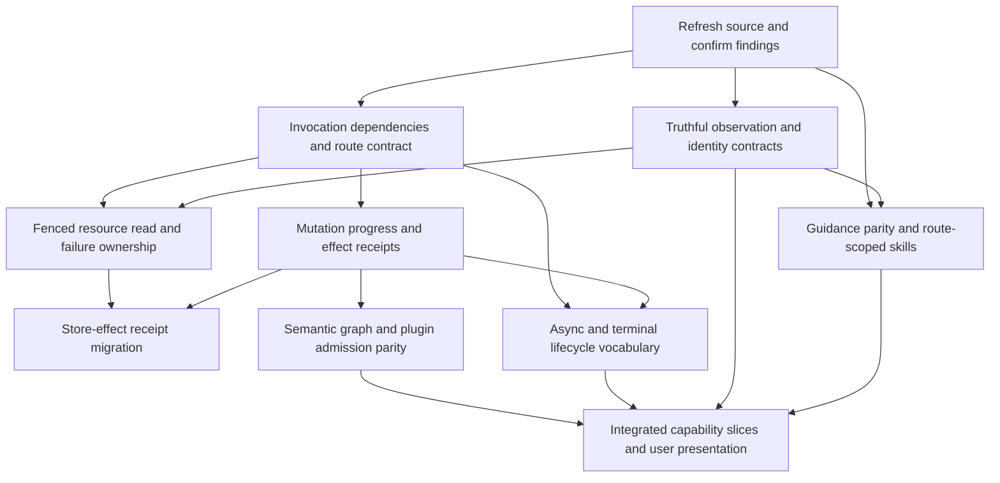

# Structural remediation plan

Baseline assessed: `3b28d537be98234da8135c418bf185a998c18b68`, restored 0.8.9.
**Status: proposed design only.** No production implementation, migration,
backlog publication, merge or deployment is included in this assessment.
The [synthesis](synthesis.md) explains the evidence and ownership diagnosis;
[individual sheets](inventory.md) retain tool-specific requirements. Finding
IDs (SG-, GS-, BOS-, XC-) and maintainer decisions (D1–D38) are defined in the
[README register](README.md#findings-register).

## Target and design choice

Establish a first-class orchestrator supported by first-class tools and plugins
by strengthening the current seams. A tool selection should have explicit
dependencies, admitted arguments, an interpretable result, known effects and a
settled or explicitly unresolved lifecycle. Plugin-owned semantics must remain
consistent through discovery, authoring, preview and execution. The orchestrator
must know when it is discovering, editing, waiting for review, recovering,
handing off or complete. The guidance each route renders must describe that
route's palette and the tools' actual behaviour.

Three approaches were considered:

| Approach | Benefit | Consequence | Disposition |
|---|---|---|---|
| Patch each observed call site independently | Fast containment of the concrete failures | New routes and tools can repeat missing-context, incomplete-observation and result-shape mistakes | Use narrowly as temporary containment and quick wins, not the target |
| Strengthen existing invocation, observation and settlement contracts in bounded slices | Reuses current provider, policy, review and durable-custody machinery; each slice has a regression oracle | Requires compatibility work at strict response and persisted payload boundaries | Recommended |
| Replace orchestration with a new generic agent/workflow framework | Could provide a uniform facade | No evidence that it preserves current audit, provider, approval, fencing, policy or replay contracts; large migration risk | Not justified by this reconnaissance |

All items stay within the Composer invariants: the provider authors pipeline
structure; server-side work is validation, rejection, redaction or disclosure;
nothing is tutorial-specific.

## Ordering and dependencies

R1 and R2 are independently investigable but changes to shared result/dispatch
types must integrate serially. R1's queue field-preservation fix and R4's no-op
progress slice do not depend on the blob read overhaul in R3. Only store-effect
receipt migration needs both R3 and the shared receipt design. R6 can be designed
early, then migrate after the relevant R4 receipt semantics are explicit.
R8 can start immediately for text that describes settled behaviour (palette
scoping, false claims about rereads, prohibited lists and patch semantics); text
describing behaviour under a pending decision (D1, D6, D7, D8) waits for that
decision, and text describing an R2 result change lands with it.
Priorities express consequence and prerequisite,
not a claim that each item is equally large or should ship in one release.

### Cross-cutting findings by work item

| Work item | Register findings |
|---|---|
| R1 | GS-01, SG-04, SG-07, XC-02 (admission before publication), XC-03, XC-10, XC-17 (batch state authority) |
| R2 | BOS-01, BOS-03, GS-02, GS-03, SG-05, XC-06 (with R3), XC-07, XC-08, XC-09, XC-11, XC-13, XC-14 (limit disclosure), XC-18 (description contracts), XC-19, XC-20 (discovery kept out of mutation deltas), XC-24, XC-25 |
| R3 | SG-04, BOS-02, BOS-05, XC-04 (typed malformed control), XC-05, XC-06, XC-14 |
| R4 | SG-03, BOS-04, XC-02 (proposal obligations and accept outcomes), XC-17, XC-20, XC-21 (finalization effects), XC-22 (effects listed in proposals), XC-25 (audit of observed results) |
| R5 | SG-01, SG-02, SG-06, SG-07, XC-05 (Tier-3 checks before web-owned gates), XC-15, XC-16, XC-21 (replay identity), XC-23 |
| R6 | XC-04, XC-12, XC-17 |
| R7 | XC-09 route parity, XC-22 presentation; every route-dependent acceptance below |
| R8 | GS-03, XC-01, XC-07, XC-11, XC-12, XC-18, XC-22 (UI copy), XC-24 |

## R0 — Rebind reconnaissance before implementation

**Priority:** prerequisite. **Owner:** implementing/reviewing agent with maintainer
scope. **Resolves:** stale-source recommendations when the incoming `.10 lite`
changes alter a finding.

Re-run the live producers, compare affected files/callers and reproduce each
candidate on the actual implementation branch. Classify findings as remaining,
changed, corrected or still unverified. Keep the old 0.8.9 observations as dated
evidence; do not revive the abandoned full `.10` workplan. Inspect policy,
provider and session routes implicated by a changed handler rather than merely
relocating line references. The [probe wave outcomes](evidence.md#probe-wave-outcomes-2026-11-09)
give each finding's 0.8.9 control (confirmed, refuted or not runnable, with the
sheet's run record); re-run the confirmed controls on the receiving branch, and
treat the 16 not-runnable rows (browser, running server, PostgreSQL, live
provider) as the remaining route-level reproductions.

**Compatibility:** none changed by this step. Preserve current data and work.
**Acceptance:** exact branch/revision and measured tool names; each selected
finding has a current trigger, source trace, positive control and rejecting
control. A fixed finding is removed from implementation scope, with source/test
evidence supporting that disposition. Do not force the tool count to stay 46.

## R1 — Make invocation prerequisites explicit and route-checked

**Priority:** P0, restores dependable tool selection and stops turns ending on
approvals the user cannot complete. **Owner:** Composer invocation and
tool-contract layer. **Findings:** GS-01 (`diff_pipeline`, freeform and planner),
SG-04 (`inspect_source` context admission), SG-07 (queue fields lost before
validation), XC-02, XC-03, XC-10, XC-17; structural observation of async/control
tools outside synchronous declarations.

Extend the current descriptor/context seam with tool-specific required
capabilities, such as baseline view, policy snapshot, session metadata,
fenced blob read, scoped secret resolver (a value-free scoped probe, per
`validate_secret_ref-N3`), secret wiring policy, data root/path authority,
runtime preflight and async session review. A descriptor need not hold raw
resources; it names what an invocation owner must supply. Use owned context
types or a validated construction step so an advertised executable tool cannot
silently lack a required dependency. Every site that re-invokes `execute_tool`
counts as a route: the explicit-approve preview, the proposal-accept replay and
MCP construct context through the same constructor as the immediate freeform
call, so the accept route cannot drop `secret_wiring_policy` (`wire_secret_ref-N1`).

Define `diff_pipeline` baseline semantics explicitly: admitted turn-start state,
not whatever state a later caller happens to pass. On the planner the current
binding is a self-diff (`diff_pipeline-N1`); remove the tool there or redefine it
as candidate against current (D8).

Admission must precede publication. Whatever D1 rules, a mutation that would be
refused must not reach the user as an approvable proposal while the model is
told it succeeded: run validation-only admission for blob and secret mutations
before staging, convert staging-time `ValueError` from proposal blob-reference
validation into a tool refusal, and either return a refused preview in-turn or
disclose to the model that the proposal is unchecked. The accept route must
settle every proposal it cannot apply: today a recurring preview
`ToolArgumentError` escapes as an unhandled 500 and a no-op 409s, and both
leave the proposal pending indefinitely (`set_source-N8`,
`patch_source_options-N2`; D1). MCP path admission (XC-10) is an
authoring-time false "valid", not a runtime escape: the stdio server's runtime
preflight already refuses the stored paths at preview, so D2 decides only where
the refusal surfaces. Same-batch writers must
read the batch's current state, not the pre-batch persisted id
(`request_interpretation_review-N2`).

In the same admission-contract workstream, preserve every admitted queue field
until the intrinsic kind guard checks it, or reject forbidden kind fields in a
typed argument union before construction. Correct this bounded invariant gap
without waiting for a full semantic graph redesign. Bulk `set_pipeline` already
refuses the same input; keep it as the control.

**Affected components:** `tools/declarations.py`, `_registry.py`, `_dispatch.py`,
`ToolContext`, freeform `tool_batch.py` (immediate and explicit-approve preview
paths), `sessions/routes/composer/proposals.py` accept replay,
`proposal_blob_refs.py`, planner context construction, MCP adapter
(`composer_mcp/server.py` `_dispatch_tool`), boot/provider tool producers,
source inspection/read adapters.

**Compatibility:** preserve tool names, ordinary arguments and legitimate route
exclusions. Existing local/internal callers must supply the newly required
capability or receive a defined unavailable result before work begins. Do not
turn an intentional MCP exclusion into automatic model exposure. A strict
prerequisite for source inspection may break unsafe direct callers; identify
and migrate those callers rather than preserving an authority bypass. Removing
or redefining planner `diff_pipeline` changes byte-pinned planner tool/prompt
hashes. Changing MCP path authority changes MCP's file-source capability (D2).

**Observable acceptance:**

- A real scripted freeform turn selecting `diff_pipeline` observes the admitted
  baseline; unchanged and changed graph controls report the correct delta.
- MCP retains its session baseline and sets it only after a successful
  `new_session`/`load_session` (`diff_pipeline-N2`); the planner either does not
  offer `diff_pipeline` or reports a non-zero delta for a changed candidate.
  Missing required context rejects before handler work.
- Source inspection and content reads require the same owned read authority and
  operation-kind allowlist; absent/wrong-session/stale/wrong-kind authority
  yields no file reads or metadata leak.
- Every emitted tool on every route can construct its declared dependencies,
  or has an explicit availability/refusal reason. A deliberately omitted
  required dependency makes the route contract check fail.
- An accepted `wire_secret_ref` proposal whose target the allowlist permits
  succeeds; removing the policy argument from the accept route turns that test
  red. An unpermitted wire refuses at the same stage on immediate and accept
  routes.
- In explicit approval, a mutation whose preview refuses (absent component,
  unrelated blocker, bound blob, unauthorized secret, unknown or non-canonical
  blob id) does not return `APPROVAL_REQUIRED` with `success=True` unless D1 rules
  that intended and the result discloses it; no staging path raises an
  unconverted exception (today an unknown or upper-case blob id ends the turn,
  `delete_blob-N3`).
- Accepting a proposal whose replay raises `ToolArgumentError` returns a
  handled refusal and settles the proposal; a repeated accept does not 500
  (`set_source-N8`).
- Existing strict/non-strict wire bytes, semantic omission/null behavior,
  tutorial/provider transitions and redaction remain covered.
- A canonical queue succeeds; each forbidden collector scope field and their
  combinations reject before mutation through public `upsert_node`, with bulk
  `set_pipeline` as the already-refusing control. The invariant sees the exact
  admitted candidate, not a cleaned surrogate.

**Risk/reversibility:** medium-to-high, because an admission change can over-hide
valid capabilities. Introduce checks around existing callers before moving code.

## R2 — Give observations completeness, scope and canonical identity

**Priority:** P0 for discovery truth. **Owner:** resource discovery services and
selected tool response contracts, with UI/orchestrator consumers. **Findings:**
BOS-01 hidden blob window, BOS-03 alternative UUID lookup, GS-02 diagnostic
response mismatch, GS-03 UI descriptions, SG-05, XC-06, XC-07, XC-08, XC-09,
XC-11, XC-13, XC-14, XC-18, XC-19; recovery park-window limitation is related but
not runtime-reproduced.

Define a bounded resource page with stable session scope, ordering (with an
`id` tie-breaker, `list_blobs-N4`), continuation and an explicit completeness
signal. Build on the existing paging authority `BlobServiceImpl.list_blobs`
rather than the tool's fixed-50 query (`list_blobs-N3`). Reuse its semantics for
ordinary blobs, inline-eligible blobs and, where warranted, parked graph
discovery while retaining their distinct eligibility rules. Planner information
coverage must come from that completeness signal: a truncated page cannot close
`blob.index.session` or `blob.index.composer`, an invalid argument cannot close a
key, and keys use canonical identity and every discriminating argument.

Admit blob and park IDs once into an owned canonical representation and pass
that value through lookup, read, echo, binding, proposal custody, retention
guards, update and delete. Decide whether noncanonical forms are
accepted/canonicalized or uniformly refused; do not accept them at one stage and
report false absence or miss a retention reference. Declare whether
continuation is snapshot-consistent or a live traversal. If live, define
duplicate/omission and readiness-transition behavior rather than promising
snapshot completeness under arbitrary concurrent mutation.

Treat model catalogue, policy availability, credential readiness, actual
remote reachability and the consumer's configuration form as separate
observations: a model id returned by `list_models` must be valid under the
validator that later judges `options.model`, or the result must say which form
it is (`list_models-N1`–`N3`). A secret validation must answer the scoped question
execution asks (`validate_secret_ref-N3`). Keep `get_audit_info` described as
policy information in its UI copy, model-facing description and payload redirect
text unless a separately authorized session-lineage operation is implemented.
Make exact/fuzzy diagnostic branches satisfy one result contract. Retire or
restore `prohibited` coherently across descriptions, skill, digest, advisor and
contracts (D6).

Apply one discovery response admission seam on every route, MCP included
(XC-09). Give every refusal a closed, registered and catalogued `error_code`;
split codes that cover different repairs.

**Affected components:** blob query helpers/service, source blob resolution,
metadata/read/write tools, `proposal_blob_refs.py`, planner manifest keys and
`_resolved_discovery_information_keys`, `_generation_responses.py` and selected
response contracts, `explain_validation_error` and the guidance catalogue,
`list_models`/model catalogue, secret tools, `plugin_policy/availability.py`,
recovery context, `composer_mcp/server.py`, UI `toolCallDescriptions.ts`, tool
cards, the file panel (`client.ts` `listBlobs`, `BlobManager.tsx`).

**Compatibility:** paging changes to bare list/data envelopes can break strict
decoders and recorded response replay. Choose an additive/versioned envelope
and update selected contracts, model serialization and browser decoders in the
same slice. Existing `{}` calls can continue to request the first page only if
the result clearly says whether more exists. Preserve all existing IDs and
session restrictions; no blob/store migration is needed just to normalize
incoming UUID spellings. Do not add credential probes to catalogue discovery.
New response keys must be declared in redaction `known_response_keys` or they
persist as `<redacted-unknown-response-key>`.

**Observable acceptance:** 0/1/50/51/large authorized inventories are complete
over continuation under the declared snapshot/mutation semantics; deterministic
create/delete/readiness interleavings meet that contract without a false
completeness claim;
malformed/stale/foreign cursors cannot cross sessions. Empty complete and
truncated nonempty results are distinguishable, and a 51-row inventory leaves
its planner key open. Equivalent accepted UUID forms resolve to the same record
in all adapters, echo the canonical id, and are recognised by the delete/update
retention guards and proposal custody, or reject uniformly. Exact and fuzzy
diagnostic matches carry the same promised code semantics; unknown queries are
honestly unmatched. MCP and web return byte-identical admitted results for the
same discovery call. A `list_models` result passes the configured validator for
the provider it names. `prohibited` is either produced by a real snapshot
builder in a test or absent from every model-facing surface. UI text makes no
run-lineage or credential-check claim for constant/catalogue tools. If parked
discovery is included, test beyond 100.

**Risk/reversibility:** medium; response compatibility is more consequential than
the query change. Preserve the previous reader through an explicit adapter if
needed, not by silently dropping completeness.

## R3 — Centralize resource snapshot reads and failure ownership

**Priority:** P1, depends on R1/R2. **Owner:** blob domain and safe tool error
projection. **Findings:** BOS-02 owned missing-byte taxonomy, SG-04 source
inspection admission, XC-05 untyped faults, XC-14 size/credential category,
XC-04 malformed recovery control; whole-file-before-slice behavior is a
source-established cost limitation, not a measured performance incident.

Make content/attachment/source inspection/preview consume one fenced snapshot
reader that binds session, blob identity, lifecycle, operation kind, storage
root and bytes/hash.
That shared port must support streaming: retain source inspection's bounded
memory and full streamed hash, rather than delegating it to the existing
whole-file `read_bytes` implementation.
Preserve no-symlink/path policy, content integrity and credential safeguards.
Represent missing service-owned ready bytes (ENOENT and ESTALE alike) and
hash/metadata corruption as typed owned-storage/integrity faults; represent
invalid user content, oversize input and binary MIME types separately. Represent
expected lifecycle states (a `pending`/`error` blob given to `update_blob`) as
refusals, not integrity faults.
Tools return safe categorical facts and supported next actions without exposing
raw paths, bytes or credential material. The orchestrator should not tell the
model to repair storage by editing the pipeline.

Model-supplied values that fail a type or lexical rule (non-string or NUL paths,
NUL filenames, malformed recovery-control arguments) must become typed refusals
or the owned malformed-provider-response fault, never a raw `TypeError`,
`ValueError` or `OSError` that ends the turn as a plugin crash.

Only optimize I/O after defining snapshot integrity: a bounded returned slice
does not prove bounded underlying work. Consider streaming hash verification or
version-bound verified snapshots; do not skip full integrity or guard scanning
merely to reduce read volume. A cached verification must bind the exact immutable
content version and policy.

**Affected components:** `tools/blobs.py`, source inspection/resolution,
`generation.py` preview inspection and proof diagnostics, `web/blobs/service.py`,
`_common.py` path validators, `web/paths.py`, recovery-control parsing on the
freeform and malformed-head routes, tool/audit exception classification and user
recovery presentation.

**Compatibility:** retain preserve/refuse behavior and exact existing bytes.
Failure categories may change downstream retry/HTTP/UI behavior: migrate
consumers deliberately and retain safe rendering of older stored responses.
No storage rewrite, reset or resource regeneration is authorized by this plan.

**Observable acceptance:** ready-existing content succeeds; unauthorized,
out-of-root, stale-fence, wrong-operation-kind, missing-ready-bytes (ENOENT and
ESTALE) and hash-mismatch controls all refuse without disclosures or false
readiness. Missing bytes receive the same owned category across service/tools.
A 262,145-byte file refuses with a size category and a 262,144-byte file reads;
neither is labelled a credential. A valid read/update interleaving sees one
snapshot or a defined retryable conflict, not mismatched metadata and bytes.
`path: 123`, `path: null` and a NUL path on `set_source`, `set_output`,
`patch_*_options` and `set_pipeline` return a coded refusal with the data root
set. A mixed or malformed recovery control receives the same typed failure on
freeform, planner and malformed-head routes. Instrument actual read volume
before claiming a paging/preview optimization; integrity and credential-negative
controls must still fail closed.

**Risk/reversibility:** high integrity risk; migrate one consumer at a time behind
the common port with existing tests and new negative controls.

## R4 — Separate graph change, observed effect and durable progress

**Priority:** P1, contract/no-op slice depends on R1; store-effect migration also
depends on R3. **Owner:** tool outcome contracts and Composer
lifecycle; store-specific settlement remains with its current service.
**Findings:** SG-03 no-op/version inconsistency, BOS-04 graph-independent blob
effects and retry limitations, XC-02 proposal obligations, XC-17 async state
appends, XC-20 validation scope, XC-21 finalization effects, XC-22 proposal
effects, XC-25 cache-hit audit; synthesis groups 4, 6 and 8.

Define stage-specific owned outcomes, or a discriminated family, for argument
admission, semantic success/refusal, graph-content change, observed external/store
effects, validation scope, proposal/review obligations and durable settlement.
Reference existing authoritative receipts rather than copying them into a new
all-optional carrier. The orchestrator can project these outcomes for the user
after settlement; that projection is not a second source of commit truth.
Fields are facts, not another broad `success` claim. Preserve dispatch audit
status separately from tool-domain refusal. Establish one no-op policy across
metadata/source/node/output/edge patch and replacement tools, `set_pipeline`,
blob update and recovery restore: content equality must not masquerade as graph
progress, while attempted actions remain audited. Declared effect domains must
match observed effects (`set_metadata` declares a graph effect it does not have,
METADATA-N1).

For effectful operations, state which durable operation/call identity supports
replay, what a fresh invocation means and when retry is unsafe or unknown. The
proposal-accept route already records a receipt-backed applied-effect replay for
blob proposals ([`delete_blob`](tools/delete_blob.md) §5 BOS-04); wrap that receipt rather than
inventing a new key, and close the remaining gap for fresh freeform
`auto_commit` calls. Do not infer that unchanged graph version means no work
occurred. Keep existing blob custody drivers, ambiguous-effect refusal, operation
replay and fences; wrap their actual receipts rather than recreating
transactions in Composer.

Server-owned steps are effects of the call that triggered them. When
required-control finalization, an approval rewrite or review reconciliation
changes the authored edit, the outcome reports it and the echo shows the
committed form (`remove_node-N5`); a proposal lists the effects accepting it will
have, including controls and moved routes, not only the authored delta
(`upsert_edge-N9`, `set_source_from_blob-N1`). Validation scope is part of the
outcome: a discovery refusal's synthetic validation must not become the next
mutation's prior validation (`diff_pipeline-N5`). Audit evidence records the
envelope the model received, including on a cache hit (`list_sinks-N5`).

**Affected components:** `ToolResult`, discovery/progress helpers, mutation
handlers, `declarations.py` effect domains, blob effect adapters, tool-batch
accumulator, proposals and acceptance, audit projections, completion checks,
anti-anchor and advisor progress consumers, recovery terminal results.

**Compatibility:** a changed no-op version policy can affect stale-view checks,
caches and progress counters; audit attempts independently and verify their
consumers. `test_source_rejection_contracts.py:662-686` pins the current
`set_source` version advance and must move with the policy. Version/adapter
strategy is required for persisted tool and proposal payloads. Do not redefine a
previously ambiguous effect as safe to repeat.

**Observable acceptance:** empty, identical, same-value and absent-key-null patch
controls preserve semantic graph identity and report no graph change; one actual
field change advances identity once; `affected_nodes` covers reconciliation side
effects. A no-op is not staged as a proposal, and accepting an existing no-op
proposal behaves the same for source, node and output patches and gives it a
terminal status (today: 409 with the proposal left pending,
`patch_source_options-N2`). A required control removed and later re-spliced is
reported in that call's outcome; a proposal card for an edge that moves a
producer's `on_success` says so. A successful mutation after a refused discovery
lists no discovery error as resolved. A cache-hit audit row carries the same
`validation` the model received. Blob creation
reports an effect even with unchanged graph state. Failed admission performs no
effect. An opted-out `request_interpretation_review` reports its state append and
the turn persists. Cancellation before, during and after an effect has an
explicit settled/ambiguous/refused receipt. Completed operation replay produces
no new writes; a fresh call follows documented idempotency semantics. The
orchestrator cannot reset repair/progress accounting solely from version churn,
nor announce completion while a required receipt/review is outstanding.

**Risk/reversibility:** high; receipts cross audit and persistence boundaries.
First add explicit facts alongside current consumers, then migrate decisions.

## R5 — Align semantic graph edits and plugin admission stages

**Priority:** P1, depends on R4; R1 context parity is prerequisite.
**Owner:** Composer semantic graph/candidate admission with plugin contracts and
web policy retaining their own authority. **Findings:** SG-01 visual/runtime
edge distinction, SG-02 splice precondition, SG-06 admission ownership, SG-07,
XC-05 Tier-3 ordering, XC-15 validity divergence, XC-16 edge/scalar
reconciliation; relevant set-source/node/output/pipeline/preview/schema sheets.

Specify each edit as an operation on the authoritative authored graph and
derive its rendered projection. Make scalar destination edits versus visual
edge edits explicit in contracts. Run one edge/scalar reconciliation point from
every endpoint-changing tool (`clear_source`, `remove_output`, `remove_node`,
`set_output`, `upsert_node`, `upsert_edge`, `remove_edge`), resolving or refusing
the literal `"source"` endpoint consistently. Decide whether splicing is allowed
to preserve unrelated invalid draft findings or requires complete validity, and
advertise that rule. For repair-friendly edits, compare relevant/new failures
using a structured diagnostic identity, not message text (`splice_transform-N7`),
rather than accidentally demanding the entire draft already be complete. For
operations requiring full validity, provide concrete selection guidance and a
repair path.

Use a shared candidate admission pipeline that exposes configuration validity,
policy/profile lowering, required controls, structural/semantic graph validity,
runtime preflight and human review as separate verdicts. Type-check Tier-3
values before web-owned gates dereference them. Stage-1 validity must read
routing fields the way lowering does, so an incremental `is_valid=True` agrees
with runtime (`upsert_node-N1`). Consume plugin-owned
schema/capability/output contracts; do not move deployment secrets, profile
allowlists or review authority into plugin configuration classes. Preserve
provider authorship and provenance through required-control insertion. Name the
owner for interpretation-review reconciliation and for which review kinds
auto-surface (D10). Run the same post-commit review reconciliation from every
writer, queue insertion included, so a resolved review cannot drift and wedge
the draft (`upsert_node-N4`, D29), and so a rebind neither keeps a guarantee
stamp without its resolved row nor carries an acknowledgement to a different
file without re-asking (`set_source_from_blob-N5`, D18). Define replay identity
over the authored projection, or document that server-wired controls end it
(`splice_transform-N9`, D35).

**Affected components:** source/node/edge/output mutations, `set_pipeline`,
planner terminal, `_common` prevalidation and path validators, `state.py`
connection/edge helpers (`_runtime_connection_targets`, `without_node`,
`without_output`), catalog/policy views, graph/YAML projection, required
controls, interpretation review reconciliation, preview and runtime assembly.
This is not authorization to redesign every plugin at once.

**Compatibility:** executable routing semantics and persisted authored graphs
are public/persistent boundaries. Preserve current meaning or make an actual
breaking change explicit with supported reinspection/reconstruction behavior.
No blanket graph migration, wipe or historical reconstruction promise. A
projection cleanup must not infer new provider-authored topology. The producer
resolver tests and AST pin over `_runtime_connection_targets` change with any
`upsert_node-N1` fix.

**Observable acceptance:** for representative single-source, multisource,
transform, gate, aggregation/collector and profiled-plugin slices, schema
discovery → valid edit → preview → runtime assembly agree on supported options,
generated fields and routing. A gate `on_success` either refuses at admission or
is reported invalid by both Stage 1 and runtime. Invalid options, policy-hidden
plugins, missing profiles/secrets, route conflicts and stale reviews reject at
their named stage. An unrelated incomplete draft has the documented splice
behavior and a refusal that names its blocker. Removing a sink, a node named
after an output, or the default root leaves no orphan edge and no unauthored
scalar. The executable graph projection agrees with authored runtime
destinations; separately typed visual annotations preserve their declared
non-executable meaning. Converting those annotations to executable relations
requires a separately approved compatibility decision. Changes to reviewed
inputs invalidate or rebind exactly the required review evidence.

**Risk/reversibility:** high blast radius. Start with the observed splice/edge
and profile contracts, then expand only with demonstrated gaps.

## R6 — Give async and terminal controls a shared lifecycle contract

**Priority:** P2 structural consolidation, design after R1 and integrate after R4.
**Owner:** Composer orchestration and tool descriptor/result layer, with Sessions
as durable authority. **Findings:** XC-04, XC-12, XC-17; async and
recovery/planner sheets; no claim that existing specialized paths are defective
simply because they differ.

Extend descriptor support to synchronous, asynchronous and terminal roles with
explicit execution owner, singleton/batch rules, context, budgets, audit and
receipt requirements. Keep advisor and interpretation semantics distinct from
graph mutations. The orchestrator's terminal vocabulary must distinguish waiting
for human review, waiting for proposal approval, provider-declined work,
authorized handoff, editable recovery, staged proposal and fully satisfied
completion obligations. Recovery receipts list collateral proposal dispositions
(superseded, left stale), and head-changing recovery applies one disposition to
every pending proposal (D15). Decide the discovery-economy rule (D7). The probe
wave corrected its premise: freeform has no discovery-turn cap at all, because
`composer_max_discovery_turns` is read only by the planner and a test pins
freeform's open-ended discovery as intended, so cached and uncached rereads both
ran to the compose deadline (`list_sinks-N9`). Decide whether freeform needs a
cap (in turns or provider calls), whether answered rereads are refused on either
route, and make the setting's name, the config validator's warning and the skill
text say what then happens.

**Affected components:** async effect/name sets, inline definitions, session-tool
owner, advisor checkpoints, recovery controls, planner terminal, tool batch,
completion, operation response decoder and progress presentation.

**Compatibility:** preserve current names, trigger meanings, strict-dialect
projection, review/approval semantics and replay. Migrate descriptions and
readers with any new outcome envelope; never treat old persisted operations as
newly approved or ready.

**Observable acceptance:** each role can be inventoried from live descriptor
projections; valid singleton controls and async calls retain current audit and
budget behavior; forbidden mixed batches make no effects and receive one owned
terminal failure category per route with a stated model-repair policy; recovery
refusal cannot publish model success text; a restored invalid graph remains
unready; recovery that supersedes a pending proposal says so in its receipt and
a test fails when the supersession loop is skipped; advisor/provider failures
cannot count as confirmed stop/completion; cancelled work retains required
evidence exactly once. Check provider calls per transition, including
empty/rootless and tutorial routes.

**Risk/reversibility:** high if unification erases legitimate authority differences;
moderate if descriptors wrap existing owners first. No new orchestration framework
is required.

## R7 — Validate coherent capability slices and presentation

**Priority:** integration checkpoint after the selected structural slices.
**Owner:** implementing lane and independent reviewer; UI and runtime owners
participate where their actual contracts change.

Admit an explicit route matrix: freeform/planner/MCP where supported; strict
and non-strict transports; direct/admitted calls; immediate, explicit-approve
preview and accept replay; valid/invalid arguments; dependency present/absent;
policy allowed/denied; success/no-op/refusal; proposal staged/approved/stale;
cancellation/replay; integrity faults. Use meaningful production-path
assertions, not merely registry counts or handler mocks.

**Compatibility:** test recorded response/proposal/operation readers as well as
new writers. **Acceptance:** user-facing state and tool summaries describe
actual committed outcomes. MCP and web discovery results agree byte-for-byte
where the tool is shared. Run focused tests and every affected whole-tree gate.
Run the full default suite only where shared runtime/contracts/graph/scan changes
justify its breadth before merge, and the separate serial PostgreSQL selection
when persistence/locks/session/Landscape change (BOS-03's raw-text comparison is
unverified on PostgreSQL). Live-provider and deployed acceptance remain
explicitly bounded follow-ups, not inferred from local green.

## R8 — Make guidance match the route and the behaviour

**Priority:** P1, with a P0 slice for planner palette scoping: the planner
serves every empty-draft first build and currently receives build instructions
for tools it does not have (XC-01). Guidance defects cost a turn or a dead end on
every affected session and are the cheapest class to remove, but text must not
describe a behaviour that a pending decision or R2 change will alter.
**Owner:** skill authors (`pipeline_composer.md`, `pipeline_capabilities.md`),
planner authoring aids, tool declarations and the guidance catalogue, plugin
`composer_hints` owners, UI copy. **Findings:** GS-03, XC-01, XC-07, XC-11,
XC-12, XC-18, XC-22 (proposal summaries), XC-24.

Render guidance per route from the route's palette: the freeform skill, planner
aids, plugin hints reachable on the planner or MCP, and catalogue repair text
attached to planner feedback may name only tools present on that route, or must
be explicitly scoped to another route. Correct claims that no code enforces
(answered rereads refused; `prohibited` populated; a supplied `model_catalog`;
"full replacement options object" for merge patches; "Edges objects alone do not
make a sink receive rows" where the sink mirror writes the field). Teach the
facts the model needs and currently learns only from refusals: patch merge and
null-delete semantics, naming rules on every route that admits names, the
read-only named `get_plugin_schema` reason probe, scoped versus unscoped secret
checks, list windows and inline caps, and an approval-pending terminal state.
Guidance describes decided behaviour; it does not substitute for removing a dead
end a tool can remove.

**Affected components:** `skills/pipeline_composer.md`, `skills/pipeline_capabilities.md`,
`prompts.py`, `planner_authoring_aids.py`, `planning_application.py` skill
rendering, tool declarations and argument descriptions, `generation.py`
guidance catalogue, plugin `composer_hints`, `progress.py`,
`toolCallDescriptions.ts`, `scripts/cicd/generate_skill_inventory.py`.

**Compatibility:** declaration bytes, planner tool/prompt hashes and skill-hash
fixtures are pinned; update them in the same slice as the text. Editing skills
during a running suite produces skill-hash mismatches. No tutorial-specific
text: the tutorial reads the same rendered guidance. No guidance may template
pipeline structure for the model.

**Observable acceptance:** a parity test enumerates every tool name in the text
each route renders (system prompt, aids, hints reachable through that route's
discovery tools, catalogue text attached to that route's feedback) and fails
when one is absent from the route's palette and unscoped; adding a
`create_blob` mention to planner-visible text turns it red. Every blocking
preview code is a subset of the skill text. Each corrected behavioural claim has
an executable check against the handler (for example, a repeated `list_sinks`
read is answered, and the skill says so). Substring parity checks are tokenized:
removing `<` and `>` from the grammar's operator line fails the operator test
(the 2026-11-09 mutation probe showed the current check stays green,
`get_expression_grammar-N4`). UI copy for each tool makes no claim its handler
does not satisfy, pinned by a frontend test.

**Risk/reversibility:** low technical risk, moderate churn; reversible text
changes, but pinned hashes make every edit visible in review.

## Temporary containment, distinct from the structural solution

These are implementation candidates, not changes made by this reconnaissance:

- Supply/document the diff baseline on freeform calls while R1 establishes the
  complete dependency contract; set the MCP baseline only after a successful
  new/load; stop `pipeline_capabilities.md:417` telling either web route to
  "preview and diff it".
- Disclose current list truncation; retain known blob IDs as a workaround until
  continuation exists. Do not claim the truncated list is complete, and do not
  let a list call close its planner information key.
- Correct model/audit tooltips, progress text and model-facing descriptions, and
  the exact diagnostic-code output; they should stay corrected even when later
  response contracts are introduced.
- Document splice's current full-validity precondition and the difference
  between visual and executable edge edits.
- Make no-op progress explicit at consumers while R4 aligns mutation receipts.
- Preserve admitted queue fields until intrinsic validation so forbidden scope
  arguments refuse, while R5 develops the broader kind-specific candidate model.
- Surface missing owned blob bytes as an operational/integrity problem, without
  telling the model to synthesize or replace the missing evidence.
- Until D1 is decided, tell the model in the `APPROVAL_REQUIRED` result that an
  incremental proposal has not been checked when its preview refused or did not
  run.

## Quick wins

Bounded §6.1 items that stop a turn, an approval or a repair from dead-ending,
ordered by how soon they unblock first-class agent use. Each is validation,
refusal, disclosure or text; none authors structure server-side. Items the same
sheet marks as needing a ruling are excluded and appear in the decisions list.
**Pin churn** marks items that change pinned declaration bytes, skill hashes or
planner tool/prompt hashes.

| # | Change | Unblocks | Source |
|---|---|---|---|
| Q1 | Pass `secret_wiring_policy` on proposal accept, with a mutation-controlled accept test | Every accepted secret wire is currently denied (XC-03) | [`wire_secret_ref`](tools/wire_secret_ref.md) §6.1 E1 |
| Q2 | Type-check `path`/`file` as a non-empty, NUL-free `str` before resolving source and sink paths | Turn-ending `TypeError`/`ValueError` (XC-05) | [`set_source`](tools/set_source.md) §6.1 item 1; [`set_output`](tools/set_output.md) item 1; [`patch_output_options`](tools/patch_output_options.md) E2 |
| Q3 | Convert staging-time `ValueError` into a failed tool result and canonicalize the id first | Unconverted proposal-staging exceptions that end the turn with no tool row (XC-02; `delete_blob-N3`, `set_source_from_blobs-N7`) | [`wire_blob_inline_ref`](tools/wire_blob_inline_ref.md) §6.1 item 4; [`update_blob`](tools/update_blob.md) item 4 |
| Q4 | Refuse non-ready blobs in `update_blob` before the replacement integrity check | `AuditIntegrityError` ending the turn for a listed `pending`/`error` blob | [`update_blob`](tools/update_blob.md) §6.1 item 3 |
| Q5 | Refuse an over-limit file with an honest size code before credential inspection | Size reported as a credential, with secret-service advice (XC-14) | [`get_blob_content`](tools/get_blob_content.md) §6.1 row 1 |
| Q6 | Fix the three JSON proof diagnostics to match `PreviewResponse` | Request-terminating `FrameworkBugError` on JSON sources | [`preview_pipeline`](tools/preview_pipeline.md) §6.1 E1 |
| Q7 | Refuse reserved identity leaf keys and traversal into existing markers | A later unrelated `delete_blob` crashing (XC-05, XC-15) | [`wire_blob_inline_ref`](tools/wire_blob_inline_ref.md) §6.1 item 1 |
| Q8 | Pass the canonical id to `_state_references_blob` in delete and update, tested over spellings | Retention-guard miss (XC-08) | [`delete_blob`](tools/delete_blob.md) §6.1 E1 |
| Q9 | Signal a precondition when the splice refusal forwards zero entries | Splice dead end on any incomplete draft (SG-02) | [`splice_transform`](tools/splice_transform.md) §6.1 E1 |
| Q10 | Suppress the `explain_validation_error` pointer for uncatalogued codes and lead freeform guidance with the full message | Repair pointer that guarantees a miss (XC-07) | [`explain_validation_error`](tools/explain_validation_error.md) §6.1 items 1–2 (**pin churn**: skill) |
| Q11 | Pass queue scope fields into `NodeSpec`; refuse gate `on_success` | SG-07 silent drop; false-green validity (XC-15) | [`upsert_node`](tools/upsert_node.md) §6.1 items 1, 3 |
| Q12 | Drop edges whose target is the removed sink in `without_output` | Orphan high-severity edges after `remove_output` (XC-16) | [`remove_output`](tools/remove_output.md) §6.1 item 1 |
| Q13 | Disclose the 50-newest window; add `truncated`/`limit`; make the planner key truncation-aware | False completeness and premature "emit now" (BOS-01, XC-13) | [`list_blobs`](tools/list_blobs.md) §6.1 items 1–2; [`list_composer_blobs`](tools/list_composer_blobs.md) E1–E3 (**pin churn**: declaration) |
| Q14 | Add closed `error_code`s to uncoded blob/source refusals and register them | Prose-only refusals (XC-06) | [`get_blob_metadata`](tools/get_blob_metadata.md) item 1; [`get_blob_content`](tools/get_blob_content.md) row 4; [`read_attachment`](tools/read_attachment.md) E1; [`inspect_source`](tools/inspect_source.md) item 1; [`wire_blob_inline_ref`](tools/wire_blob_inline_ref.md) item 2; [`delete_blob`](tools/delete_blob.md) E3; [`create_blob`](tools/create_blob.md) row 1; [`list_blobs`](tools/list_blobs.md) item 6 |
| Q15 | Echo the canonical blob id from content readers | Split turn coverage, planner keys and advisor recovery (BOS-03) | [`get_blob_content`](tools/get_blob_content.md) row 3; [`read_attachment`](tools/read_attachment.md) E2 |
| Q16 | Catch ESTALE alongside ENOENT in the shared reader | `OSError` plugin crash on NFS revocation (BOS-02) | [`read_attachment`](tools/read_attachment.md) E4; [`get_blob_content`](tools/get_blob_content.md) row 6 |
| Q17 | Catch `StorageAccountingUnavailableError` as a coded refusal | Plugin crash where upload returns 503 | [`create_blob`](tools/create_blob.md) §6.1 row 3 |
| Q18 | Wrap malformed freeform/malformed-head recovery controls in the planner's typed `MALFORMED_RESPONSE` | Generic first-party fault with no repair (XC-04) | [`handoff_to_user`](tools/handoff_to_user.md) §6.1 item 3; [`restore_parked_graph`](tools/restore_parked_graph.md) item 8 |
| Q19 | Remove or scope planner-visible instructions for tools the planner lacks | Planner build guidance ending `DISCOVERY_ONLY` (XC-01) | [`emit_pipeline_proposal`](tools/emit_pipeline_proposal.md) §6.1 item 7; [`create_blob`](tools/create_blob.md) row 7; [`wire_blob_inline_ref`](tools/wire_blob_inline_ref.md) item 7 (**pin churn**: skill, planner prompt) |
| Q20 | Correct the skill's "refused rather than answered" claim (what freeform does instead waits for D7) | Model expecting a refusal that never comes (XC-12) | [`list_sinks`](tools/list_sinks.md) §6.1 E6; [`list_sources`](tools/list_sources.md) item 5 (**pin churn**: skill) |
| Q21 | Reword "full replacement options object" to merge semantics with `null` delete | Refused read-modify-write patches | [`patch_node_options`](tools/patch_node_options.md) §6.1 item 6; [`patch_output_options`](tools/patch_output_options.md) E7; [`patch_source_options`](tools/patch_source_options.md) item 11 (**pin churn**: skill) |
| Q22 | Stop the false json `on_write_failure` hint; attach post-call hints on `set_output` | A suggested patch that is always refused | [`patch_output_options`](tools/patch_output_options.md) E1; [`set_output`](tools/set_output.md) item 2 |
| Q23 | Reword the `list_*` "only for enum values…" sentence to agree with the schema precondition | Discovery order contradiction (XC-18) | [`get_plugin_schema`](tools/get_plugin_schema.md) §6.1 E1 (**pin churn**: declaration) |
| Q24 | Route `openrouter/...` through the catalogue accessor; remove the never-supplied `model_catalog` from both skills | Model ids the validator rejects (XC-19) | [`list_models`](tools/list_models.md) §6.1 E1, E6 (**pin churn**: skill) |
| Q25 | Tokenize the grammar operator parity test | A parity test that passes with `<`/`>` removed (mutation-confirmed) | [`get_expression_grammar`](tools/get_expression_grammar.md) §6.1 item 3 |
| Q26 | Treat a `ToolArgumentError` raised on proposal accept like a refused result: 422 and auto-reject | Unhandled 500 that leaves the proposal pending on every retry (XC-03, `set_source-N8`) | [`set_source`](tools/set_source.md) §6.1 item 9 |
| Q27 | Record `version` and `validation` in the cache-hit audit payload | Audit evidence missing the envelope the model received (XC-25) | [`list_sinks`](tools/list_sinks.md) §6.1 E13 |
| Q28 | Show the producer's routing change on an `upsert_edge` proposal whose target is a sink | Approver cannot see that accepting moves `on_success` (XC-22) | [`upsert_edge`](tools/upsert_edge.md) §6.1 item 10 |
| Q29 | Canonicalize a UUID-parseable `park_id` at admission | Uppercase, braced or padded ids of an advertised park refused as unavailable (BOS-03) | [`restore_parked_graph`](tools/restore_parked_graph.md) §6.1 item 3 |
| Q30 | Say audit export is not available for composer-built Web runs, instead of operator-configured | Users sent to a setting no Web path can write (XC-18; the product question is D14) | [`get_audit_info`](tools/get_audit_info.md) §6.1 item 7 |

## Confidence, risks and unresolved decisions

Confidence is high that the concrete findings warrant the named contract fixes;
confidence is moderate in the exact packaging/order beyond dependencies because
no implementation spike or migration prototype was performed. After the probe
wave most rows are demonstrated through in-memory runs, scripted-provider
compose or planner turns, the in-process REST accept route, the MCP handler or
jsdom, but none through a live provider, deployed service, PostgreSQL or real
browser; R0 should re-run the recorded controls and do the 16 not-runnable
reproductions first. The highest risks
are loss of authority/evidence, incompatible persisted responses, and accidental
redefinition of routing or retry safety. The recommended approach is reversible
by bounded adapters until a persistent semantic change is approved.

Before implementation, decide the supported response version strategy, precise
diff baseline, noncanonical-ID policy, splice invalid-draft policy, effect
replay identity, and the questions in the
[README decisions list](README.md#decisions-needed-from-the-maintainer) (D1–D38).
Those decisions do not block this assessment; they belong to the separately
scoped changes. Refresh against `.10 lite` first. No estimate, release
assignment, cloud qualification or historical-data migration is implied.
