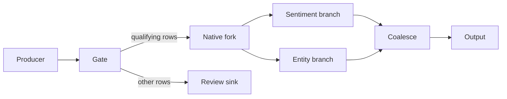

# Distinct runtime fork node: design and implementation workplan

Date: 2026-11-05. Status: proposed; implementation is not authorized by this document.

This workplan explores adding a genuine runtime `fork` node while continuing to
support existing gate-based forks. The authorized deliverable is this document.
No production implementation, migration, deployment, or release assignment is
part of this planning task. The user's review instruction explicitly removes
backward-compatibility requirements for this feature. Gate-based forks remain
a supported feature; that does not require preserving old serialized bytes,
hashes, API aliases, saved-graph acceptance, or cross-version resume.

The source baseline inspected is commit
`e5a743f23caeaf9f77b6503ece1ef3ba2d948295` on
`release/0.8.10-assembly`. That is an investigation baseline, not the proposed
landing branch or target release. The shared checkout contained ongoing
Continuation edits at review start; another session committed them during
review, advancing HEAD to `8855dab18ed3967b76db137602619a852826776e`.
Section 10 records the qualification. Rebind the baseline and use an isolated
worktree before implementation. Confirm the integration branch and release then.

## 1. Outcome and scope

Add an unconditional, executable fork with its own settings type, graph node
type, executor dispatch, audit identity, and Composer representation. Both
native forks and gate-based forks must use the existing child-token, lineage,
join, loss-accounting, and recovery mechanisms.

Completion means:

- YAML, programmatic configuration, and Composer can author a native fork.
- An arriving parent creates one child per declared branch and receives the
  existing `(transient, fork_parent)` terminal outcome. Each child carries its
  own FORK lineage frame and follows its declared destination.
- The execution graph and Landscape record `node_type: fork`. Execution does
  not construct a synthetic `GateSettings` or evaluate a constant condition.
- Gate-based unconditional and conditional fan-out remains supported alongside
  native forks, with truthful gate-specific audit evidence. Historical node
  identities and serialized contracts need not be preserved.
- A pipeline may contain both kinds, including nested mixed-kind regions.
- Current-version configuration, topology, and Composer identities are
  deterministic and agree across validation, execution, join, and recovery.
  Historical identities may differ; historical records are never rewritten.
- Existing topology refusals, lease fencing, settlement rules, and supported
  resume boundaries continue to hold for both origin kinds.

Non-goals: removing or deprecating gate forks; automatically converting saved
graphs; changing join policies; adding dynamic branch selection; fan-in without
the existing queue/barrier contracts; redesigning token persistence; general
runtime dispatch cleanup; or making a performance claim.

## 2. Current implementation and evidence

Paths below link to the inspected source. Proposed new symbols later in the
document are explicitly identified as proposals.

| Concern | Current behavior and source |
| --- | --- |
| Configuration | [GateSettings](../../../src/elspeth/core/config.py) carries `condition`, `routes`, and optional `fork_to`. Boolean conditions require both `true` and `false` labels, including constant `True`. `ElspethSettings` has no native `forks` collection. |
| Persisted node vocabulary | [NodeType](../../../src/elspeth/contracts/enums.py) has `GATE`, but no `FORK`. |
| Graph construction | [builder.py](../../../src/elspeth/core/dag/builder.py) builds `config_gate` identities and `_GateEntry` records, owns branch resolution and closure checks, and constructs group bindings from gate rosters. |
| Branch representation | [models.py](../../../src/elspeth/core/dag/models.py) includes `BranchInfo.gate_node_id`, `_GateEntry`, and gate-oriented coalesce branch plans. [graph.py](../../../src/elspeth/core/dag/graph.py) exposes separate gate and branch maps and resolves nested branch endpoints. |
| Execution | [GateExecutor](../../../src/elspeth/engine/executors/gate.py) evaluates a condition, resolves a route, calls `TokenManager.fork_token`, records routing, and completes a guarded node state. |
| Traversal | [token_traversal.py](../../../src/elspeth/engine/token_traversal.py) dispatches nominally between `GateSettings` and transforms. Gate fork handling schedules children and returns the parent's fork outcome. |
| Scheduling | [dag_navigator.py](../../../src/elspeth/engine/dag_navigator.py) and [work_items.py](../../../src/elspeth/engine/work_items.py) recognize gate-origin continuation cursors. The navigator's current gate-membership set includes configured gates; it is not an independent branch-roster registry. |
| Atomic fork primitive | [TokenManager](../../../src/elspeth/engine/tokens.py) isolates child row data. [data_flow/tokens.py](../../../src/elspeth/core/landscape/data_flow/tokens.py) fences the parent claim and atomically writes children, parentage/lineage, the group record, and the parent outcome. Its replay reconciliation checks the persisted fork. |
| Audit registration | [landscape_registration.py](../../../src/elspeth/engine/orchestrator/landscape_registration.py) explicitly classifies engine-owned nodes; an unrecognized non-plugin node otherwise fails metadata resolution. |
| Recovery and admission | [resume.py](../../../src/elspeth/engine/orchestrator/resume.py), [follower.py](../../../src/elspeth/engine/orchestrator/follower.py), and [implementation_compatibility.py](../../../src/elspeth/engine/orchestrator/implementation_compatibility.py) rebuild traversal and compare graph/implementation evidence. [checkpoint/recovery.py](../../../src/elspeth/core/checkpoint/recovery.py) derives branch recovery facts from group bindings. |
| Schema and field proofs | [schema_validation.py](../../../src/elspeth/core/dag/schema_validation.py) and [guarantees.py](../../../src/elspeth/core/dag/guarantees.py) recurse through gates for unchanged schema, field presence, and value/type provenance. Gate-condition checks are separate from those transparency rules. |
| Composer | [state.py](../../../src/elspeth/web/composer/state.py), [yaml_generator.py](../../../src/elspeth/web/composer/yaml_generator.py), [yaml_importer.py](../../../src/elspeth/web/composer/yaml_importer.py), and [transforms.py](../../../src/elspeth/web/composer/tools/transforms.py) have closed node vocabularies and gate-based fork handling. |
| Frontend | [GraphView.tsx](../../../src/elspeth/web/frontend/src/components/inspector/GraphView.tsx) registers gate fork outputs from `routes` and `fork_to`; [types/index.ts](../../../src/elspeth/web/frontend/src/types/index.ts) carries the closed node vocabulary. |
| Configuration identity | `resolve_config()` in [core/config.py](../../../src/elspeth/core/config.py) serializes defaults with `model_dump(mode="json")`. [compute_full_topology_hash](../../../src/elspeth/core/canonical.py) includes node IDs, node types, plugin names, config hashes, and edges. |
| Stored vocabulary compatibility | [schema.py](../../../src/elspeth/core/landscape/schema.py) stores `nodes.node_type` as `String(32)`; [model_loaders.py](../../../src/elspeth/core/landscape/model_loaders.py) converts it with `NodeType(row.node_type)`. Physical storage and reader compatibility are different questions. |

The historical rationale for child tokens is in
[ADR-002](../adr/002-routing-copy-mode-limitation.md): each token must have one
terminal outcome. It does not require a gate container.
[ADR-005](../adr/005-adr-declarative-dag-wiring.md) retained gate-based forks
when explicit connection wiring was introduced. Neither requires changing old
forks to add a native node.

## 3. Proposed public contract

### 3.1 YAML and settings

Introduce `ForkSettings` in `core/config.py`, independent of `GateSettings`,
and an optional `ElspethSettings.forks` collection.

```yaml
forks:
  - name: parallel_analysis
    input: enriched
    fork_to:
      - sentiment_path
      - entity_path
```

The fragment is a proposed node declaration, not a complete runnable pipeline.
Its source/producer must publish `enriched`, and every branch must have a legal
consumer, sink, or correlated barrier destination.

| Field | Proposed contract |
| --- | --- |
| `name` | Required; existing node-name rules and global cross-kind uniqueness. The reserved keyword `fork` remains reserved as a name. |
| `input` | Required named connection; resolved by the same producer/consumer rules used for gates. No implicit list-order input or implicit fan-in. |
| `fork_to` | Required ordered sequence of 1–32 unique, valid branch labels. Freeze it in `ForkSettings`, preferably as a tuple; serialize it as a JSON/YAML array. |

Allow a one-branch native fork because the existing token primitive supports
one branch and still creates a new lineage member and a fork-parent outcome.
Reject zero branches; do not reinterpret an empty fork as pass-through or drop.
This makes the new node's cardinality match the existing fork primitive rather
than silently introducing a new two-branch minimum.

Reject unknown fields. Native forks have no `plugin`, `condition`, `routes`,
`on_success`, or `on_error`. There is no per-row expression to fail, so an
infrastructure, coordination, or audit failure propagates through the existing
run failure/recovery path rather than being routed as row data.

Proposed resource limit: bound the native collection at 100, matching the
existing per-kind gate collection bound. Mirror that bound in Composer.
There is no measured basis here for a new combined gate-plus-fork limit:
`ElspethSettings` independently caps other structural collections too. Do not
introduce an aggregate routing budget as an incidental part of this feature.

Existing gate declarations remain valid and keep their original meaning:

```yaml
gates:
  - name: conditional_analysis
    input: enriched
    condition: "row['needs_analysis']"
    routes:
      "true": fork
      "false": review
    fork_to: [sentiment_path, entity_path]
```

The `condition` is illustrative; authors should use expressions appropriate to
their row schema. No new validator must alter existing gate admission behavior.

### 3.2 Conditional entry and coexistence

A native fork always fans out when a token arrives. A gate can route qualifying
rows to its input connection. That produces a real gate followed by a real fork.
The existing single-node conditional gate fork remains equally supported.



Keep gate-to-native-fork conversion an explicit author edit. Adding the extra
node changes the topology and audit sequence even when final row payloads are
equivalent. It is never an automatic optimization or resume-time substitution.

### 3.3 Composer representation

Add `node_type: "fork"` to `NodeSpec`, tool schemas, and frontend contracts.
Reuse the existing `input` and `fork_to` fields; do not add a second spelling for
branches. Validate fork-specific field admissibility at all authoring entries,
including upsert, set-pipeline, patch, and YAML import.

Native fork YAML import/export preserves its node kind. Legacy gate YAML
import/export preserves its gate kind, condition, routes, and branch order.
Current-version save/reload must preserve meaning and stable content identity.
Older saved graphs need not load; refuse incompatible records explicitly and
leave their stored bytes untouched rather than silently converting them.

Planner guidance prefers a native fork for a newly requested unconditional
split. The planner still chooses the topology and destinations. Guidance must
preserve existing gate placement, conditional behavior, branch membership, and
sibling concurrency during edits. No tutorial-specific path or provider bypass
is introduced. An unconditional fork must not trigger the existing review term
for a planner-authored gate condition; ordinary gate conditions keep that rule.

## 4. Internal architecture

### 4.1 Shared fork-origin metadata, distinct nodes

Add `NodeType.FORK = "fork"`. Construct native identities with a distinct
`config_fork` prefix, `plugin_name: config_fork:<name>`, and an immutable ordered
branch config. Reuse the existing node-ID derivation function and length/name
validation. Do not place native nodes in `get_config_gate_id_map()`.

Proposed additions:

- A `ForkName` nominal identifier alongside existing name types, if a named
  native ID map is needed by the graph API.
- A native fork ID map with accessors, and a `forks` sequence in `PipelineConfig`.
- An internal frozen `ForkOrigin` record carrying opener node ID, authored name,
  node kind, and ordered branch roster. Derive it once from gate fork entries
  and native fork entries; use its node ID as the canonical ownership key.

Gate route handling stays gate-specific. The shared registry drives branch
ownership, destination resolution, nested-region walks, group binding,
continuation cursors, and fork-aware warnings. Ordinary non-fork gates never
become fork origins merely because they are gates.

Generalize the gate-named branch metadata needed by these consumers to
`opener_node_id`, updating callers directly without compatibility aliases.
Keep one stored owner identity, not parallel fields that can diverge. Gate-only
getters may remain where they answer a genuinely gate-only question; shared
origin getters must use neutral names. Do not perform unrelated naming cleanup.

### 4.2 Graph invariants

Use one branch resolution path for both origin kinds. Extend it to recognize
native forks as legal consumers and nested origins without loosening the other
consumer restrictions.

Preserve:

- Global branch-label uniqueness across both origin kinds, including collisions
  between a native fork and a gate fork.
- Explicit destinations; no fallback to a similarly named sink or next node.
- The existing COPY/MOVE edge encoding for each destination shape. Some
  consumer-fed unbound branch edges currently use MOVE; do not blanket-convert
  every fork outgoing edge to COPY.
- The current distinction between fully unbound fan-out and a fork roster
  bound to exactly one supported closer. Keep all existing mixed-closure and
  cross-origin join refusals.
- Region containment, nesting depth, forbidden entry/escape paths, and existing
  restrictions around aggregation, expansion scopes, and row-union nesting.
- Branch order for child creation, replay reconciliation, and row-union release.

Native forks have no route-label resolution entries. Keep gate route-completeness
validation gate-only. Add an explicit native-fork completeness check against
the shared roster and actual destination edges, with a mutation control that
removes a required branch edge.

Schema, required-field, extras, value-source, and field-type proofs must treat a
native fork as an unchanged-row routing node. Recurse through its producers as
the gate transparency rules do. Do not extend gate-condition evaluation or
invent transform declaration flags to achieve that result. Both runtime and
Composer must propagate these proofs through mixed gate/fork/queue chains.

### 4.3 Runtime dispatch and executor

Introduce `ForkExecutor` and a small frozen `ForkOutcome` for the native path.
`ForkOutcome` should contain the existing fork routing action and ordered child
tokens, without sink, condition, discard, or gate-result fields. The current
`GateOutcome` contract stays intact.

Extract only the shared fork action from `GateExecutor` into a focused helper:
create the existing routing action, call `TokenManager.fork_token`, and record
the origin's routing edges. Both executors use it. Retain truthful gate-condition
and selected-route evidence and audit-before-telemetry ordering; result and
context layouts may change with their in-tree consumers. For one-branch
forks, preserve the existing routing recorder behavior as well as the bulk path
used for multiple branches; do not silently move a lease-fencing boundary.

`ForkExecutor` performs:

1. Validate/obtain the existing worker-membership and scheduler-claim authority.
2. Start a fork span and `NodeStateGuard`, using a new closed failure phase
   `fork_execution` with corresponding vocabulary tests.
3. Record the parent input and hash; invoke the common fork action.
4. Complete the node state with identical input/output data hashes and typed
   fork context. Do not fabricate a condition evaluation or `GateResult`.
5. Return the children and fork action to traversal; emit best-effort telemetry
   only after the relevant durable audit calls succeed.

Widen the execution-target union to include `ForkSettings`, then use explicit
nominal dispatch for gate, fork, and transform. A native fork must never fall
through the current negative `not GateSettings => transform` assumption, nor
be classified as an inert structural node and skipped. No structural Protocol
probing or `getattr`-based dispatch.

Extract common child scheduling from the gate fork handler into an origin-neutral
routine. Keep its direct-sink, unbound-consumer, coalesce, row-union, and nested
continuation behavior. Supply the origin identity explicitly. Update
`DAGTraversalContext`, navigator predicates, work-item factory, and processor
initialization together. Keep genuinely gate-only query behavior; new shared
behavior uses a clearly named fork-origin query.

Audit every other consumer of that widened union. In particular,
`DAGNavigator.resolve_jump_target_sink()` currently assumes a non-gate target
has `on_success`; a gate routing into a native fork must instead recognize a
self-routing frontier and return no single static sink. The aggregation intake
path in [barrier_coordination.py](../../../src/elspeth/engine/barrier_coordination.py)
and committed-output reconstruction in
[processor.py](../../../src/elspeth/engine/processor.py) also exclude only
`GateSettings` before treating a target as a transform. Extend those nominal
refusals to native forks so malformed routing authority fails as an owned
invariant error, rather than accessing nonexistent transform attributes.

Wire this through fresh leader execution, resume, and follower initialization.
The graph and runtime config must account for every executable native node;
omitting its runtime settings is an invariant failure, not a default pass-through.

### 4.4 Persistence, audit, and observability

Reuse the existing token and group representations without a new lineage kind,
terminal path, barrier protocol, or scheduler journal format. A native fork and
a gate fork both open a `FrameKind.FORK` group.

The existing token primitive's transaction covers children, lineage/parentage,
group record, and parent outcome. Routing events and guarded node completion
are separate calls today. Do not claim the whole executor is one transaction
or change that boundary in this feature. Prove recovery across those boundaries.

Classify native forks as engine-owned audit nodes in metadata resolution for
both initial registration and implementation compatibility checks. Reuse the
current engine metadata convention rather than registering a fake plugin or
adding a plugin catalog entry.

Add a typed `ForkExecutionContext` containing the declared ordered branch roster
and a categorical native-fork routing reason. Store no synthetic condition,
gate result, or row-value preview. Gate forks continue to record their evaluated
condition and selected route; historical context/reason bytes are not a contract.

Add an additive `ForkExecuted` row-level telemetry event and fork span. Route it
through telemetry filtering, public event exports, generic exporters, frontend
progress observers, and their vocabulary tests as applicable. Preserve
`GateEvaluated` for legacy gate forks. Reuse existing run counters and fork-parent
outcome derivation; telemetry delivery is not the authoritative count.

The fork span also requires an additive `EngineSpanName.FORK` and allowed
attribute entry in [events.py](../../../src/elspeth/contracts/events.py); adding
only an OpenTelemetry span method leaves the closed engine-event contract
incomplete. Include the terminal lineage reader:
[tui/lineage_view.py](../../../src/elspeth/tui/lineage_view.py) directly indexes a
node-kind label table and needs a Fork label before native records are readable
through that surface.

## 5. Current-version integrity, recovery, and unsupported versions

### 5.1 Supported boundary matrix

| Boundary | Required behavior |
| --- | --- |
| Current YAML and programmatic callers | Gate-only, native-only, and mixed configurations work through current APIs. Update in-tree callers directly; old positional APIs need not be supported. |
| Resolved settings and graph identities | Use ordinary deterministic serialization, including an empty `forks` field if that is the model default. No omission shim or old-hash fixture is required. Current-run recorded and reconstructed identities must agree. |
| Composer records | Current-version save/reload and import/export retain node kind and semantics. Old saved-graph acceptance and old content hashes are not requirements. Reject unsupported records without rewriting them. |
| Existing gate behavior | Both conditional and unconditional forks retain their current validators, child semantics, reasons, telemetry, and supported refusal boundaries. |
| New native graph | Has a distinct native node identity and type, even if payload outputs match an equivalent gate graph. |
| Resume after conversion | Refuse a changed topology. Converting a gate to a native fork starts a new configuration/run; it does not reinterpret an existing run. |
| Resume and follower admission | Preserve config, topology, source-lifecycle, group-satisfiability, implementation-evidence and fencing checks within the supported current implementation. Cross-version resume and mixed-version workers are unsupported. Never rewrite the recorded baseline to make admission pass. |
| Old software and exports | No old-reader, old-client, old-verifier, or rolling mixed-version support is required. The current implementation must identify and refuse unsupported input formats; it cannot retrofit refusal behavior into old binaries. |

The follower join fingerprint is concretely
`stable_hash(resolve_config(settings))` in
[join_admission.py](../../../src/elspeth/engine/orchestrator/join_admission.py).
Characterize admission as well as hash equality: matching current-version
settings admit, while changed settings or topology refuse. Checkpoint row serialization
has its own fidelity-preserving encoder in
[checkpoint/serialization.py](../../../src/elspeth/core/checkpoint/serialization.py);
do not replace it with canonical JSON to support the new tuple-backed settings.

Keep crash recovery distinct from the product's `run_mode: replay` and `verify`.
Exercise those modes for a completed native-origin source run using the same
native topology, and preserve existing non-live admission limits and the
non-live-resume refusal in
[run_modes.py](../../../src/elspeth/engine/orchestrator/run_modes.py).
Converting a gate to a native fork does not promise cross-topology call replay.

### 5.2 Recovery and coordination scenarios

Exercise both origins at these cut points:

- Before the token transaction commits: no partial child group or parent outcome.
- After fork commit but before routing recording or node-state completion:
  reconcile the exact persisted fork, preserve original children, and recover
  through the supported scheduler path without extra children or outcomes.
- After durable fork recording but before children have runnable scheduler work:
  existing scheduling/journal recovery must finish publication or explicitly
  refuse an unsupported residual. Do not infer that token creation itself
  atomically enqueues every child.
- With a stale worker claim or evicted membership: the same fenced write
  refusals apply; the new executor must not acquire unfenced write access.
- With one branch failed, diverted, or held: keep loss settlement, barrier
  release, and final run accounting consistent across both origin kinds.
- For native-in-gate, gate-in-native, native-in-native, and mixed FORK/EXPAND
  nesting: select the nearest applicable remaining lineage frame and closer.
- Include a fork after row_union release, then replay that second fork after
  its mint transaction commits. First mint accepts a witnessed post-pop
  `parent_lineage_path`, but the existing-terminal branch in
  [tokens.py](../../../src/elspeth/core/landscape/data_flow/tokens.py#L634)
  does not pass it to `_reconcile_fork_replay`; that method loads the parent's
  durable mint path at line 722. This is a source-established asymmetry and a
  potential exact-replay refusal, not an executed reproduction. W0 must
  characterize the reachable scheduler path and establish a failing case or
  explain how recovery avoids it before W4 shares the primitive. A confirmed
  defect is a prerequisite repair, retaining witnessed-pop integrity checks.

Use actual subprocess/process-death recovery where the existing harness supports
it. Monkeypatching an exception inside a transaction is not equivalent to a
process dying after the commit. If an existing gate-based path fails a necessary
case, record the exact source-bound blocker and address it before sharing that
path; do not label the new feature complete or silently expand into a general
recovery rewrite.

### 5.3 Storage and deployment boundaries

No database DDL or data rewrite is currently proposed: `nodes.node_type` is a
string column and the existing token/group schema expresses the operation.
Verify SQLite and PostgreSQL storage constraints and all relevant read/export
contracts before confirming that conclusion for implementation. An unchanged
physical schema does not establish old-reader compatibility.

Native runs require the current implementation's workers, readers, API, and
frontend. Rolling mixed-version operation is outside scope. This is a support
boundary to document, not a deployment census or rollout task for this plan.

Inspect the current export/verify contract and update its version or vocabulary
when required to describe the new format truthfully. Current exports must
verify; unsupported formats must refuse. An old verifier implementation is not
required. Leave historical exports untouched and never weaken integrity checks.

No rollback or cross-version recovery guarantee is added. Do not infer that
old software can open a store containing native records, and never rewrite
native records as gates to make that possible. This plan authorizes no
migration, reset, deletion, or downgrade.

## 6. Ordered implementation units

Implement in a dedicated branch/worktree after authorization. Every landed
commit must preserve previously passing tests. Units are logical work packages;
combine or reorder commits where necessary to avoid landing a partial node
vocabulary that breaks whole-tree gates. Do not land a failing-first test or a
planted mutation. Run focused checks per unit and one assembled broad gate.

### W0 — Rebind baseline and characterize shared semantics

Prerequisite: confirm integration branch/release and establish a clean isolated
worktree with verified local imports and a worktree-local environment.

- Read the current [AGENTS.md](../../../AGENTS.md) and whole-tree gate sections
  of [CONTRIBUTING.md](../../../CONTRIBUTING.md). Preserve unrelated edits.
- Inspect actual callers of `ExecutionGraph.from_plugin_instances`,
  `PipelineConfig`, graph registration, follower/resume construction, schema
  proof walks, audit readers, and Composer authoring/import/export entry points.
- Characterize baseline gate graphs: no-fork, unconditional, conditional,
  one-branch, bound, unbound, nested, and invalid closure/ownership cases.
- Characterize current-run fingerprint agreement and mismatch refusal through
  actual producers. Do not freeze pre-feature hashes or serialized defaults.
- Investigate the post-row_union replay asymmetry in section 5.2 before
  extraction. The existing reclaimed-gate test uses a discard route, so it
  does not establish fork mint/publication recovery.
- Inspect current export vocabulary/refusal contracts; no mixed-version
  deployment or external old-reader qualification is required.

Exit: gate-feature characterization, disposition of the replay prerequisite,
and a current receiving-branch map. Checks: affected tests and current-version
identity/refusal cases; no broad suite yet.

### W1 — Native contracts and settings admission

Paths: `contracts/enums.py`, `contracts/types.py`, `core/config.py`,
`contracts/config/alignment.py`, `engine/orchestrator/types.py`, and associated
public exports and serializer tests.

- Add independent frozen `ForkSettings`, `NodeType.FORK`, native name type if
  needed, empty-default `forks` collections, immutability, and per-kind caps.
- Apply current name/connection validation and reject duplicate/empty/invalid
  branch labels. Preserve authored order.
- Treat `ForkSettings` as a direct settings contract in the alignment registry,
  as `GateSettings` is; do not create an unused runtime-config twin.
- Use ordinary serialization and cover `join_admission.py`'s actual follower
  fingerprint/admission path for current-version gate/native/mixed graphs.
  Preserve checkpoint row serialization fidelity, not pre-feature config bytes.
- Keep new enum/field/schema declarations synchronized with the whole-tree
  node-vocabulary and runtime-rejection gates. If those cannot be green before
  later units, retain this unit on the feature branch until assembled.

Exit: parsing/serialization and current-version admission specified in tests.
Checks: settings, contract alignment, immutable containers, fingerprint agreement,
reserved/colliding names, 0/1/32/33 branches, and per-kind collection boundaries.

### W2 — Graph construction and shared origin model

Prerequisite: W1. Paths: `core/dag/{builder,graph,models,group_bindings,
bound_regions,coalesce_warnings,row_union_warnings}.py`.

- Add native graph construction and ID maps with explicit `forks` API input.
- Produce one shared immutable origin registry from both kinds. Generalize
  only the gate-oriented branch plans, closer rosters, ownership keys, and
  endpoint/ancestry walks that native origins actually need.
- Preserve gate route maps and add native branch-completeness validation.
- Generalize the roster input to `build_group_binding_registry` and include
  native origins in `validate_openers_bound_in_region`'s opener set. Updating
  only branch edges or `BranchInfo` leaves the builder's gate-only census at
  [builder.py](../../../src/elspeth/core/dag/builder.py#L2216) incomplete and
  could admit an unbound native opener inside a bound region. Keep the
  existing `GroupBindingRegistry` as the authority for bound groups; the
  proposed origin registry describes all origins, including unbound ones,
  and must not become a second independently assembled closer registry.
- Preserve edge mode/label behavior for each destination shape and all existing
  bound/unbound, ownership, closure, nesting, and region restrictions.
- Carry actual component kind/name through diagnostics and authored rejection
  mapping; do not identify a native fork as a gate in actionable errors.

Exit: native-only and mixed graphs build or refuse at the correct boundaries.
Checks: graph construction/routing/branch tests, group bindings, bound regions,
warnings, nested endpoint walks, current topology identities, and mutation
controls for missing branch edges, duplicate ownership, and escaped regions.

### W3 — Schema, value, and declared-input proof propagation

Prerequisite: W2. Paths: `core/dag/{schema_validation,guarantees,builder}.py`,
Composer `_producer_resolver.py` and `state.py`, plus affected value-source or
required-control traversals discovered from their callers.

- Extend unchanged-row transparency to native forks for schemas, required
  fields, presence, extras, value provenance, and type propagation.
- Preserve the actual upstream declaration owner: the exclusions at
  [guarantees.py](../../../src/elspeth/core/dag/guarantees.py#L724) and line 733
  must recognize native forks, not merely copy a schema onto the new node.
  Test `declared_by` as well as inferred types. Composer already registers
  `fork_to` producers generically, but its
  [walk-back](../../../src/elspeth/web/composer/_producer_resolver.py#L383)
  stops at anything other than a gate; extend traversal without adding a
  competing producer map.
- Keep gate condition field requirements and gate route-completeness checks
  gate-only. Native forks introduce no field reads or writes.
- Register native branch connections in Composer and runtime producer tables;
  recognize native consumers where the shared topology permits them.
- Check ordered nested joins and divergent queue inputs using existing proof
  rules; do not assume all predecessors guarantee the same fields.

Exit: runtime and authoring proofs agree on native/mixed fork graphs.
Checks: fixed/observed/parse schemas, forwarded source fields, missing-field
refusals, extras restrictions, field renames/removals, and guarantee propagation
through gate/fork/queue chains. Include negative cases that would silently pass
if the new node were treated as an unknown dynamic schema.

### W4 — Executor, shared action, and traversal wiring

Prerequisites: W2–W3. Paths: proposed `engine/executors/fork.py`, focused shared
fork helper, executor types, `engine/{processor,token_traversal,dag_navigator,
work_items,barrier_coordination}.py`, and `engine/orchestrator/{types,graph_wiring,run_state,
run_context_factory,preflight,graph_registration,resume,follower}.py`.

- Add `ForkOutcome`, `ForkExecutor`, typed execution context/reason, and the
  `fork_execution` guard phase. Keep gate conditional-fork behavior; update
  result contracts and in-tree consumers together where useful.
- Extract shared mint/routing action and child scheduling without moving
  transaction or fencing boundaries. Do not duplicate `fork_token` SQL.
- Replace the two-way execution assumption with closed nominal three-way
  dispatch and a native-aware fork-origin continuation query.
- Update `resolve_jump_target_sink()` for gate-to-native-fork entry. Extend the
  non-transform refusals in aggregation intake and committed-output recovery,
  and test native settings substituted at those owned authority boundaries.
- Wire actual native settings/ID maps through initial, resumed, and follower
  execution. Freeze newly added artifact/config collections.
- Update every production graph/config assembly call, including CLI validation,
  execution and resume surfaces, Web execution preflight, and programmatic
  builders. Concrete duplicate assembly sites include `cli.py`'s fresh
  `_PipelineConfig` construction and join/follower `PipelineConfig` construction,
  `web/execution/preflight.py:build_runtime_graph`, and
  `engine/orchestrator/preflight.py:assemble_and_validate_pipeline_config`.
  `PluginBundle` should not gain a fake fork plugin.

Exit: native and gate forks run through production construction and scheduling.
Checks: gate executor regression, new native executor cases, navigator/work-item
tests, graph-wiring omission refusal, direct-sink and branch-consumer runs,
native-to-gate and gate-to-native entry, and no expression parser invocation on
the native path. Test output payloads and audit facts, not only class dispatch.

### W5 — Audit registration, telemetry, and recovery acceptance

Prerequisite: W4. Paths: `engine/orchestrator/{landscape_registration,
implementation_compatibility,graph_registration,run_status}.py`,
`contracts/{events,node_state_context}.py`, `engine/spans.py`, telemetry
filtering/exporters, audit readers/exporters, and existing checkpoint/journal
recovery integration seams.

- Register native nodes as deterministic engine nodes on fresh and recovered
  paths, using the current engine metadata convention.
- Add native context/event/span vocabularies and update real consumers; retain
  gate-specific condition/routing evidence. Include `EngineSpanName` and its allowed-attribute
  table in `contracts/events.py`. Verify fork counts from durable outcomes.
- Verify native records can be read, inspected, and exported and their exports
  validated. Include `tui/lineage_view.py`'s closed node-kind label table. Check
  envelope/vocabulary decisions from W0 against actual readers.
- Run the crash/replay/fencing matrix in section 5.2 on both origin kinds;
  include leader/follower scheduling and SQLite/PostgreSQL paths.
- Keep mismatch and corruption refusals strict. If shared recovery requires a
  prerequisite repair, isolate that defect and revise the dependency/estimate.
- Exercise native-source-run replay and verify through existing run-mode
  admission, while preserving the current non-live-resume refusal. Do not
  conflate persisted fork replay reconciliation with recorded-call replay.

Exit: durable semantics and recovery are demonstrated, including legacy cases.
Checks: implementation compatibility, audit export, parent/child outcome and
lineage assertions, real process-death cases, stale claims, divergent replay
rosters, post-commit publication, branch-loss settlement, and PostgreSQL
contention. A serial SQLite happy path does not satisfy this unit.

### W6 — Composer authoring, serialization, and UI

Prerequisites: W1–W3; execution acceptance depends on W4–W5. Paths:
`web/composer/{state,yaml_importer,yaml_generator,planner_authoring_aids}.py`,
`web/composer/tools/{transforms,schema_contract,generation}.py`, capability
guidance, Web execution diagnostics, `web/interpretation_state.py`, frontend
types, `GraphView.tsx`, inspectors, and affected API contracts.

- Add the node kind to all authoring entrances, tool schema enums and validated
  argument models, field admissibility checks, caps, lowering table, importer
  accepted sections, and runtime/authoring rejection mapping.
- Preserve current-version semantic gate round trips. Native forks
  remain native across import, export, proposal/diff, persistence, and reload.
- Render a visible Fork node, branch edges/labels, correct node details, and
  actionable errors. Display native branch destinations without condition UI.
- Update planner guidance and fork fan-out diagnostics for both kinds. Keep
  authored gate-condition reviews bound to real gates and the current reviewed
  artifact hash; inspect any required-control walks that cross forks. Changed
  content must invalidate its prior review, not preserve approval by old hash.
- Check provider wire schema fidelity, tool redaction, frontend contract
  generation, and current clients receiving the new node discriminator.

Exit: a planner-authored native fork can be proposed, reviewed through ordinary
controls, validated, executed, saved, and reloaded in the same backend used by
all sessions. No server-authored topology or tutorial exception.
Checks: tool entry parity, rejected-edit state preservation, import/export and
content hashes, topology rendering/inspector behavior, focused browser journey,
and provider-call boundary controls for any touched authoring entry paths.

### W7 — Assemble, document, review, and integrate

Prerequisites: W1–W6 complete. Use one assembled candidate, not separate broad
suites for each unit.

- Add ordinary configuration/Composer reference material and a runnable native
  fork example alongside existing gate-fork examples. State the compatibility
  and rollback boundaries explicitly. Confirm the target release before editing
  release notes. Do not rewrite historical accepted ADR examples in this task.
- Extend the scenario corpus through its actual loader/manifest contracts for
  native-only and mixed kinds; add real behavior to the node-kind coverage
  witness rather than mechanically adding an enum to a set.
- Reconcile runtime-rejection dispositions using the existing generator and
  review each new binding. Do not hand-edit keys or raise coverage ceilings to
  hide an unauthored rule. Run the other whole-tree gates whose inputs changed.
- Independently review the assembled diff, concentrating on dispatch fallthrough,
  skipped nodes, ownership/closure widening, shared transaction boundaries,
  gate-feature regressions, current identity drift, and unsupported-input refusal.
- Run the gates below with established host capacity. Inspect terminal receipts
  and source freeze before treating the result as integration evidence.
- Integrate to the confirmed parent only when safe and reverify the receiving
  SHA and applicable checks. Feature completion is not deployment or release
  qualification; do not claim either from a local gate.

## 7. Acceptance matrix and test locations

Existing files are starting points, not claims that they already cover native
forks. Proposed test modules should be added beside them where no suitable
cohort exists. Use fixture factories and the production plugin/graph builders.

| Acceptance | Required observation | Starting tests |
| --- | --- | --- |
| Current identity and gate support | Gate forks still execute; current resolved config, topology, and Composer identities are deterministic across entry paths. A gate-to-fork edit changes identity and refuses same-run resume. No pre-feature hash equality required. | `tests/unit/core/test_config.py`, `tests/unit/core/test_dag_construction.py`, `tests/unit/core/checkpoint/test_compatibility.py`, `tests/unit/web/composer/test_state_serialisation_contract.py` |
| Native declaration | Empty native list is valid; ordered branches load; zero/duplicate/invalid labels, inappropriate gate fields, cross-kind names, and over-cap collections refuse. | `tests/unit/core/test_config.py`, new adjacent native-fork settings tests, `tests/unit/web/composer/test_gate_fork_guidance.py` |
| Native execution | Stored node is `fork`; no expression evaluation; exact branch children, isolated nested row data, unchanged schema contract, one parent outcome, correct sink results and run counters. | `tests/unit/engine/test_gate_executor.py`, proposed `tests/unit/engine/test_fork_executor.py`, new production-path integration cases |
| Ownership and closure | Cross-kind duplicate branch owners, unrelated fork rosters at one closer, missing destinations/edges, and region escapes refuse; supported identity and transformed branches build. | `tests/unit/core/test_dag_branch_transforms.py`, `tests/unit/core/dag/test_group_bindings.py`, `tests/unit/core/dag/test_bound_regions.py`, `tests/unit/core/test_dag_row_union.py` |
| Schema/value propagation | Guaranteed source/forwarded fields remain available through native forks; missing or removed fields still refuse; fixed/observed and queue distinctions remain sound. | `tests/unit/core/test_dag_schema_propagation.py`, `tests/unit/core/test_dag_gate_guarantee_propagation.py`, `tests/unit/core/test_dag_row_union_guarantee_propagation.py`, `tests/unit/web/composer/test_state_pass_through.py` |
| Mixed nesting | Gate-in-native, native-in-gate, native-in-native and sequential mixed regions produce expected merged rows and settle every group. Include outer fork → expansion scope → inner fork/coalesce → collector → outer coalesce, preserving all existing refusals. | `tests/integration/core/dag/test_nested_fork_coalesce.py`, `tests/integration/pipeline/test_gate_in_collector_scope.py`, new adjacent mixed FORK/EXPAND case |
| Recovery and fencing | Transaction rollback, exact replay, process death after commit, child publication recovery, stale claim refusal, follower/releader paths, and corrupted roster refusal are demonstrated. | `tests/unit/engine/test_gate_claim_recovery.py`, `tests/unit/core/checkpoint/test_recovery.py`, `tests/integration/core/dag/test_dag_recovery_partial_terminal.py`, `tests/testcontainer/core/test_barrier_recovery_postgres.py`, `tests/testcontainer/core/test_scheduler_lease_eviction_postgres.py` |
| Audit/readers | Native node metadata, context and COPY/MOVE evidence are truthful; legacy gate evidence unchanged; export verification and implementation admission work; old-reader incompatibility is explicit. | `tests/unit/engine/orchestrator/test_implementation_compatibility.py`, `tests/unit/contracts/test_node_state_context.py`, `tests/integration/audit/test_export.py`, relevant PostgreSQL export cohorts |
| Composer parity | Every authoring entry admits/refuses consistently, current round trips preserve kind, rejected edits preserve state, hashes bind current content, UI shows the real topology. | `tests/unit/web/composer/test_composer_tool_contract.py`, `tests/unit/web/composer/test_semantic_edge_contract_parity.py`, serializer/import/export cohorts, `GraphView.test.tsx`, `tests/e2e/yaml-export-roundtrip.spec.ts` under the frontend |
| Negative controls | Removing a branch edge, omitting runtime settings, weakening origin ownership, treating a fork as inert/dynamic, or omitting native lowering makes the applicable checks fail. | Targeted unit/integration tests and `tests/unit/architecture/test_dag_scenario_corpus_node_types.py`; mutations are temporary and never landed. |

For equivalent native/gate examples, compare payload outputs and selected durable
semantic facts. Do not assert audit byte identity between different node kinds.
Random token/group IDs and timestamps require narrow, explicit normalization;
preserve lineage shape, ordering, outcomes, and ownership in the comparison.

## 8. Validation and execution discipline

Planning validation is limited to source review, document consistency, and local
link/path checks. No runtime result is claimed by this workplan.

During implementation:

1. Run affected/enclosing tests per unit, including meaningful negative controls.
   Use `-n 0` for single cases. Write logs to a unique project-local lane path
   and read actual process exit codes. Establish baseline counterexamples before
   assigning an existing flaky recovery failure to this feature.
2. Run ruff, mypy, configuration contracts, and the relevant whole-tree gates:
   runtime-rejection parity, dynamic attributes/masquerade, wire shape/fidelity,
   node-kind and lowering coverage, context/event vocabularies, scenario corpus,
   redaction, and frontend API contracts. Select gates from actual changed inputs.
3. Compare keyless trust-tier finding sets at base and tip. Signing is suspended;
   no signature operation, HMAC key, or fingerprint-baseline regeneration is
   part of this work. The keyless set diff is not signature clearance.
4. Run frontend typecheck, lint, focused Vitest cases, build, and the applicable
   existing Playwright journey with its real prerequisites. Read scripts from
   `web/frontend/package.json`; do not invent unavailable npm tasks.
5. Because this touches shared graph/runtime behavior, run the full default
   Python suite at the integration checkpoint. Because it adds persisted node
   vocabulary and recovery/coordination paths, also run serial PostgreSQL
   testcontainer acceptance; the default suite excludes it.

Use the canonical full-suite launcher with the selected stages, an established
worker allocation, and a unique log directory. Prefer one assembled run covering
ruff, mypy, contracts, pytest, and serial testcontainer. Follow the current script
for keyless lint handling rather than interpreting the standing corpus as zero.
Require passing launcher, supervisor, driver, and stage receipts, complete cleanup,
and `summary.txt` showing a frozen tree. A detached launch or `.done` alone is
not a passing result. No broad suite is needed merely to publish this plan.

If new settings/tool arguments change redaction or wire inventories, regenerate
only with the documented tool and review the generated diff; confirm whether
the sensitive path count should change. Do not weaken gates, add suppressions,
or globally regenerate evidence to accommodate the new enum.

## 9. Effort, dependencies, and decisions

No measured delivery estimate is available. The earlier **9–16 human engineering
workdays** is retained only as a provisional budgeting hypothesis, not a
source-validated commitment. Removing compatibility shims removes work, while
the post-pop replay prerequisite may add work; neither supports a quantified
adjustment without characterization. The range excludes external CI queues,
operator rollout, and any confirmed prerequisite repair. Re-estimate after W0.

| Work | Approximate effort | Main uncertainty |
| --- | --- | --- |
| W0–W1: characterization and contracts | 1–2 days | Post-pop replay disposition and current identity agreement |
| W2–W3: graph and proof propagation | 2–4 days | Gate-named ownership/closure metadata and proof walks |
| W4: runtime and all execution entries | 2–3 days | Fresh/resume/follower wiring and continuation cursors |
| W5: audit, process death, PostgreSQL | 2–4 days | Existing crash/publication behavior and read/export contracts |
| W6–W7: Composer/UI and assembly | 2–3 days | Authoring-entry parity, saved graphs, and whole-tree gates |

The replay prerequisite and graph/origin contract are on the critical path.
Composer/UI work can proceed after the contract is stable, but shared files
need one owner. This review's runtime test parallelism ceiling is **0**: no
tests run during planning. Any implementation-phase allocation must be
established anew; it is not authorized by this document. Re-estimate after W0
and after the first native production-path run.

Proposed design defaults are the `forks`/`fork_to` spelling, unconditional native
semantics, 1–32 ordered branches, a native collection cap of 100,
distinct persisted node identity, and unchanged legacy gate support. They are
reviewable choices in this proposal, not existing product guarantees.

Before implementation, obtain implementation authorization and confirm the
receiving branch/release. W0 must resolve the concrete replay prerequisite and
current export-format contract. Old-reader deployment qualification is not a
blocker. No uncertainty justifies rewriting records or bypassing refusal checks.

## 10. Plan review and current limits

The source inspection followed settings admission, graph construction and
ownership, schema/field proof propagation, gate execution, fork token persistence,
runtime wiring, initial/resume/follower assembly, audit registration and readers,
and Composer import/export/tool/UI vocabulary. Relevant existing test bodies
were read, including gate-fork authoring and nested fork/coalesce behavior.

This is an implementation proposal, not an exhaustive census of every enum
consumer or an executed compatibility proof. W0 explicitly closes the remaining
caller and reader inventory. No source/test changes, provider calls, databases,
scenario-corpus regeneration, signing, or application test runs were performed
to create the plan. No live deployment or external export consumer was inspected.

An independent source review checked the proposed settings/hash boundary,
canonical topology identity, follower admission, node-kind dispatch, fork mint
and routing transactions, graph/region rules, Composer field contracts, and
closed telemetry/lineage-reader vocabularies. It identified and incorporated:

- Additional consumers of the widened execution union: jump-target sink
  resolution, aggregation intake, and committed-output recovery (section 4.3,
  W4). These must not read transform-only fields from native fork settings.
- Concrete fingerprint and construction entries: follower join admission,
  CLI fresh/follower configurations, Web runtime graph construction, and shared
  orchestrator assembly (section 5.1, W1/W4).
- The closed engine-span enum/attribute table and terminal lineage labels
  (section 4.4, W5), plus an explicit distinction between process recovery,
  persisted fork reconciliation, and product replay/verify admission.

The earlier review's conditions are superseded by the Astra review below.

### Astra review — findings, dispositions, and limits (2026-11-05)

**Verdict: ready with conditions for implementation planning; implementation
remains unauthorized.** W0 has a concrete recovery prerequisite to resolve
before the shared fork action is extracted. This is not a demonstrated runtime
failure or a claim that the proposed implementation already works.

Baseline: `git rev-parse HEAD` returned
`e5a743f23caeaf9f77b6503ece1ef3ba2d948295` at review start and an interim recheck. The live
checkout was materially dirty: Continuation production/test changes and two
release documents were modified, with new Continuation files; during review
those unrelated changes became staged and were committed by another session.
Final `git rev-parse HEAD` returned
`8855dab18ed3967b76db137602619a852826776e`; final `git status --short` showed only
`?? docs/architecture/design-notes/distinct-runtime-fork-workplan.md`.
A direct diff from the start baseline over the inspected DAG tree, fork token
repository, engine token manager, row_union executor, node enum, and Composer
state returned no changes. This is bounded source continuity, not a frozen
whole-tree review. The reviewer changed only this document and staged nothing.

| Finding | Source and consequence | Disposition |
| --- | --- | --- |
| Unnecessary backward-compatibility work | [resolve_config](../../../src/elspeth/core/config.py#L3274) and [follower admission](../../../src/elspeth/engine/orchestrator/join_admission.py#L118) require identity agreement for a run, not preservation of a previous release's bytes. | Removed empty-field omission shims, old hash fixtures, aliases, saved-graph acceptance, old verifier support, and mixed-version qualification from scope and acceptance. Kept gate functionality, current-run consistency, and explicit refusal without historical rewrites. |
| Post-pop exact replay asymmetry | [first mint and replay dispatch](../../../src/elspeth/core/landscape/data_flow/tokens.py#L634), [replay comparison](../../../src/elspeth/core/landscape/data_flow/tokens.py#L721), and [witnessed-pop validation](../../../src/elspeth/core/landscape/data_flow/tokens.py#L276) use different parent-path inputs. | Added section 5.2/W0 prerequisite for a second fork after row_union release, including post-commit recovery. Characterize production reachability; repair a confirmed defect before reuse. Do not weaken the lineage witness or rewrite mint frames. |
| Existing recovery tests do not establish this case | [reclaimed gate](../../../tests/unit/engine/test_gate_claim_recovery.py#L20) uses discard; [released union process-death test](../../../tests/e2e/recovery/test_row_union_released_token_resume.py#L191) exercises journal-restored paths and sink recovery, not a second fork's exact replay. | Retain these useful starting points and add the missing behavior explicitly; passing them alone cannot qualify native-fork recovery. No tests executed in this review. |
| Partial origin generalization would miss a safety gate | [builder opener census](../../../src/elspeth/core/dag/builder.py#L2216) uses configured gates; [binding input](../../../src/elspeth/core/dag/group_bindings.py#L217) is gate-name keyed although `GroupBinding` already has neutral opener fields. Existing [mixed-closure test](../../../tests/unit/core/dag/test_group_bindings.py#L359) asserts refusal. | W2 now names both consumers and requires native unbound-opener rejection inside a region. Reuse the binding authority rather than rebuilding parallel closer maps. |
| Schema copying alone can falsify provenance | [type declaration ownership](../../../src/elspeth/core/dag/guarantees.py#L724) and [Composer walk-back](../../../src/elspeth/web/composer/_producer_resolver.py#L383) are gate-specific. | W3 now requires upstream `declared_by` assertions and the shared walk-back update, in addition to schema/field tests. |
| Aggregate cap and effort precision lacked evidence | [settings collections](../../../src/elspeth/core/config.py#L2124) impose a gate cap and separate structural collection caps; source inspection supplies no shared gate/fork capacity measurement. | Replaced combined cap with a proposed per-kind cap; marked the effort range provisional and dependent on W0. |

The previous review's production-entry, widened-union, audit-metadata, span,
and TUI findings remain in W4–W6. Source checks confirmed concrete CLI/Web
assembly calls, traversal's inert-node hazard, engine metadata refusal, and
closed span/lineage vocabularies; these are implementation dependencies, not
backward-compatibility work. Gate event/context semantics remain meaningful
current functionality, while native events must describe a fork truthfully.

Limits: bounded manual source/test-body review and document editing only;
no implementation, application/provider calls, database access, test runs,
generated inventories, Git mutations, staging, or commits. No exhaustive
consumer census, live export-consumer review, runtime reproduction, integration,
or release qualification is claimed. Remaining implementation conditions are
authorization and branch/release selection, the W0 replay disposition, and
current-format admission/export decisions. Old readers and cross-version
resume are explicitly outside scope.
