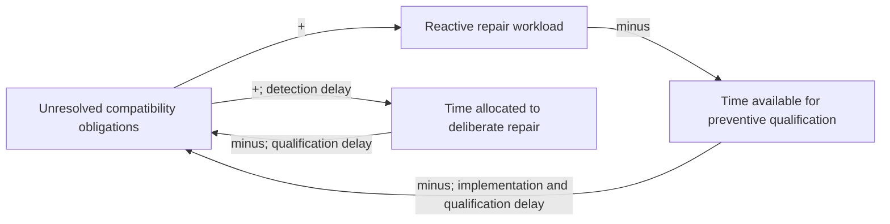

# Independent Astra review: LiteLLM alternatives

Review date: 2026-10-24. Verdict: **AMEND**. Retain the direction of owning a
bounded provider contract and reusing ELSPETH's existing boundaries. Treat native
adapters as the leading hypothesis to compare, and make deployment through the
standalone gateway a separate decision. The source supports meaningful reuse;
it does not yet establish the lowest ongoing maintenance burden.

Reviewed recommendation: `docs/architecture/design-notes/litellm-alternatives-2026-10-23.md`.
Independently observed baseline:

```text
git symbolic-ref --short HEAD
main
git rev-parse HEAD
3b28d537be98234da8135c418bf185a998c18b68
sha256sum docs/architecture/design-notes/litellm-alternatives-2026-10-23.md
17e094ac41be097a15be194a040051f65a6505c691e5c1912dd4188b78d82542  docs/architecture/design-notes/litellm-alternatives-2026-10-23.md
```

Applied `using-systems-thinking`, including its recognizing-system-patterns,
causal-loop-diagramming and leverage-points-mastery references, and
`axiom-solution-architect:using-solution-architect`, including its scope and
technology restraint reference. This is an architecture and maintenance review,
not an implementation approval, security certification or release assignment.

## Material findings

### 1. Medium: separate translation ownership from gateway deployment

**Evidence.** The recommendation combines gateway extension and native adapters
in its preferred option, then specifies provider-bound gateway instances
(`docs/architecture/design-notes/litellm-alternatives-2026-10-23.md:76`,
`:126–134`). The present service creates one adapter, token manager and upstream
client (`gateway/src/elspeth_llm_gateway/core/app.py:227–248`), with one origin
and OAuth configuration (`gateway/src/elspeth_llm_gateway/core/config.py:124–139`).
Its transport obtains a bearer token for each send and can replay after a 401
(`gateway/src/elspeth_llm_gateway/core/transport.py:147–193`).

An in-process native option is independently credible: Azure already injects
`AzureOpenAI(max_retries=0)` into its audited client
(`src/elspeth/plugins/transforms/llm/providers/azure.py:328–355`); Bedrock's
replaceable adapter is below the existing audited boundary
(`src/elspeth/plugins/transforms/llm/providers/bedrock.py:181–202`); and Composer
admits custody immediately before its physical call
(`src/elspeth/web/composer/provider_gateway.py:536–569`). These facts do not prove
that replacing those adapters is trivial, but they show that adding a service
hop is not a prerequisite for replacing LiteLLM.

**Consequence.** Sending ordinary native cloud calls through new gateway
instances introduces instance lifecycle, health, credential distribution,
endpoint selection and another request/response boundary. The current gateway's
completion log describes a logical completion, while its transport may send
twice (`gateway/src/elspeth_llm_gateway/core/service.py:185–218`, `:262–288`).
Consequently, distributed attempt evidence is real new work, independent of
native message translation. Conversely, a gateway can be valuable when an agency
requires a custom invoke API, separately operated credentials, or a shared
endpoint for multiple clients. The review has no deployment requirements proving
that all requested clouds need that topology.

**Counterevidence.** The recommendation already recognizes the extra instances,
rejects a mandatory multi-cloud router, keeps Azure direct, and explicitly calls
out attempt accounting (`:126–144`, `:167–172`). Its opening includes existing
provider boundaries, so this is a needed decision distinction rather than a
contradiction of its entire design.

**Minimal amendment.** Split the preferred option into two independent choices:
ELSPETH-owned translation versus a maintained model library; and direct dispatch
versus a provider-bound gateway service. Keep the agency gateway. Prefer direct
dispatch as the initial comparison baseline for native clouds unless a named
deployment requirement justifies the additional service. If cloud credentials
must leave the ELSPETH process, evaluate that requirement explicitly before
choosing direct dispatch.

### 2. Medium: the bounded maintenance contract is still an assumption

**Evidence.** The recommendation prefers in-house work for a bounded scope
(`docs/architecture/design-notes/litellm-alternatives-2026-10-23.md:76`,
`:258–263`), but defining the route/model/feature matrix is its first future step
(`:217–219`). ELSPETH has a single maintainer (`AGENTS.md:303–308`). The current
gateway cannot carry Composer's native thinking blocks or rich usage: its
message content is `str | None`, and usage is prompt/completion/total
(`gateway/src/elspeth_llm_gateway/sdk/types.py:58–66`, `:105–131`). Composer
already preserves exact signed and redacted thinking fields
(`src/elspeth/web/composer/provider_thinking.py:22–50`, `:68–90`). Pricing and
catalog ownership are additional moving parts
(`src/elspeth/core/llm_pricing.py:414–465`,
`src/elspeth/plugins/llm/model_catalog.py:100–130`).

**Consequence.** Four provider labels do not bound the supported combinations of
model family, endpoint generation, auth mode, schema dialect, continuation state
and usage semantics. Initial adapter construction and ongoing qualification draw
on the same maintainer capacity. Selecting native adapters from reuse alone can
underprice the future compatibility work; selecting a library from provider
coverage alone can underprice ELSPETH-specific conversion and verification work.
Neither cost comparison has been measured here.

**Counterevidence.** The report rejects a general-purpose framework, restricts the
initial GCP interpretation, declines a schedule or percentage-complete claim, and
explicitly says it has not established superior safety, speed or cost
(`:10–22`, `:248–263`). Those are sound limits. Native SDKs also remove one
translation dependency and can expose provider semantics more directly. A
maintained abstraction can introduce new transformations and release churn.

**Minimal amendment.** Make the native preference explicitly provisional on a
small comparison against Pydantic AI's model layer using the same named
requirements. Separate existing-workload parity from new GCP capability. State
what will be unsupported, including whether new endpoint generations and model
families require deliberate admission. Do not make completing GCP support a
condition for removing LiteLLM from already-qualified existing routes unless
the product requirement actually demands it.

### 3. Lower priority: distinguish required semantics from characterized LiteLLM quirks

**Evidence.** The migration calls for parity and reuse of the Composer wire
matrix (`docs/architecture/design-notes/litellm-alternatives-2026-10-23.md:217–244`).
That matrix explicitly characterizes LiteLLM 1.102 behavior, including negative
cases where patterns, `oneOf`, enum nulls or strictness are transformed or lost
(`tests/unit/web/composer/test_wire_fidelity_matrix.py:1–49`).

**Consequence.** Literal equivalence to every characterized byte is the wrong
replacement oracle: restoring a required field could fail an old characterization,
while reproducing a documented loss could satisfy it. Conversely, forwarding an
unsupported field unchanged is not proof that the chosen provider accepts it.
The selection needs declared endpoint semantics as well as an accurate recorder.

**Counterevidence.** The recommendation already separates forwarding strictness
from provider enforcement (`:155–159`) and asks to reconsider the cache-counter
workaround (`:188–193`). It does not explicitly require preserving every LiteLLM
quirk.

**Minimal amendment.** Add one instruction to acceptance: classify existing
characterizations into required preserved behavior, intentional provider
translation, and LiteLLM-specific behavior to remove. Reuse the wire recorder and
negative controls; set replacement expectations from the chosen contract. This
does not require reproducing a defect for compatibility.

## What the recommendation gets right

The user's observation that the gateway already contains much of the foundation
is supported. Request validation, capability refusal, safe error vocabulary,
bounded transport and the adapter seam are reusable mechanisms. They do not
measure the fraction of the remaining cloud-provider work. In particular,
function-tool strictness is absent from `ChatFunctionDef`, although JSON response
strictness exists (`gateway/src/elspeth_llm_gateway/core/contract.py:49–56`,
`:159–174`). The report accurately distinguishes these contracts.

The direct Azure and OpenRouter paths, the Composer physical-call seam, and owned
usage/audit structures make an entire replacement tool loop unnecessary.
OpenRouter already separates wire messages from audit messages around its HTTP
send (`src/elspeth/plugins/transforms/llm/providers/openrouter.py:406–437`).
Composer requires an admitted attempt before SDK entry and terminal audit before
settlement (`src/elspeth/web/composer/provider_quota.py:222–294`). Those authority
boundaries should survive any choice of translator.

The report also correctly treats complete LiteLLM removal as broader than
inference. The locked package is still `1.102.0` (`uv.lock:2100–2102`), and a
read of the installed distribution metadata returned:

```text
.venv/lib/python3.13/site-packages/litellm-1.102.0.dist-info/METADATA
Name: litellm
Version: 1.102.0
```

Together with the user's stated lack of a recent update, this review has no new
evidence of exposure to the separately reported `1.107.0` incident. An urgent
migration is not justified by that incident context. This is not a fresh advisory
investigation or a claim about every deployed environment.

## Maintenance dynamics: explicit hypotheses

The following is a qualitative causal model, not an observed time series or a
forecast. Its boundary includes the maintainer's provider work, compatibility
qualification and gateway operations. Provider API changes and desired new
capabilities are external inputs. Other ELSPETH development competes for the same
finite capacity. No rates, costs or delay durations were measured.

The main stock is **unresolved compatibility obligations**: required behavior
that has changed or remains unqualified. Its inflows are upstream changes,
accepted new scope and discovered mismatches. Its outflows are qualified repairs
or deliberate retirement of supported scope. Removing LiteLLM changes which
upstream changes reach this stock; it does not remove the stock.



**R1, capacity erosion, is a conditional reinforcing loop.** More unresolved
obligations can create more reactive work; at fixed total capacity that leaves
less preventive time, allowing more obligations to remain. Reversing each change
gives the opposite effect, so the two negative links make a reinforcing loop.
This requires obligations to affect used routes and reactive work to displace
preventive work. It is not evidence that ELSPETH is currently in a crisis.

**B1, deliberate repair, is a balancing loop with delays.** Detecting more gaps
can increase deliberate repair allocation, which reduces the stock after
qualification. The same allocation is constrained by the maintainer's other
work. A clean initial fixture run cannot establish the strength of this loop:
server-side drift, credential refresh and rare cancellation paths may appear
later. Fewer gaps can release repair time; more effective repair can reduce gaps.
One negative link makes this loop balancing.

**Scope growth is a separate conditional reinforcing hypothesis.** A useful
multi-cloud surface can attract more requested model features; accepting those
requests expands the supported surface and can attract further use. The loop
exists only if requests become support commitments. A fixed provider count does
not stop it. Conversely, learning from shared fixtures and provider mechanisms
can reduce the effort of later repairs. The net effect is unknown.

These hypotheses identify practical interventions:

- **Scope rule:** explicitly admit supported route/model/features, rather than
  treating SDK reach as a support promise. This controls obligation inflow.
- **Feedback:** keep a small wire and usage contract corpus with rejection and
  refresh controls; use authorized live qualification for behavior fixtures
  cannot establish. This shortens detection delay without a new process system.
- **Ownership decision:** compare recurring adaptation and qualification work,
  not only implementation size. A library outsources some translation repair
  while retaining local integration checks; a self-hosted external gateway also
  retains service operations. A native route removes one dependency layer while
  retaining SDK and provider change.

None of these relationships establishes that fewer dependencies, more owned code
or an external gateway is intrinsically safer. Release risk and compatibility
maintenance are related costs, not interchangeable measurements.

## Boundaries and conditions that change the preferred option

Prompt guard, credential-content checks, provider admission, tool execution,
retry decisions and settlement remain ELSPETH authorities. A translator does not
gain permission to author pipeline structure or execute tools. Unknown usage and
unknown cost stay unknown. Preserve existing deployment identifiers and dated
Azure semantics; do not reinterpret saved responses through a newly selected
adapter. The recommendation's explicit replay and rollback limits are appropriate
(`docs/architecture/design-notes/litellm-alternatives-2026-10-23.md:228–237`).

A service boundary is also a data boundary: it receives prompts and responses,
holds upstream credentials, and may have its own logs and retries. The existing
gateway calls loaded adapter methods in the same process
(`gateway/src/elspeth_llm_gateway/core/adapter_identity.py:31–32`,
`gateway/src/elspeth_llm_gateway/core/service.py:232–247`). `InvokePlan` checks
constrain returned plans; they do not themselves isolate executable adapter code.
Separate gateway instances can narrow configured credentials, but process,
secret and egress isolation must be established if containment is a reason for
the topology. No new isolation redesign is required merely to complete this
comparison.

| Option | When it becomes preferable | Remaining cost or reversal limit |
| --- | --- | --- |
| Keep locked LiteLLM while qualifying | Current required routes work and replacement benefit or capacity is unproven | Retains dependency and existing translation workarounds; pinning does not freeze remote API behavior. |
| Direct native adapters behind owned boundaries | A deliberately small feature matrix passes with understandable local mappings, auth and attempt evidence | ELSPETH owns provider drift and catalog/pricing adaptation; avoid permanent duplicate implementations during migration. |
| Extend the existing gateway | A named custom upstream, shared-client endpoint or credential-placement requirement warrants a service | Additional instance operations and distributed attempt evidence; current agency OAuth and contract compatibility need preservation. |
| Pydantic AI model layer | The same comparison preserves required semantics with materially less local translation maintenance and controllable physical attempts | Still owns ELSPETH conversion, schema review, dependency upgrades and qualification; no new agent loop is needed. |
| Bifrost or Portkey | The desired outcome is an externally maintained translation service, and a concrete release satisfies data, deployment and attempt requirements | Self-hosting retains operations; hosted use changes the data and credential boundary. Coverage claims alone do not settle either decision. |

Current primary documentation supports Pydantic AI as a real comparator: it has
a direct request interface, native Bedrock client injection and distinct Google
Cloud provider support. Its Bedrock documentation also says a generic
`max_retries` model setting does not control boto3 retries, which reinforces the
need to observe sends rather than assume one request means one attempt.
These are documentation claims, not ELSPETH parity results.
[Direct model requests](https://pydantic.dev/docs/ai/core-concepts/direct/),
[Model.request](https://pydantic.dev/docs/ai/api/models/base/#pydantic_ai.models.Model.request),
[Bedrock client and retries](https://pydantic.dev/docs/ai/models/bedrock/),
[Google Cloud provider](https://pydantic.dev/docs/ai/models/google-cloud/).

Native cloud semantics also justify a demanding comparator. AWS documents that
signed reasoning and the prior conversation must survive subsequent Converse
requests; Google documents refresh requirements for the access token used with
its compatible endpoint. Neither is established by a successful text response.
[AWS Converse](https://docs.aws.amazon.com/bedrock/latest/userguide/conversation-inference.html),
[Google OpenAI compatibility](https://docs.cloud.google.com/vertex-ai/generative-ai/docs/start/openai).

## Small falsifiable next comparison

The next step should answer **whether ELSPETH should own the native translation
for its required contract**, before broad gateway expansion. Select one existing
OpenAI-compatible workload and one existing Bedrock tool-continuation workload
from the agreed matrix. Compare the locked behavior, a native mapping and
Pydantic AI's low-level model path using the same synthetic/captured inputs.
Select candidate versions first. This is proposed future work; none was executed
for this review.

Reuse the existing wire recorder and negative controls. Inspect the final
transmitted body and the admitted owned result, including tool IDs/arguments,
required schema fields, exact native continuation data, cache counters, absent
versus zero usage and price provenance. Exercise one forced rate-limit response
and one cancellation after dispatch to expose hidden sends and uncertain terminal
outcomes. If a gateway candidate is retained, include its 401 replay and a lost
downstream response; a gateway completion log alone is insufficient attempt
evidence. Credential-refresh behavior remains a separate mandatory route check.

For each candidate, record concrete missing fields, required local conversion
rules, additional deployment components and any SDK behavior that cannot be
controlled. Reject a candidate for the chosen contract if it loses required
opaque data, silently rewrites required schema semantics, or creates model sends
without the required admission/evidence relationship. Do not rank it by a toy
text-completion success or line count. If both native and library candidates meet
the contract, compare the remaining owned rules and upgrade qualification work;
the result may overturn the provisional native preference. If neither does,
retain the current qualified path while addressing the specific gap.

This bounded exercise cannot measure long-term maintenance rates or establish
all cloud parity. New GCP support then needs its own named model, endpoint and
auth acceptance. No latency or throughput target was supplied or measured;
production workload and acceptable gateway overhead remain unknowns to resolve
only if performance affects the topology choice.

## Review limits

Reviewed source and test definitions at the stated baseline and consequential
official documentation. Read installed LiteLLM metadata without importing it.
No tests, provider calls, candidate installations, builds, deployments or
benchmarks ran. No production/configuration/dependency files or the original
recommendation were edited. Existing unrelated dirty and untracked work was
preserved. The review file's `git check-ignore -v` produced no output (exit 1),
so it is outside ignored scratch storage.

Unknowns include the deployed route/model/feature inventory, actual credential
placement requirements, recurring maintenance capacity, candidate version
closures and live error/cancellation/refresh behavior. These unknowns qualify
the preferred option; they do not undermine the demonstrated reuse seams or
create an urgent incident-remediation requirement.
