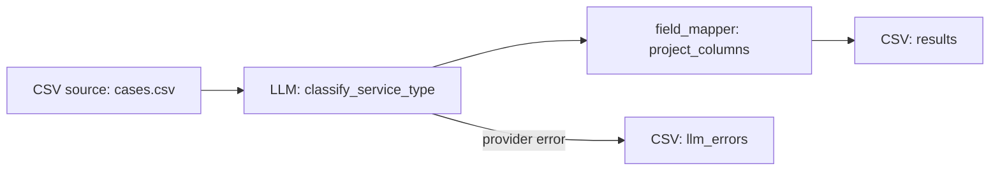

# Local Composer exercise: CSV, LLM lookup and complex reference

The real local Web Composer authored the requested pipeline on its first user request in **218.889 seconds**. The stored draft includes the complete supplied reference and all required row fields. Authoring is complete and reviewable; execution remains blocked by two human review cards. No review was approved and no pipeline was executed.

## Scope and source

- Branch: `codex/emergency-diagnostics-20261012`.
- HEAD: `fdaa670394fd311fc5df61befb1a7b1941c01182`, with the branch's uncommitted diagnostic repairs present.
- Source fingerprint before and after: `fc42d5e3a1a345fa901aa191fbaa93131d1db4bbb694c8c4dc772f8ae3e671cd`; server shutdown reported `frozen=true`.
- Session: `3cf5f035-dda4-4429-a75a-1be8b7ae7bb3`.
- Operation: `f03228a7-c62c-41d7-a392-c322f1832a43`.
- Final state: `ec6cf8ca-b6d6-441e-8388-f9d156c28a69`, version 2.
- Surface: normal authenticated loopback HTTP APIs, ordinary Composer tool loop and real OpenRouter provider. The normal intent classifier selected `compose_loop`, recording `state_is_structurally_empty=true` and `intent_is_explicit_mutation=false`.
- Dedicated auth, session, Landscape and blob stores; no shared or deployed state changed. The runner supplied natural-language intent and uploads, never pipeline structure or simulated tool/provider outcomes.

The requested LLM-specialist and systematic-debugging skills informed tool-loop evidence collection and boundary tracing. Current IDs and tool support were checked against the [official OpenRouter model catalogue](https://openrouter.ai/api/v1/models) and [tool-calling documentation](https://openrouter.ai/docs/guides/features/tool-calling).

## Reviewable inputs

All material is synthetic. The input CSV has six data rows and three fields in every record, including its header. The reference defines PCS/LH/Unknown, customer-versus-supplier supervision, precedence over category labels, current agreements superseding historical pilots, and missing/conflicting evidence handling.

| Artifact | Measured uploaded bytes | SHA-256 |
| --- | ---: | --- |
| [cases.csv](fixtures/composer-exercise-20261012/cases.csv) | 889 | `2ade5c3929dcd456e387d975b82abf5867d8982d0e89385349c69c9099428592` |
| [reference.md](fixtures/composer-exercise-20261012/reference.md) | 2130 | `f493bb9d0a0698efdf69fcad094e6620f79aa0f01b54aad97ff6addc6195e178` |

The [exact authoring request](fixtures/composer-exercise-20261012/authoring-request.txt) requires both `case_study` and `category`, the complete reference, preserved input fields, two new classification fields, a downloadable CSV and explicit provider-error routing. It explicitly forbids execution and approval on the user's behalf. [Expected classifications](fixtures/composer-exercise-20261012/expected.csv) are retained separately for future execution assessment; they were not submitted as an answer key to Composer.

## Accepted authored draft



The LLM selected a column projection between classification and output to keep exactly `case_id`, `case_study`, `category`, `service_type` and `classification_rationale`. It configured the normal `sonnet` operator profile, structured enum output for PCS/LH/Unknown, and `on_error=llm_errors`. Source and sink plugin choices, topology, prompts and options came from the real provider's `set_pipeline` call. There is no pending mutation proposal: the tool applied the draft through the normal workflow; the proposals API returned `[]`.

The complete [authored LLM options](fixtures/composer-exercise-20261012/authored-llm-options.json) are preserved for inspection. Measured checks against the stored state returned:

```text
reference_exact_text_in_system_prompt=True
negative_mutated_reference_present=False
required_input_fields=["case_id", "case_study", "category"]
row_field_refs=True
data_rows=6
csv_widths=[3, 3, 3, 3, 3, 3, 3]
```

The positive reference check uses the full original text, including its final newline. Its negative control changes the reference revision; that altered reference was absent. The row-field check confirms all three named fields appear explicitly in the Jinja template.

The provider called `get_blob_content` for both uploaded files before authoring. Durable receipts show successful, untruncated retrieval of all 2130 reference bytes. The accepted system prompt reproduces the reference verbatim, demonstrating that the authoring provider used it. Exact HTTP request bodies were not captured, so this is not a byte-level transcript of provider context or a runtime prompt-delivery proof.

## Validation and human reviews

The `set_pipeline` and `preview_pipeline` tool responses reported authoring validation success with no errors. The independent public strict validation endpoint subsequently returned:

```json
{
  "is_valid": false,
  "authoring_valid": true,
  "completion_ready": true,
  "execution_ready": false
}
```

The strict blockers are exactly the pending interpretation reviews:

| Event | Kind | Required human decision |
| --- | --- | --- |
| `6b9d360f-f5c7-42e7-b75f-1443ae18e17d` | `pipeline_decision` | Prompt-injection shield recommendation for third-party case text; no authorized shield was available in this local configuration |
| `846bdb3c-81ab-4a93-9ea8-9aa8e6fc6450` | `llm_prompt_template` | Review the complete system prompt and row template |

Both events remain `choice=pending`, `accepted_value=null`, `resolved_at=null`. Checks before the interpretation gate, including plugin enablement, operator profile options and secret-reference resolution, passed. Later checks such as plugin instantiation, graph structure, schema compatibility and advisor signoff were explicitly skipped after the review failure. This result does not establish execution readiness or runtime classification accuracy. The isolated sessions database contains `runs=0` for this session.

## Real provider accounting and timing

Planner: `openrouter/anthropic/claude-sonnet-4.6`. Advisor: `openrouter/anthropic/claude-opus-4.6`. Successful responses reported those corresponding returned model IDs and served provider `Claude Platform on AWS`. The configured runtime profile targets Sonnet 4.6, but no runtime call was made.

| Purpose | Physical attempts | Outcome | Known cost, USD |
| --- | ---: | --- | ---: |
| Planner boot conformance probes | 2 | Both HTTP 200 | 0.09821475 |
| Advisor boot conformance probe | 1 | Cancelled at 41.650 seconds; transient timeout recorded; unpriced | unknown |
| User authoring: Sonnet | 5 | All HTTP 200 | 0.72429765 |
| User authoring: Opus advisor | 1 | HTTP 200 | 0.17755000 |
| Total | 9 | 8 successes, 1 cancelled/unpriced boot attempt | 1.00006240 known |

One user authoring operation completed; there was no user repair request or blind retry. The slowest authoring call took 151.916 seconds in the Composer audit, with 75,555 prompt tokens and 9,228 completion tokens. The HTTP observer measured 151.858 seconds for the same call; these are different timing boundaries. Its provider request ID is `gen-1791761335-TB6cGqF6i5ZvjtksvrcF`.

The unchanged acceptance server's effective operation budget was **900 seconds**, not the historical incident's 300 seconds. Admission was at `2026-10-11T23:28:48Z`, with deadline `2026-10-11T23:43:48Z`; transport idle ceiling was 960 seconds. The compose loop forwards its remaining operation budget as the provider timeout and wraps the call in the same remaining deadline (`service.py`, `_call_llm_before_deadline`; `provider_gateway.py`). The observed completion was below 300 seconds, but this was **not a test configured with a 300-second deadline** and does not prove a latency repair or repeated convergence.

The observer capped physical dispatches at 30 and stopped new dispatches after USD 3 known cost. Neither limit was reached. Known cost excludes the cancelled/unpriced probe; it is not a complete billing total.

## Diagnostic findings and evidence limits

1. **D20 is visible on harmless synthetic discovery/tool evidence.** Durable `get_blob_content` receipts replace the reference with `<redacted-blob-content>`. Schema responses contain `<redacted-unknown-response-key>`, and persisted `set_pipeline` arguments replace option mappings with shape/count summaries. The full accepted prompt remains recoverable from the saved state and pending prompt-review event in this successful exercise. No candidate was rejected here, so this exercise does not itself prove rejected-candidate unrecoverability or fix D20. The separate source investigation establishes that mechanism.
2. **The final model prose overstates readiness.** It says approving the two cards makes the pipeline execution-ready. Strict validation skipped downstream checks, so that conclusion has not been established. Its statement that enum output makes off-vocabulary replies “structurally impossible” is also an unverified runtime assurance in this authoring-only exercise. These are bounded observed wording deficiencies, not measured runtime failures.
3. **Authoring remains expensive enough to matter.** The first ordinary Composer provider audit records 59,035 prompt tokens; the next records 75,555. A single successful run cannot establish typical latency or explain the deployed incident.

The initial driver setup registered and logged in successfully, then received HTTP 403 creating a session because open registration does not grant the required live `user` workload role. No upload or authoring occurred at that point. Ordinary isolated setup then created a separate synthetic administrator with the documented bootstrap CLI and granted the author its workload role through the admin API. Shared/deployed IAM and HTTP authentication were untouched. An earlier progress update that prematurely claimed uploads was corrected before the actual successful session creation; only the retained receipts establish the results above.

## Reproduction and custody

The existing `scripts.composer_acceptance.serve` started the service on loopback port 18479, with isolated output under `.claude/lanes/emergency-diagnostics-20261012/exercise/service`. It used the normal app, real boot probes, a `sonnet` runtime profile, and its existing six optional-transform allowlist. The requested CSV, LLM and column-projection plugins were available under the compiled ordinary policy. Both `elspeth` and `elspeth_lints` imports were explicitly verified to resolve to the repair checkout.

Only `OPENROUTER_API_KEY` was selected from the explicitly authorized environment file, without sourcing the file or interpolating other assignments. No operator signing key was read. Local login secrets, stores and raw state containing local paths remain in the ignored lane; no credential is included in these fixtures or this report.

Evidence files in the ignored exercise directory include `turn-1.request.json`, `turn-1.accepted.json`, `turn-1.progress.json`, `turn-1.response.json`, `turn-1.timing.json`, `state.json`, `validation.json`, `pending-reviews.json`, `messages-audit.json`, `proposals.json`, `service/provider-ledger.jsonl`, and both source fingerprint receipts. The driver and collection processes exited 0. The owned server received SIGINT, completed normal application shutdown and exited 0; its PID was confirmed absent. Final shutdown receipt:

```json
{"frozen":true,"provider_calls":9,"known_cost":1.0000624,"unpriced_calls":1}
```

No source/test edits, broad suites, production deployment, execution, approval, commit or push were performed by this exercise agent.
