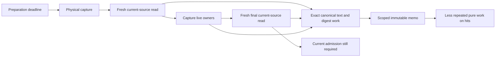

# Related sites: continuation preparation and pure memo proofs

Source-only review, 2026-11-02. Base HEAD supplied by the sole Git controller:
`9ff8bcbb625acabc077aaf67de891164156bf9a5`, `release/0.8.10-assembly`.
This reviews the current uncommitted G8/U40 changes over that base, not a
qualified release. Root checked this report path with `git check-ignore -v`:
no output, exit 1 (not ignored). No source edits, tests, providers, dependency
changes, branches or Git operations were performed by this reviewer.

## Decision and observed mechanism

The decision is where to check for the same failure mechanism after a diagnosed
issue, while preserving current SQL authority and the original preparation
deadline. The boundary is one physical runtime capture, its two current-source
reads, pure memo families, and the instruments that observe them.

The existing target-task lifecycle receipt is
`.claude/lanes/codex-takeover-20261101/classifier-preparation-target-capture-lifecycle-sampler.json`.
Selected raw fields:

```text
pytest_exit: 1
target_capture_lifecycle_valid: true
registered_target_task_match: true
controls.busy_positive_samples: 6
controls.wrong_thread_busy_samples: 0
capture_worker_wall_seconds: 8.175613441038877
capture_current_source_read: [3.7885886940639466, 3.1403083191253245]
capture_owners: [1.2462228329386562]
clock_remaining_seconds.capture_entry: 4.955770635046065
clock_remaining_seconds.capture_exit: -3.2260675439611077
shared_submit_exit: 0.00023498991504311562
worker_entry: 0.0002820079680532217
```

This receipt locates deadline exhaustion inside the target physical capture;
it does not establish the performance of the subsequently edited source.
Nested sample counts are not additive wall times. Executor queueing is not
supported as the dominant explanation in this observation. Host scheduling,
instrument overhead and larger input cohorts remain alternative contributors
to future timings.



Observed caller edges are in
[`capture_continuation_runtime_owners`](../../src/elspeth/web/composer/continuation_runtime.py),
[`read_runtime_source_on_connection`](../../src/elspeth/web/sessions/continuation_runtime.py),
[`_read_current_inputs`](../../src/elspeth/web/composer/continuation_prompt_producers.py),
and [`read_selected_turn_evidence_graph_data_on_connection`](../../src/elspeth/web/composer/continuation_evidence_restore.py).
The final read also occurs on the retention-refusal path. Eliminating either
read would change the authority contract, not merely remove duplicate work.

## Related-site dispositions

| Shared mechanism | Actual related sites and disposition | Smallest useful follow-up |
|---|---|---|
| Hidden dependency behind stable producer identity | `canonical_text_proof` trusts only its original SHA callable. The recorder wrapper previously read dynamic `hashlib.sha256` behind a stable memo producer. This review and G8 independently identified that dependency; U40 has now added `_TRUSTED_RECORDER_BLOCK_SHA256` and a per-transfer bypass for a replaced hasher. Current source re-read confirms the guard. Source-controlled; native verification pending. | Exercise a warm recorder transfer with an equivalent wrapper, a changed digest and the original raised exception; verify fresh hash execution and unchanged exception identity. |
| Large valid input crosses the proof-retention threshold | A full canonical proof accounts for text plus encoded bytes, digest and reference metadata. `verify_private_chunk` now falls back to canonical-only verification when the full proof cannot fit, and computes binding SHA afresh. Codec tests contain the large-valid case and stateful hash refusal. Source-controlled; final native run pending. | Run those exact tests on the final source; retain malformed canonical-before-binding refusal and changed reference controls. |
| Multiple cache families share some, but not all, capacity | `RetentionStageMemo` combines `_canonical_proof_bytes` and `_recorder_block_hash_bytes` for eviction. `_recorder_request` has a separate complete-text budget; `_chunks`, snapshots and credential families are outside those two counters. The 1 MiB claim therefore describes the new shared proof-family budget, not total stage or process memory. No OOM or aggregate memory defect is established. | A mixed-family eviction control should fill canonical proofs, add recorder blocks, then reverse insertion order and assert both byte accounting and recomputation. Measure total retained memory only if actual capacity evidence requires it. |
| Reuse accidentally retains mutable state | `_prepared_request_text` retains immutable strings/tuples; `_transfer_prepared_request_text` reparses and stores fresh block objects. `encode_private_chunk` reparses state and reconstructs `CompositionState`; it does not reuse the parse tree. The inspected request-text test mutates the first returned document and block, then checks isolation of the next transfer. Existing source control. | Keep mutation-isolation tests alongside any future decode optimization. Do not memoize `AdmittedTurnEvidence`, SQL rows, running owners, inventory authority or live recorder objects. |
| Stale policy/producer data survives a cache hit | Credential keys capture typed input tokens, role, surface, policy bounds, environment reference names, detector version and detector callable. `credential_guard` still resolves current policy and validates constructor-owned options before lookup. This is the relevant sibling of the hash-producer issue, rather than every function named “cache.” | Preserve changed-policy/detector and changed-input controls. Callable identity alone does not prove an arbitrary stateful function pure; production trusted dependencies and supported replacement behavior must remain explicit. |
| Lifetime leaks across worker handoff or error | `retention_stage_memo_scope` closes in `finally`; `prepare_retention_sql_callable` transfers only the memo into a fresh `Context`; late publication checks closure under the lock. Capture deliberately shares pure values between fresh reads. Ordinary, owed-batch and owed-tool runtime readers converge on `_runtime_source_from_inputs_on_connection`, which retains current inventory, snapshot, chunk, clock and cost reads. Existing source control, with runtime limits unmeasured here. | Preserve close/error/nested-scope and late-worker controls. For any further change, verify a changed current SQL source is still refused on the final read despite warm pure entries. |
| Instrument depends on the implementation it observes | `tests/helpers/continuation_memo.py` binds actual code objects, AST expression positions and native CALL offsets. The cache path changed from private-chunk lookup to canonical proof lookup, invalidating old collection/trace assumptions. Collection repair alone is not a working runtime observer. Separately, the earlier setup-capture selection error was corrected by exact task identity and chronology controls in the cited sampler. | Complete the cold-trace runtime port, demonstrate the positive target and wrong-task/neighbor-call negatives, then run the original target test. Never loosen an observer until it merely collects. |

Relevant implementation and substantive test bodies inspected:

- [`continuation_retention_memo.py`](../../src/elspeth/web/continuation_retention_memo.py)
  and [`test_continuation_retention_memo.py`](../../tests/unit/web/test_continuation_retention_memo.py).
- [`continuation_codec.py`](../../src/elspeth/web/composer/continuation_codec.py)
  and [`test_continuation_codec.py`](../../tests/unit/web/composer/test_continuation_codec.py).
- [`continuation_audit_buffer.py`](../../src/elspeth/web/composer/continuation_audit_buffer.py)
  and [`test_continuation_audit_buffer_request_text_memo.py`](../../tests/unit/web/composer/test_continuation_audit_buffer_request_text_memo.py).
- [`credential_guard.py`](../../src/elspeth/web/credential_guard.py)
  and [`continuation_memo.py`](../../tests/helpers/continuation_memo.py).

## Priority and stopping rule

1. Finish the observer runtime port and its controls, then run the original
   classifier target under the unchanged deadline. This determines whether the
   reported user-visible defect is fixed. A pure-helper cohort cannot answer it.
2. Verify the final codec fallback and recorder changed-hasher guard with the
   affected tests. Earlier passing receipts predate these final changes.
3. Add the mixed-family eviction control when this memo change is next tested;
   preserve final-read freshness and mutable-result isolation. If native capture
   still misses its deadline, sample the exact target again before selecting
   another pure operation to optimize.

No-change preserves the demonstrated deadline miss on the sampled source.
Scoped pure reuse is the selected intervention because it preserves provider
and current-source admission paths. It may still miss the deadline when inputs
are cold, larger, or evicted. Wider caching would increase semantic risk; raising
the timeout would not demonstrate that the original requirement was met.
No whole-repository bug sweep or additional implementation is proposed here.

For each future diagnosed issue, use one short **mechanism → related edges →
disposition** pass: name the violated invariant; follow the actual producer,
direct callers and shared dependency one step outward; inspect the equivalent
failure condition at those sites; record confirmed defect, controlled case or
untested risk; select one discriminating positive/negative test. Stop when the
shared mechanism ends. Reopen only when new source or runtime evidence crosses
that boundary. Keep this in the issue or existing review rather than creating
another approval package.

Reviewed source fingerprints (ordinary snapshot identifiers, not qualification):

```text
8a53d9f2cc4e95277bf7b3d1c32f2a4cb8a0a69d56357c52e8914911fcba7c52  src/elspeth/web/continuation_retention_memo.py
50d7dc8b0cfe201c848d273364af758a93e7ecf1df3cd9bae724cf212f804248  src/elspeth/web/composer/continuation_codec.py
7b1c5c98dddfaa5fb937b414358b4ab7a3ee004a2b645f895b974bc88a9449a5  src/elspeth/web/composer/continuation_audit_buffer.py
21f2024e0990cd314f41e3ef5ded7f2caaacee6950234a5e6ed75b4f6cbe3052  tests/helpers/continuation_memo.py
```

## Post-checkpoint delta: observer call graph port

Root reported the subsequent checkpoint published as `e585…` and remote-verified
at 15:09, followed by frozen C1r3 collection failure at `_CHUNK_LENGTH_SITES`
(`expected=3`). Publication and the failed receipt are Root-provided status;
this reviewer performed no Git or native execution. The following is a bounded
source read during U40's authorized helper port, not a result for its eventual
completed source. U40 received the specific sites below before this append.

The common mechanism is **an observer's executable provenance model lagging
behind its production call graph**. The collection assertion is a useful
fail-closed signal. Merely increasing a literal count would not restore its
meaning:

| Related edge | Source observation | Required preservation during the port |
|---|---|---|
| Callee selection → native operand accounting | `_direct_target_call_sites` selects `len` calls by callee/source position. The new `full_proof_bytes` calculation also calls `len` on reference metadata and decimal strings. `_byte_call` currently classifies every `builtins.len` in `_CHUNK_REQUEST` as `chunk_length`, then requires its operand to be the encoded payload buffer. | Explicitly distinguish payload-binding calls from metadata accounting. Neither treating metadata as payload nor ignoring every unfamiliar call preserves the measurement. Use a neighboring metadata-call negative control and an actual payload-call positive control. |
| Producer substitution → deferred parse binding | `_CHUNK_PRODUCER` now names `_private_chunk_canonical_text_bytes`, but `_defer_chunk_parse` and `_bind_pending_chunk` still compare `_verify_private_chunk_canonical` against that producer and require `PrivateChunkVerificationKey`. The full-proof path supplies `CanonicalTextEncodingKey`; canonical-only fallback still has its old path. These inspected predicates are inconsistent with the new producer graph. | Model each actual path explicitly, including fresh full proof, full-proof hit, canonical-only fallback and cold refusal. Preserve original text/buffer identity, current memo, thread/submission ownership and exception behavior; do not substitute reconstructed byte sizes for native evidence. |
| Artifact query chain → cold and warm coverage | `_artifact_event` selects one chunk query/work chain through `_CHUNK_QUERY_SITE`; `_chunk_artifact_source_is_original` binds code and callable identities for that chain. Fallback introduces another query/producer chain, while digest work for full proofs moves into the memo method. | Follow the actual producer and digest sites, not just the public verifier's direct calls. Preserve exact source identity and key/reference binding on both paths. A broad ancestor match would weaken the evidence boundary. |
| Native instruction grammar → adjacent guards | `_direct_call_site`, `_direct_target_call_sites`, `_artifact_query_site`, `_scanner_size_windows` and `_structure_row_callback_site` all bind CALL locations or operands. The latter already handles combined `LOAD_FAST_LOAD_FAST` and `STORE_FAST_STORE_FAST`; keyword calls and inline-cache windows have separate handling. | Check the supported interpreter's actual grammar at each affected shared helper. Keep exact callable, arguments, keyword tuple and native offset checks. A combined load containing a symbol is not by itself proof that the symbol is the callee. Do not generalize a fix to unrelated sites without a discriminating control. |
| Caller fixture → mutation effectiveness | `test_native_byte_chunk_channels_use_original_validated_loader_bytes_and_charge_each_hit` wraps `RetentionStageMemo.private_chunk` to inject extra work, but its small valid chunk now takes `canonical_text_proof`. Old key/producer labels and per-hit digest budgets also appear in the accounting tests. | Port the injected mutation to the actual executing path and demonstrate that it fires and fails the observer. Preserve the fixture's real SQL loader source, direct/bypass negatives and original independently authored UTF-8 payload. A green test with an inert mutation proves nothing. |

The connected scope is the helper, its accounting and UTF-8 observation tests,
and the production verifier/memo edges they measure. No additional production
repair is inferred from this collection failure. U40 owns that port; Root owns
native capacity and qualification. The next useful evidence is successful
collection followed by the observer's affected positive/negative controls and
the original classifier target, with the final source held. Collection success
alone neither validates byte attribution nor demonstrates the five-second
preparation requirement.

## Related-sites delta: recovery state and SQL postconditions

Root reported native failures in the new recovery-projection controls: a valid
park rejected its bookmark, attempted corruption of append-only chat rows was
stopped before projection, and terminal retry returned an exception group.
This delta is source-only, read while G1 repairs
[`continuation_graph_recovery_projection.py`](../../src/elspeth/web/sessions/continuation_graph_recovery_projection.py)
and its [actual SQL tests](../../tests/unit/web/sessions/test_continuation_graph_recovery_projection.py).
It does not qualify the eventual repair. G1 received the findings below.

The relevant causal chain is:

```text
turn-start context + original provider recovery intent + current fenced head
  -> prepare_graph_recovery_on_connection selects target and expected head
  -> paid Stop source replays selection before DML
  -> settle checks expected head, writes/reuses checkpoint, writes park/receipts
  -> projection checks persisted rows and public response
  -> terminal CAS commits, or rollback precedes the exact retry
```

Source edges are `composer_finalization.py`'s recovery branch,
`service.py:prepare_graph_recovery_on_connection`,
`require_continuation_graph_recovery_selection_on_connection`,
`_settle_graph_recovery_on_connection`, `_write_graph_recovery_receipt`, and
`composer_operation_authority.py:settle_composer_operation_on_connection`.

| Action/path | Correct state relationship | Related-site disposition |
|---|---|---|
| Reset to safe checkpoint | The current pre-settlement head is the CAS expectation. The selected eligible historical target supplies graph content; the recovered checkpoint is a new identity/version derived from that target. If none is eligible, a new empty checkpoint is the declared fallback. | Do not compare the recovered graph with the abandoned working candidate or require its identity to equal the selected target. The current test starts with no stored head, so it exercises empty fallback, not restoration of an eligible historical checkpoint. |
| Park, unchanged existing head | Preparation can choose `state_id == expected_state_id`; settlement then skips checkpoint insertion and bookmarks that existing row. | The inspected projection unconditionally compares validation/composer metadata against normalized `recovery.data`, while `checkpoint_data` clears validation status/errors. An existing validated head can legitimately retain metadata because no new row was written. This is a concrete source-level comparand inconsistency requiring G1 disposition, not a native reproduction from this review. Add an existing-head positive before applying new-checkpoint metadata expectations to this branch. |
| Park, changed candidate or malformed head | The original provider candidate is captured as a new checkpoint, version `expected_version + 1`, with lineage to the prior target where present. The park points to the newly captured checkpoint. | Keep candidate content, prior head, captured checkpoint and bookmark identities distinct. The empty-head park fixture covers creation, not the unchanged-head branch above. |
| Restore parked graph | The requested park resolves a historical checkpoint; success writes a new editable checkpoint derived from it. A missing park instead produces a refusal receipt and no new checkpoint. | The inspected fixture supplies a random park ID and explicitly expects `outcome.state is None`; it therefore tests refusal, not successful restoration. A real existing park is the necessary sibling positive. |

The immediate bookmark failure has a representation mismatch: the inspected
checker compares raw `park.created_at` with `receipt.created_at` after the
chat-row converter restores UTC. The writer supplies the same timestamp to
both rows. G1 plans raw-row to raw-row comparison; equally, both sides could be
normalized. Preserve exact equality rather than adding time tolerance. The
receipt/audit comparison already compares converted records on both sides.
The database-specific runtime result of the correction remains to be measured.

Identity domains must also remain distinct. Recovery selection, checkpoint
creator and park `operation_id` use the physical session-operation fence;
the public response exposes `running.claim.operation_id`, the logical job.
Actor authority is separately checked by
`require_composer_settlement_actor_on_connection` in terminal settlement, which
also reloads and compares the actual assistant SQL row before projection.
Direct calls to the projection helper do not prove those upstream authority
checks. Keep foreign-session, physical-operation, logical-response and actor
controls at their actual owning seams rather than asserting all IDs are equal.

The append-only trigger failure is evidence that the attempted UPDATE is
forbidden, not evidence that the projection checker rejected corrupt content.
For checker negatives, G1 plans to inject incorrect notice/raw content through
the real receipt writer **before insertion**, retaining database triggers and
then asserting that the intended checker is reached. Changed projection DATA
can test source binding separately. Keep those claims separate from durable
row corruption. Root's grouped failure is consistent with the terminal
writer's exact retry; G1 reports both causes were the same early bookmark
failure. A valid rollback control must first establish the positive projection,
then identify the deliberate checker error in each actual attempt and verify
that checkpoint, park, receipt and terminal changes did not commit. A generic
exception-group assertion would permit unrelated early failures to pass.

The smallest follow-up is the corrected park positive, followed by the intended
writer-injection negative/rollback control and the unchanged-head park plus
successful-restore positives. Preserve the existing refusal case. No trigger
disablement, data reset, broader recovery redesign or whole-repository sweep
is called for by these findings.

For the unchanged-head park discrepancy, the proposed exact proof is a full
pre-DML state record captured locally on the same fenced terminal connection,
then full equality with the post-DML row, alongside graph-content comparison
with selected recovery DATA. `read_content_publication` validates the existing
row's version/content binding; `prepare_content_publication` describes a new
insert and should not manufacture an expectation for an untouched row. This is
advice to G1, not an implemented or runtime-verified change. It avoids simply
dropping metadata checks; this review has not independently established a
database trigger making all state fields immutable. Root should resolve any
additional plumbing scope before implementation.

## Related-sites delta: cancellation after the first settled PRIMARY

The retained diagnostic summary at
`.claude/lanes/codex-takeover-20261101/canonical-first-primary-private-diagnostic.md`
reports different last business cuts: staged review has two committed tool
effects at `ToolBatch(tool_ready)` before P4; owned recovery has committed P4 at
`ToolBatch(result_retained)`. Their later settled cursors are terminal events,
not evidence that another business action completed. The former retained a
group of two `CancelledError` objects, the latter one `CancelledError`; neither
retained traceback origins. Elapsed operation times of about 81 and 78 seconds
do **not** establish deadline exhaustion or a shared failing callsite.

The inspected source connects these cuts as follows:

- Before P4, `ContinuationLivePhases.advance` reads current runtime for a
  `tool_ready` frame and chooses `_execute_one` or `_persist_batch` from the
  batch's actual `call_ready`/`dispatch_ready` phase. `_persist_batch` owns a
  separate `continuation-required-p4` stage and joins it before setting
  `finished_batch`.
- At an applied batch cut, `_SegmentDriver.advance` selects
  `advance_continuation_iteration`, semantic review, or publication according
  to the current iteration-stage DATA. A `result_retained` snapshot alone does
  not identify which awaited operation was cancelled.
- Both paths run inside the driver's registered continuation stage. Its
  `_ActionExpiry` can cancel the stage and business child after actual expiry;
  timer-arm failure instead interrupts with lease-loss classification.
  `watch_stage` can independently cancel for local/SQL Stop, changed
  attempt/segment/generation, lease loss, drain reserve, or an unexpected watcher
  cancellation/error. Worker shutdown can also cancel owned tasks.
- `SessionOperationLease.join_continuation_stage` shields the producer while
  retaining caller-delivered cancellation separately from the child's original
  failure. It can therefore preserve multiple cancellation objects. This is a
  plausible explanation for a group, not attribution of the observed group.
  P4 can also commit and subsequently re-raise a retained failure, so committed
  P4 does not imply that the enclosing await completed successfully.

Clock domains must remain explicit. `ContinuationActionClock` owns a loop-clock
total deadline and a separate monotonic preparation deadline. The SQL deadline
owner clips action time to the hard bound and drain signal; dispatch additionally
reserves drain-finish time. `begin_settlement` switches the SQL allowance mode
without extending the original action deadline. Fresh database timing reads
drive segment admission/yield; they are observations, not reusable monotonic
anchors. None of these fields can be inferred from total test runtime.

The initial `observe_original_driver_failures` wrapper in
[`tests/helpers/continuation_app.py`](../../tests/helpers/continuation_app.py)
delegates to the saved `advance`/`settle` methods and uses bare `raise` for the
original advance error. Its initial operation-ID filter and traceback metadata
are useful, but not sufficient to identify the cancellation sender. Review
constraints sent to the test owner for the next revision:

1. Bind the intended session as well as logical operation, and record physical
   attempt, segment and ownership generation. Same logical ID in another session
   must not be attributed to the target. Record current task identity and
   `cancelling()` separately from the observed child/business task where known.
2. At entry, return and error, record monotonic elapsed time, selected frame
   phase/cursor, iteration-stage category and action ordinal. Record policy
   allowances, action remaining, SQL dispatch remaining, hard remaining and
   drain presence using their original clock domains. No new SQL reads or awaits
   should be introduced solely by the observer.
3. Preserve original delegation, exception identity and application behavior.
   Observer metadata extraction must not replace a cancellation with its own
   formatting/getter error. Bound exception-group depth as well as width, retain
   safe traceback locations without source lines or locals, and use
   repository-relative paths to disambiguate same-named modules. Never print
   prompts, tool arguments or provider results.
4. To prove a deadline origin, capture the actual expiry signal/flag or the
   original cancellation-source event. `advance`/`settle` snapshots plus negative
   remaining time only establish correlation. If sender instrumentation is not
   added, explicitly retain that attribution limit in the next result.

The next discriminating evidence is the exact target's first escaping traceback
with these bounded phase/task/clock observations. Keep staged and recovery
failures separate until that evidence joins their mechanisms. No timeout change,
cancellation suppression or production repair is justified by this source-only
pass. The test owner is extending the observer; this review is not approval of
its final uninspected revision and ran no native tests or Git operations.

Final observer source review subsequently found and resolved one diagnostic
blocker: the initial exit condition required the action ordinal to increase
inside `advance`, although the driver binds the clock and increments the ordinal
before calling it. The corrected observer captures the actual clock at entry,
reports that same object's remaining allowances at exit, and flags an identity
change. Driver/task IDs distinguish arrival at the action child and settlement
parent; exact session/operation filtering and claim generation/segment/attempt
remain present. The classifier test supplies its actual harness session ID.

Disposition: **ready for the bounded canonical diagnostic run**, source-only.
Reviewed helper SHA-256:
`6c9d930769a98f9303ae262833c8f54018c3318e3835a2776b9ee6600c08c179`;
classifier-service test SHA-256:
`1b9c98e44cc50e829441e2da9687f9bd7395b1f2d27c0abf18213eb06a3b9890`.
Saved-method delegation, bare rethrow, metadata-extraction error containment,
fixed-vocabulary redaction and bounded exception-group traversal were inspected.
No added cancellation, watcher, timer, SQL or await operation was found in the
observer path apart from delegation to the original methods. Instrumentation
still adds synchronous observation overhead and is not a performance baseline.
Its clock snapshots and traceback show cancellation arrival; they do not by
themselves identify the cancellation sender. Native results remain pending.

## Related-sites delta: semantic cuts and same-sequence handover

G6 requested a bounded design review before widening `classify_drain_cut` to
live Advisor `response_retained`/`decision_ready` and consumed semantic END
`publication_ready`. Keeping `next_continuation_action_policy` first, and
requiring `is_consumed_semantic_stop_cut` for END, preserves structural
restrictions. It does not alone establish cold-resume support.

**Source blocker to a classifier-only repair:** receiving semantic proof
readers assume checkpoint adjacency that a real handover changes.

- `sessions/continuation.py` appends a complete snapshot with a `recovered`
  event, advances the cursor, and advances generation in the same segment.
  It preserves paid frames/effects, not their old selected cursor.
- `continuation_semantic_advisor.py:_paid_result_data` requires the selected
  cursor to equal the physical result manifest's source cursor plus one for
  `response_retained` or plus two for `decision_ready`. It also requires the
  response-retained root to equal the original paid root. The structural reader
  calls this directly; runtime restoration invokes that structural validation.
- `continuation_semantic_actions.py:_reprove_installed_snapshot` calls the same
  paid-result proof and requires a `checkpoint` event at the selected cursor.
  A recovered cursor instead names a `recovered` event. The committed semantic
  Read branch dispatches by the current checkpoint's semantic kind, so it also
  belongs in this bounded receiving-path review.
- `require_semantic_publication_on_connection` reads `selected.cursor - 1` as
  the installed Advisor decision. After recovery at consumed END, that preceding
  checkpoint is the old END publication-ready root instead. The structural
  consumed-Stop predicate is explicitly not the final SQL paid-Stop proof.

These are inspected producer/consumer mismatches, not new native results.
G6 and Root were notified. The required decision is whether to extend the
bounded semantic readers to prove intervening recovery lineage. Such proof must
retain current CAS/ownership separately from original paid source, validate
intervening recovered events/attempts and unchanged business DATA, and continue
checking original response, effect, creator and installed-action receipts.
Replacing exact cursor checks with inequalities, deleting event checks, or
passing historical DATA as current authority would not repair the contract.

The proposed actual-app sequence (PRIMARY, semantic Read, semantic Review,
END, semantic Stop) is a useful receiving control only if each newly admitted
cut is reached through its real producer and cold-reclaimed by a new generation.
Assert unchanged original paid response/effect rows and counters, same segment
with advanced generation, fresh runtime ownership, no duplicated SDK calls and
successful final SQL Stop proof. Cover action-fit and process drain separately;
a drain-only test that stops after handover cannot prove cold restoration. Keep
future-only END, Advisor input and unsafe awaiting-response negatives. Existing
handover rollback, Stop-before-suspend and ambiguous readback tests remain the
applicable custody controls; no new handover transaction is called for.

This review changed no implementation and ran no tests or Git commands.
The reader changes exceed a classifier-only patch and require Root's scope
decision before G6 expands its repair.

## Related-sites delta: canonical staged run remains in flight at polling limit

Read `.claude/lanes/codex-takeover-20261101/staged-classifier-original-driver-timeline-r2.log`.
Its terminal receipt reports `child_returncode=1`, `cleanup_complete=true`,
`elapsed_seconds=107.84355617687106`, `user_cpu_seconds=107.630135`, and
`system_cpu_seconds=2.280482` for `wait4-reaped-processes`. The test's poll raises
`AssertionError("Continuation request did not settle")`. Subsequent lifespan
shutdown groups include lease-loss cancellation and unavailable/shutting-down
required executor. Those later exceptions are not established original causes.

At the 60-second faulthandler dump, one worker is in
`contracts/hashing.py:_normalize_frozen_and_reject_non_finite` (lines 63 and 48),
followed by `<invalid frame>`; the visible other pool workers are waiting, and
the main thread is in the asyncio event loop. The run's CPU accounting supports
substantial computation somewhere in the reaped process tree. A single truncated
stack does not identify the responsible canonicalization caller, input size,
repetition count, infinite loop or deadline origin. Teardown's later traceback
does locate an unfinished P4 path through `_persist_batch`, the required P4
child, `persist_turn_audit`, and `ContinuationLiveP4.prepare`; it does not prove
that this was the missing ancestor of the 60-second hash sample.

Bounded related producers to sample next:

- `ContinuationLiveP4.prepare` encodes the prepared P4 and pending batch, then
  runs its own registered worker capture: `read_source`, `_capture_owners`,
  `read_source`. These are the same kinds of source validation and immutable
  work implicated in the earlier runtime-capture measurement. This distinct
  closure does not use the explicit `capture_continuation_runtime_owners`
  wrapper whose physical capture opens the shared memo scope. Whether an
  ambient scope exists in this run must be observed, not assumed.
- `prepared_p4_members` is called by `capture_prepared_p4`,
  `encode_prepared_p4`, decoding and `p4_semantic_input`; it canonicalizes and
  reconstructs owned P4 members. These are real repeated validation edges, not
  proof that any one dominates the run.
- `_capture_owners` and both current-source reads reach evidence, batch,
  recorder and application-graph encoders. The generic normalizer recursively
  traverses each container occurrence; one large structure, repeated ordinary
  structures, or repeated aliases can all yield the same visible leaf. No
  payload-size or alias-expansion claim has been measured here.

The next discriminating measurement should reuse the validated exact-task
worker selection approach, bind it to this operation/session/action ordinal
and actual registered capture, and collect repeated bounded full ancestor
stacks while that invocation is live. Include submission, worker entry/exit,
the two source-read spans, `_capture_owners` span and pre-SQL preparation span,
plus the already-added phase/clock observations. Separate leaf from inclusive
samples and report any truncated stack. If repeated sampling still cannot
distinguish one long call from many calls, add bounded invocation counters and
elapsed timing at the identified producer boundary. Do not print graph values,
prompts, exception locals or provider responses, and do not recursively walk
the input merely to measure a hot recursive walk.

Avoid replacing `canonical_json`, SHA producers or memo callbacks to instrument
this run: callable identity participates in memo/trace contracts, so such a
wrapper could disable the optimization being measured. A sampler must first
demonstrate a known busy target and a wrong-task negative, and retain sampling
overhead as a limitation. Keep sampling and native execution under Root's sole
capacity control.

The test owner reports a saved catch-and-bare-rethrow around `submit_and_settle`
which prints only the bounded observer rows on a raised outcome as well as a
returned failed snapshot. This addresses the missing pre-teardown timeline;
its new native behavior has not been run by this reviewer. No timeout increase,
hash rewrite or deletion of current-source checks follows from this evidence.

## Related-sites delta: sampler2 source review

Source-reviewed lane-only `staged-tool-ready-source-worker-sampler.py` against
the current `_execute_one_owned` → `current` → `_current_phase_read` path.
Disposition: ready for Root's bounded diagnostic run; native behavior remains
unmeasured. The task/actor anchor selects the exact session/operation's
`tool_ready` action at origin cursor 9. `_retain` loads a new selection and calls
`current` in that same task; the sampler correctly binds each read's actual
selected identity rather than incorrectly requiring its cursor to remain 9.
The registered-read filter checks task identity, nominal returned owner and
the original `read_source` closure's source file, `self` and `selected` cells.
The physical operation wrapper selects the worker thread at actual entry and
calls the original operation. The patched delegates do not replace canonical
or SHA producers or memo callbacks.

Root must require the observed positive match, all four wrong-target counters,
busy-thread/wrong-thread sampling controls, empty observer errors and actual
worker chronology before treating a completed capture as valid. A stopped
capture may supply partial stacks but cannot acquire a completed lifecycle by
inference. Entry spans include attempted ordinary reads and possible nested
finish reads; their count is not necessarily a count of independent successful
source acquisitions. Reported stack and span timing includes observer cost.
This sampler targets the earlier `tool_ready` source read, not automatically
the separate P4 capture described above.

R3 scope correction: the independent cold-reader reviewer subsequently flagged
`sessions/continuation_runtime` routing attachment `effect_reconciling` through
native tool-issue proof and `next_action` assigning SQL-only allowance after an
attachment prefix despite remaining SDK calls. Those findings were sent to
Root and the implementer. The earlier phase-level attachment review does not
clear these reader or action-clock paths; their source repair and actual driver
controls remain separate obligations. Subsequent Root status update: the
independent reviewer closed both blockers after source fixes and found no
remaining P1/P2 in the cold-prepared proof. Same-sequence fresh-claim recovery
is supported under strict proofs; cross-sequence prepared yield is explicitly
refused. R3 is now source-ready pending Root's native run. This last status is
Root-reported, not a second source re-review by this reviewer; the historical
findings above are not current open blockers.

## Related-sites delta: sampler3 memo counters

Source-reviewed lane-only `staged-tool-ready-memo-and-action-sampler.py`.
Original proof/private-chunk methods are delegated with unchanged canonical,
SHA and producer identities. Memo observation is restricted to the matched
physical source worker; action spans use the established originating task.
Digest-equivalence keys are retained only internally and excluded from JSON.

One counter-integrity correction was requested before treating eviction counts
as exact: integer-only pre/post object-ID snapshots permit address reuse after
an evicted object is released. Keep bounded strong references to the pre-call
snapshot objects through the post-call comparison, or explicitly report the
result as a lower bound on disappearing identities. Shared concurrent mutation,
if present, would also make pre/post change a scope observation rather than
proof that this call alone caused each eviction.

Interpretation limits: repeat-digest misses span all memo instances within one
source-read invocation, not just one cache; miss charged-byte sums measure
repeated requested retention charges, not resident or peak process memory;
action spans overlap and nest, so their sums are not elapsed action time.
First-seen/repeat misses do not by themselves prove a reusable cross-call
authority scope. This review has not run the sampler or its pure controls.

Follow-up source read confirmed bounded strong pre-call snapshot references now
prevent cache-entry address reuse from hiding disappearance. Diagnostic run is
source-ready with the limitations above. The author also added `id(memo)` to
the digest-equivalence key; this narrows the intended grouping, but an integer
address can itself be reused across sequential memo lifetimes. Until lifetime
identity is proved, do not claim that a repeated key proves loss in the same
memo instance. This does not invalidate observed cache hits, size charges or
the corrected pre/post entry-disappearance measurements.

Final correction source-reviewed: a locked `WeakKeyDictionary` now assigns a
monotonically increasing token to each actual memo lifetime without retaining
the memo. The ordinary `RetentionStageMemo` class supports identity keys and
weak references. This closes the lifetime address-reuse limitation above.
Counter names now explicitly say `disappeared_between_snapshots`. Final
disposition: source GO for Root's bounded diagnostic run, with runtime controls,
chronology, concurrency attribution and observer-overhead limits still required.
