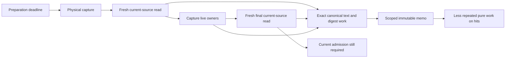

# Related sites: continuation preparation and pure memo proofs

Source-only review, 2026-11-02. Base HEAD supplied by the sole Git controller:
`9ff8bcbb625acabc077aaf67de891164156bf9a5`, `release/0.8.10-assembly`.
This reviews the current uncommitted G8/U40 changes over that base, not a
qualified release. Root checked this report path with `git check-ignore -v`:
no output, exit 1 (not ignored). No source edits, tests, providers, dependency
changes, branches or Git operations were performed by this reviewer.

## Decision and observed mechanism

The decision is where to check for the same failure mechanism after a diagnosed
issue, while preserving current SQL authority and the original preparation
deadline. The boundary is one physical runtime capture, its two current-source
reads, pure memo families, and the instruments that observe them.

The existing target-task lifecycle receipt is
`.claude/lanes/codex-takeover-20261101/classifier-preparation-target-capture-lifecycle-sampler.json`.
Selected raw fields:

```text
pytest_exit: 1
target_capture_lifecycle_valid: true
registered_target_task_match: true
controls.busy_positive_samples: 6
controls.wrong_thread_busy_samples: 0
capture_worker_wall_seconds: 8.175613441038877
capture_current_source_read: [3.7885886940639466, 3.1403083191253245]
capture_owners: [1.2462228329386562]
clock_remaining_seconds.capture_entry: 4.955770635046065
clock_remaining_seconds.capture_exit: -3.2260675439611077
shared_submit_exit: 0.00023498991504311562
worker_entry: 0.0002820079680532217
```

This receipt locates deadline exhaustion inside the target physical capture;
it does not establish the performance of the subsequently edited source.
Nested sample counts are not additive wall times. Executor queueing is not
supported as the dominant explanation in this observation. Host scheduling,
instrument overhead and larger input cohorts remain alternative contributors
to future timings.



Observed caller edges are in
[`capture_continuation_runtime_owners`](../../src/elspeth/web/composer/continuation_runtime.py),
[`read_runtime_source_on_connection`](../../src/elspeth/web/sessions/continuation_runtime.py),
[`_read_current_inputs`](../../src/elspeth/web/composer/continuation_prompt_producers.py),
and [`read_selected_turn_evidence_graph_data_on_connection`](../../src/elspeth/web/composer/continuation_evidence_restore.py).
The final read also occurs on the retention-refusal path. Eliminating either
read would change the authority contract, not merely remove duplicate work.

## Related-site dispositions

| Shared mechanism | Actual related sites and disposition | Smallest useful follow-up |
|---|---|---|
| Hidden dependency behind stable producer identity | `canonical_text_proof` trusts only its original SHA callable. The recorder wrapper previously read dynamic `hashlib.sha256` behind a stable memo producer. This review and G8 independently identified that dependency; U40 has now added `_TRUSTED_RECORDER_BLOCK_SHA256` and a per-transfer bypass for a replaced hasher. Current source re-read confirms the guard. Source-controlled; native verification pending. | Exercise a warm recorder transfer with an equivalent wrapper, a changed digest and the original raised exception; verify fresh hash execution and unchanged exception identity. |
| Large valid input crosses the proof-retention threshold | A full canonical proof accounts for text plus encoded bytes, digest and reference metadata. `verify_private_chunk` now falls back to canonical-only verification when the full proof cannot fit, and computes binding SHA afresh. Codec tests contain the large-valid case and stateful hash refusal. Source-controlled; final native run pending. | Run those exact tests on the final source; retain malformed canonical-before-binding refusal and changed reference controls. |
| Multiple cache families share some, but not all, capacity | `RetentionStageMemo` combines `_canonical_proof_bytes` and `_recorder_block_hash_bytes` for eviction. `_recorder_request` has a separate complete-text budget; `_chunks`, snapshots and credential families are outside those two counters. The 1 MiB claim therefore describes the new shared proof-family budget, not total stage or process memory. No OOM or aggregate memory defect is established. | A mixed-family eviction control should fill canonical proofs, add recorder blocks, then reverse insertion order and assert both byte accounting and recomputation. Measure total retained memory only if actual capacity evidence requires it. |
| Reuse accidentally retains mutable state | `_prepared_request_text` retains immutable strings/tuples; `_transfer_prepared_request_text` reparses and stores fresh block objects. `encode_private_chunk` reparses state and reconstructs `CompositionState`; it does not reuse the parse tree. The inspected request-text test mutates the first returned document and block, then checks isolation of the next transfer. Existing source control. | Keep mutation-isolation tests alongside any future decode optimization. Do not memoize `AdmittedTurnEvidence`, SQL rows, running owners, inventory authority or live recorder objects. |
| Stale policy/producer data survives a cache hit | Credential keys capture typed input tokens, role, surface, policy bounds, environment reference names, detector version and detector callable. `credential_guard` still resolves current policy and validates constructor-owned options before lookup. This is the relevant sibling of the hash-producer issue, rather than every function named “cache.” | Preserve changed-policy/detector and changed-input controls. Callable identity alone does not prove an arbitrary stateful function pure; production trusted dependencies and supported replacement behavior must remain explicit. |
| Lifetime leaks across worker handoff or error | `retention_stage_memo_scope` closes in `finally`; `prepare_retention_sql_callable` transfers only the memo into a fresh `Context`; late publication checks closure under the lock. Capture deliberately shares pure values between fresh reads. Ordinary, owed-batch and owed-tool runtime readers converge on `_runtime_source_from_inputs_on_connection`, which retains current inventory, snapshot, chunk, clock and cost reads. Existing source control, with runtime limits unmeasured here. | Preserve close/error/nested-scope and late-worker controls. For any further change, verify a changed current SQL source is still refused on the final read despite warm pure entries. |
| Instrument depends on the implementation it observes | `tests/helpers/continuation_memo.py` binds actual code objects, AST expression positions and native CALL offsets. The cache path changed from private-chunk lookup to canonical proof lookup, invalidating old collection/trace assumptions. Collection repair alone is not a working runtime observer. Separately, the earlier setup-capture selection error was corrected by exact task identity and chronology controls in the cited sampler. | Complete the cold-trace runtime port, demonstrate the positive target and wrong-task/neighbor-call negatives, then run the original target test. Never loosen an observer until it merely collects. |

Relevant implementation and substantive test bodies inspected:

- [`continuation_retention_memo.py`](../../src/elspeth/web/continuation_retention_memo.py)
  and [`test_continuation_retention_memo.py`](../../tests/unit/web/test_continuation_retention_memo.py).
- [`continuation_codec.py`](../../src/elspeth/web/composer/continuation_codec.py)
  and [`test_continuation_codec.py`](../../tests/unit/web/composer/test_continuation_codec.py).
- [`continuation_audit_buffer.py`](../../src/elspeth/web/composer/continuation_audit_buffer.py)
  and [`test_continuation_audit_buffer_request_text_memo.py`](../../tests/unit/web/composer/test_continuation_audit_buffer_request_text_memo.py).
- [`credential_guard.py`](../../src/elspeth/web/credential_guard.py)
  and [`continuation_memo.py`](../../tests/helpers/continuation_memo.py).

## Priority and stopping rule

1. Finish the observer runtime port and its controls, then run the original
   classifier target under the unchanged deadline. This determines whether the
   reported user-visible defect is fixed. A pure-helper cohort cannot answer it.
2. Verify the final codec fallback and recorder changed-hasher guard with the
   affected tests. Earlier passing receipts predate these final changes.
3. Add the mixed-family eviction control when this memo change is next tested;
   preserve final-read freshness and mutable-result isolation. If native capture
   still misses its deadline, sample the exact target again before selecting
   another pure operation to optimize.

No-change preserves the demonstrated deadline miss on the sampled source.
Scoped pure reuse is the selected intervention because it preserves provider
and current-source admission paths. It may still miss the deadline when inputs
are cold, larger, or evicted. Wider caching would increase semantic risk; raising
the timeout would not demonstrate that the original requirement was met.
No whole-repository bug sweep or additional implementation is proposed here.

For each future diagnosed issue, use one short **mechanism → related edges →
disposition** pass: name the violated invariant; follow the actual producer,
direct callers and shared dependency one step outward; inspect the equivalent
failure condition at those sites; record confirmed defect, controlled case or
untested risk; select one discriminating positive/negative test. Stop when the
shared mechanism ends. Reopen only when new source or runtime evidence crosses
that boundary. Keep this in the issue or existing review rather than creating
another approval package.

Reviewed source fingerprints (ordinary snapshot identifiers, not qualification):

```text
8a53d9f2cc4e95277bf7b3d1c32f2a4cb8a0a69d56357c52e8914911fcba7c52  src/elspeth/web/continuation_retention_memo.py
50d7dc8b0cfe201c848d273364af758a93e7ecf1df3cd9bae724cf212f804248  src/elspeth/web/composer/continuation_codec.py
7b1c5c98dddfaa5fb937b414358b4ab7a3ee004a2b645f895b974bc88a9449a5  src/elspeth/web/composer/continuation_audit_buffer.py
21f2024e0990cd314f41e3ef5ded7f2caaacee6950234a5e6ed75b4f6cbe3052  tests/helpers/continuation_memo.py
```
