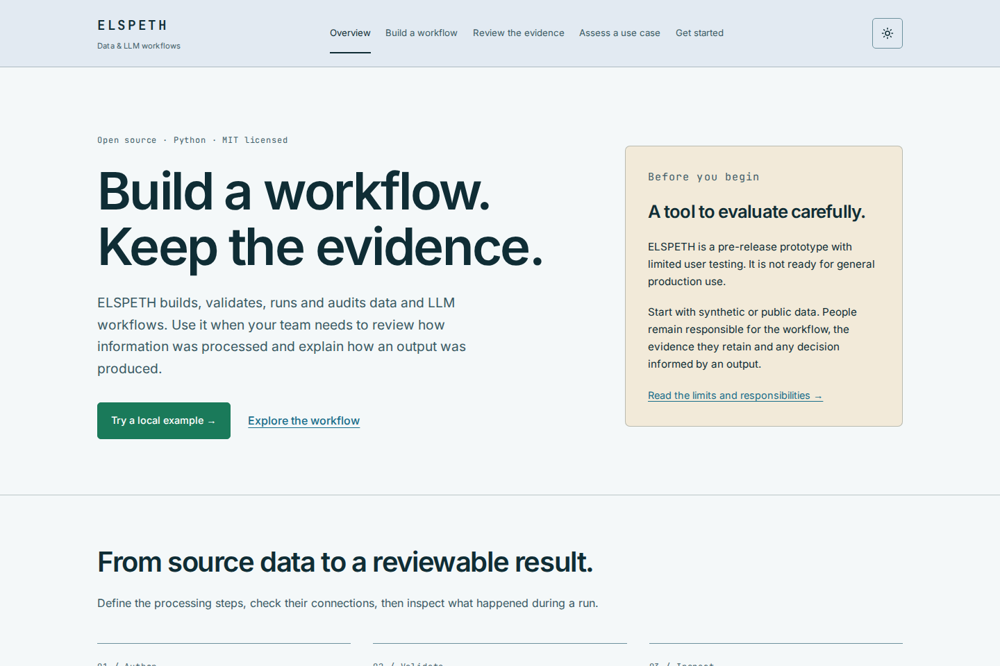

# Public website rewrite — local implementation handoff

Completed 11 October 2026 on Nyx. Local artifact for coordinated 0.8.5
integration; not pushed, deployed or release-qualified by this work.

Branch: `codex/public-site-085-20261011`, based on
`40b0dfb66799e286c97166e08b4286fa26f3fc3f`. The final commit and tree are reported
with the handoff; this document travels with that commit.

## Outcome and ownership

The five existing public URLs remain. Their copy now explains the concrete
authoring, evaluation, review and operating tasks, with the README's prototype
and production-readiness limitations visible. Navigation names describe reader
tasks. YAML/Composer remain distinct authoring paths to the same runtime.
Provider requirements, validation limits, human review and bounded recovery
replace unqualified assurance claims. Local Composer setup now includes both
required keys, limits, model-configuration references and separate administrator
and workload-user setup.

The site uses the current Composer's navy navigation, teal workspace and warm
paper colour roles. Existing website badge text variants remain above 4.5:1.
Fonts and icons stay local. Native mobile navigation works without JavaScript;
theme and copy controls progressively enhance it.

Only public website files and this review/preview evidence change. Composer,
`website/tutorial-site/`, workflows, release metadata and tests are unchanged.
The home release strip and full database-upgrade section on get-started retain
their baseline markup/text. The historical streaming worktree was inspected
read-only: its pending site changes concern preceding release labels and
upgrade text already represented in this newer baseline. They were not imported
or altered.

The sole 0.8.4 integrator acknowledged no active public-site writer and supplied
the baseline, scope and post-0.8.4 integration target. The 0.8.5 coordinator
held no site reservation and confirmed its telemetry work has no site overlap.

## Source rationale

Changed paths (relative to the repository root):

```text
website/README.md
website/index.html
website/authoring.html
website/assurance.html
website/use-cases.html
website/get-started.html
website/site.css
website/site.js
website/check-contrast.mjs
website/tokens/colors.css
website/images/composer-workspace.webp
website/images/composer-inspection.webp
docs/reviews/public-site-085-20261011.md
docs/reviews/assets/public-site-085-20261011/overview-desktop.png
docs/reviews/assets/public-site-085-20261011/overview-mobile.png
```

| Public statement | Authority checked in the baseline |
| --- | --- |
| Explicit pipelines, YAML/Composer, shared runtime and audit store | [README](../../README.md), [architecture](../../ARCHITECTURE.md) |
| Prototype, limited user testing, AI-generated/reviewed code; not general-production ready | README pre-release status; presented prominently on overview and evidence pages |
| Provider-driven proposals, candidate review and validation | [Composer guide](../release/composer-guide.md), Composer state/validation source and existing site contracts |
| Lineage, calls, routing and terminal outcomes; evidence does not establish factual correctness | [Guarantees](../release/guarantees.md), [trust model](../guides/data-trust-and-error-handling.md), Landscape source |
| Conditional interrupted-publication recovery | [Recovery runbook](../runbooks/sink-effect-recovery.md); no universal exactly-once claim |
| Local prerequisites, secrets, limits, account versus workload permission | [Local development](../guides/web-local-development.md), [identity guide](../guides/identity-providers.md), `cli.py`, local auth, middleware and RolesEditor |
| Deployment is a separate operating task | [Platform reference](../reference/deployment-platforms.md), [AWS runbook](../runbooks/aws-ecs-deployment.md) |
| Chroma should not be selected under the current project warning | README restriction, linked rather than restating vulnerability/version claims |
| Illustrative use cases | Explicitly proposed evaluation patterns, not deployment or domain-validation evidence |

The systems-thinking pass bounded the intervention to the public information
surface: clearer prerequisites and limits can improve a reader's evaluation
decision, but do not improve engine reliability or prove successful adoption.
No-change would retain unsupported assurances and incomplete setup. The chosen
rewrite makes those constraints visible while preserving routes and release
custody. Reader task success remains an untested usability hypothesis; a useful
next observation is a fresh reader completing the CLI walkthrough and accurately
describing what validation does and does not establish.

## Genuine Composer images

Captured from unchanged Composer source at the baseline commit, Chromium
151.0.7922.34 (revision 1234), 1440 × 960 CSS pixels, device scale 1.

- [Workspace](../../website/images/composer-workspace.webp): CSV source,
  `funding_review` gate, `additional_review` and `standard_review` CSV sinks.
- [Inspection](../../website/images/composer-inspection.webp): actual gate
  inspection with connections/schema expanded, showing
  `row['requested_amount'] > 50000` and both destinations.

The three synthetic records were:

```csv
project_id,facility,requested_amount
DEMO-001,Example community hall,32000
DEMO-002,Example library access ramp,68000
DEMO-003,Example recreation shelter,45000
```

A normal authenticated blob upload and production YAML import created the
session. The import returned `is_valid: true` with no validation errors; the UI
showed validation passed. This is configuration evidence, not a funding-policy
assessment. No model authoring or pipeline execution was used for these images.
The provider-unavailable notice remains visible; no graph, model response, DOM
or screenshot content was fabricated.

The API used fresh isolated SQLite state, a clean environment, disabled provider
boot probes and no provider credentials. A local socket/DNS guard blocked
non-loopback egress. Browser interception recorded no attempted external
origins. No Docker, paid service, credential access or dependency installation
was needed. Owned API and Vite processes were stopped and their absence checked.

Lossless PNG-to-WebP conversion retained identical decoded RGB pixels. Measured
sizes: workspace **62,026 bytes**; inspection **75,366 bytes**. Both have useful
alt text, explanatory captions and links to full-size images.

## Local verification

The site has no compilation step. The actual deployment artifact is the static
`website/` directory; it was served directly on loopback for these checks.
The Pages workflow was inspected read-only: protected default-branch push/manual
events upload that directory on the trusted Nyx runner and deploy via Pages.

| Check | Completed result |
| --- | --- |
| Existing `tests/unit/website/test_release_site_contract.py`, serial, both worktree source roots verified | Exit 0; `12 passed in 1.47s` |
| Five pages × dark/light × 1440/390 CSS-pixel widths, Chromium + axe WCAG A/AA rules | Exit 0; 20 states, no reported violations, page errors, missing images or horizontal overflow |
| Keyboard | Skip link focuses main; mobile menu opens, reaches links, closes with Escape and restores focus |
| Theme | Toggle updates action label; choice persists across reload |
| Clipboard | Actual copy/readback succeeds; forced clipboard/fallback failure announces manual-copy guidance and preserves focus |
| Narrow/no-JS | 320-pixel get-started reflow passes; native mobile navigation works with JavaScript disabled |
| Contrast | Exit 0; `44 pairs checked; 0 below 4.5:1. Controls passed.` |
| Contrast negative control | Setting dark text equal to its background in a temporary copy produced exit 1 and 1.00:1 for the body pair |
| Accessibility detector control | Injected missing-alt image detected; removing it cleared that rule |
| Links/assets | 39 unique HTML references; all local assets and repository paths/anchors resolve; missing-file and missing-anchor controls fail as expected |
| Syntax/whitespace | `node --check` for both JS files and `git diff --check` passed |
| CLI walkthrough | Clean-environment validation exit 0; execution exit 0: `8 rows processed`, `8 succeeded`, `0 failed`, `0 quarantined`, routes `high_values:4, output:4` |
| Scope | Public-site edits only before adding this handoff/preview evidence; excluded surfaces have no diff |
| Release text | Both preserved release sections match baseline DOM and text |

Actual pixels were inspected for both Composer images, desktop overview, mobile
overview/menu and representative full-page layouts. Preview evidence:



[Mobile overview](assets/public-site-085-20261011/overview-mobile.png)

An independent bounded source/content reviewer accepted the final scope with
no blocking findings. Its initial readability suggestion was addressed by
formatting HTML/CSS. It rechecked the final assets against captions and scenario.
Its own browser launch was sandbox-blocked before page load; the browser evidence
above belongs to the implementation lane's completed run, not that reviewer.

Initial browser runs correctly failed while screenshots were pending. A later
test-only whitespace comparison failed after HTML formatting; trimming visible
text and waiting for lazy-loaded images fixed the instrument. The final complete
run exited 0. Neither failure was hidden by a partial output capture.

## Limits and safe integration

This is Chromium desktop/mobile-emulation verification, not physical-device,
screen-reader, cross-browser or complete accessibility certification. External
HTTP availability was not measured; GitHub document links were resolved against
the reviewed source. A fresh dependency installation and provider-backed
Composer conversation were not run. Python full suites, PostgreSQL, Docker,
GitHub CI, deployment and release qualification were deliberately not started.

Keep this branch out of PR #287. After 0.8.4 integration, the sole coordinator
can inspect and cherry-pick the local website commit onto `release/0.8.5`, resolve
any release-text overlap against current release truth, and rerun the bounded
site checks on that integrated tree. Do not change version/epoch claims as a
side effect of accepting the design. Agree publication timing and host capacity
with the coordinator before pushing or triggering Pages. The normal protected
merge/publication path remains the deployment authority.

Detailed lane-private logs, raw captures, fixture YAML/CSV and the independent
review are retained in the work lane; they are not staged as product assets.
